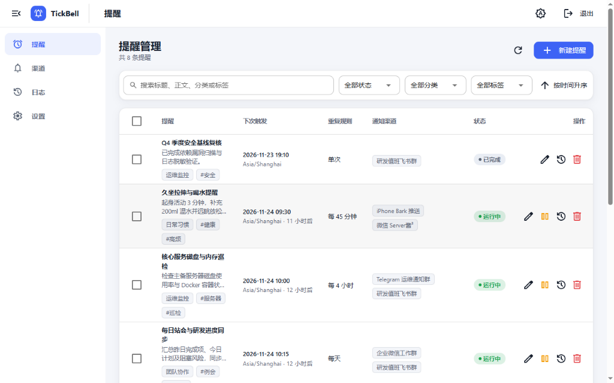
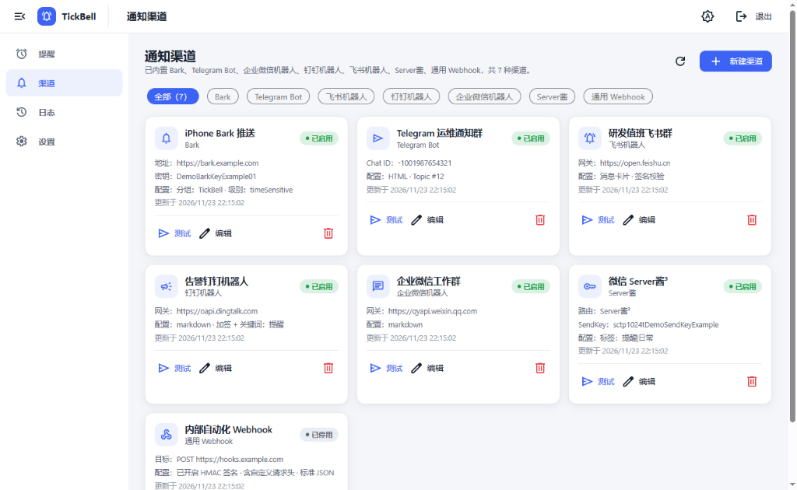

# TickBell

轻量、可靠的多渠道定时提醒系统，支持 **Cloudflare Workers + D1 一键部署** 与 **Docker 单机自部署** 双运行形态。  
基于 **Hono + SQLite/D1 + Vue 3 + Quasar 2** 构建，不设提醒条数上限，原生适配 PC 与移动端（H5）。

[](https://deploy.workers.cloudflare.com/?url=https://github.com/WishMelz/tickbell)

[核心特性](#核心特性) · [部署选型](#部署选型) · [快速部署](#快速部署) · [通知渠道](#内置通知渠道) · [数据迁移](#备份与双端迁移) · [本地开发](#本地开发)

---

## 核心特性

- **双形态同源**：一套核心代码同时运行于 **Cloudflare Workers + D1** 与 **Docker / Node + SQLite**，前端按运行环境能力自动适配界面。
- **零配置首次初始化**：无需手写环境变量或密钥，部署后打开网页按向导设置管理密码与系统密钥即可使用。
- **高可靠调度引擎**：精确 IANA 时区与重复规则（分 / 时 / 日 / 月 / 年，自动处理月底锚定、闰年与夏令时）；数据库唯一键 + 历史去重凭据 + 乐观锁防重发；支持错过宽限补偿（默认 60 分钟）与指数退避重试（`1 → 5 → 15` 分钟）。
- **无提醒条数上限**：全量服务端分页与排序，D1 端自动按 100 绑定参数上限切片并打包进单次原子 `batch()`。
- **全端体验**：PC + 移动端（H5）响应式界面，内置浅色 / 深色 / 跟随系统主题与 TipTap 富文本编辑器。

---

## 部署选型

| 对比维度 | Cloudflare Workers + D1（推荐） | Docker 单机自部署 |
| :--- | :--- | :--- |
| **服务器与费用** | 零服务器，Free Plan 免费额度即可运行 | 需自备 Linux / NAS / VPS |
| **部署难度** | 点击一键部署按钮，零命令行 | 单文件 `docker-compose.yml` 启动 |
| **数据库** | Cloudflare D1（自带 Time Travel 灾备） | 本地 SQLite WAL（每日自动 `VACUUM INTO` 备份） |
| **调度精度** | 1 分钟（Cron Trigger + 子请求预算流控） | 默认 15 秒（可自定义） |
| **推送内网 / 自建服务** | 仅支持公网 HTTPS/HTTP 地址 | 支持内网 IP / Docker 容器直连 |
| **出站网络代理** | 不支持（边缘节点公网直连） | 支持 HTTP / HTTPS / SOCKS5 代理池 |
| **适用场景** | 个人日常提醒、零运维、全球稳定推送 | 内网自建 Bark/Webhook、高频提醒、完全私有化 |

---

## 快速部署

### 方式一：Cloudflare 一键部署（零成本、零命令行）

1. 点击页面顶部的 **Deploy to Cloudflare** 按钮，登录并授权克隆仓库到你的 GitHub 账号（如果你之前已经 Fork 过同名仓库，在页面中改一个仓库名即可）。
2. Cloudflare 会自动构建前端、创建并绑定 D1 数据库 `tickbell-db`，并发布 Worker 与 Cron Trigger。
3. 首次访问生成的 `https://<your-worker>.workers.dev` 地址时，Worker 会自动初始化全部 D1 数据表，直接按网页向导完成初始化即可使用。

> **想通过 GitHub `Sync fork` 一键更新上游代码？**  
> 一键部署按钮创建的是独立克隆仓库（没有 `Sync fork` 按钮）。如果你希望保留 Fork 同步能力，可以直接 **Fork 本仓库**，然后在 Cloudflare 后台 **Workers 和 Pages → 创建 → 导入存储库** 选择你的 Fork，使用默认构建命令（`pnpm run build`）与部署命令（`npx wrangler deploy`）即可——Wrangler 会自动创建 D1 数据库，Worker 首次启动会自动建表，之后只需在 GitHub 点 **Sync fork** 即可自动重新部署。

<details>
<summary>常见问题：一键部署提示 “You must reinstall the Cloudflare GitHub App to use templates” / 命令行手工部署</summary>

**1. 提示需要重装 Cloudflare GitHub App**

这是旧版 GitHub App 授权缺少模板建仓权限导致，按以下步骤重装即可（不影响已有服务）：
1. 打开 GitHub [已安装的 GitHub Apps](https://github.com/settings/installations) → 找到 **Cloudflare Workers and Pages** → 点击 **Configure** → 滑到页面最底部 **Uninstall** 卸载。
2. 回到本页重新点击 **Deploy to Cloudflare** 按钮并重新授权即可。

**2. 使用命令行手工部署到 Cloudflare**

```bash
pnpm install
pnpm run deploy
```

> 首次执行 `pnpm run deploy` 时 Wrangler 会自动创建并绑定 `tickbell-db`，Worker 首次请求时会自动初始化 D1 表结构。

**3. 兜底方案：若因特殊环境仍提示数据库未初始化**

1. 在 Cloudflare 后台进入 **Workers 和 Pages → 你的项目 → 设置 → 绑定**，确认存在变量名为 `DB` 的 D1 数据库绑定。
2. 打开 **存储和数据库 → D1 SQL 数据库 → 你的数据库 → 控制台**，粘贴执行仓库中 [`migrations/d1/0001_init.sql`](./migrations/d1/0001_init.sql) 的全部 SQL（或本地运行 `pnpm run db:migrate:remote`）即可手动完成建表。

</details>

---

### 方式二：Docker Compose 单机自部署

无需克隆源码，只需仓库根目录的 [`docker-compose.yml`](./docker-compose.yml) 一个文件（同时支持 `linux/amd64` 与 `linux/arm64`）：

```bash
mkdir -p tickbell/data && cd tickbell
chown -R 1000:1000 ./data   # Linux 宿主机授权给容器内 node 用户（uid=1000）
docker compose up -d
```

启动后访问 `http://<服务器IP>:3000` 完成首次初始化。

> 从源码构建镜像、反向代理配置与运维备份详见 [`deploy/README.md`](./deploy/README.md)。

---

### 首次初始化

无论采用哪种部署方式，首次访问站点都会进入初始化向导：

1. 设置 **管理密码**（至少 6 位）与 **系统密钥**（支持一键随机生成）；
2. 选择默认全局时区（如 `Asia/Shanghai`）；
3. 提交后自动登录，密码以加盐 PBKDF2-SHA256 哈希保存在数据库中，可随时在「系统设置」修改。

---

## 内置通知渠道

采用插件化渠道架构，开箱内置 7 种通知渠道，支持在网页端实时测试推送：

| 渠道 | 主要特性 |
| :--- | :--- |
| **Bark** | 支持官方及自建服务；支持分组、通知级别、铃声、重复响铃、重要警告音量、图标与历史记录 |
| **Telegram Bot** | 支持官方及自建 Bot API 代理、超级群组 Topic 话题、HTML 富文本排版、静默推送与防转发 |
| **企业微信机器人** | 支持 `markdown`、`markdown_v2`、`text` 消息类型及 `@成员` / `@所有人` |
| **钉钉机器人** | 支持加签（HMAC-SHA256）与自定义关键词校验、`markdown` / `text` 及 `@成员` / `@所有人` |
| **飞书机器人** | 支持飞书 / Lark 签名校验与关键词、交互式富文本卡片（延迟送达自动标橙）与 `@所有人` |
| **Server酱** | 自动识别 Server酱³（`sctp{uid}t...`）与 Server酱 Turbo（`SCT...`），支持通道与标签 |
| **通用 Webhook** | 支持 `POST` / `PUT`、HMAC-SHA256 签名头（`X-Reminder-Timestamp` / `X-Reminder-Signature`）、自定义请求头与 JSON 模板 |

---

## 备份与双端迁移

- **双向无损互迁**：在「系统设置 → 备份与恢复」导出的明文 JSON 备份（包含提醒、渠道、全局时区，不含登录密码与发送日志），可在 **Cloudflare 版 ↔ Docker 自部署版** 之间直接导入恢复。
- **防重复推送保护**：导入恢复后所有提醒默认处于「暂停」状态，确认旧实例已停用后再启用即可。
- **自动灾备**：Docker 版支持本地定时 JSON 备份与每日 SQLite `VACUUM INTO` 热备；Cloudflare 版可直接使用 D1 Time Travel 按时间点恢复。

---

## 界面预览

<details>
<summary>点击展开桌面端 / 移动端 / 深色模式截图</summary>

| 提醒管理（桌面端） | 新建与编辑提醒 |
| :---: | :---: |
|  |  |

| 通知渠道管理 | 投递日志（深色模式） |
| :---: | :---: |
|  |  |

</details>

---

## 目录结构

```text
tickbell/
├─ package.json             根 pnpm Workspace（deploy / build / test / dev:* 脚本）
├─ wrangler.jsonc           Cloudflare Workers + D1 + Assets + Cron + RateLimit 配置
├─ docker-compose.yml       单文件 Docker Compose 开箱部署模板
├─ migrations/
│  ├─ d1/                   Cloudflare D1 数据库迁移
│  └─ sqlite/               Node SQLite 数据库迁移
├─ packages/core/           纯 Web Standards 共享业务核心（Hono API + 7 渠道 + 调度引擎）
├─ apps/worker/             Cloudflare Workers 运行时（D1 + DoH SSRF 校验 + RateLimit + Cron）
├─ apps/node/               Node / Docker 运行时（SQLite WAL + 代理池 + 磁盘自动备份）
├─ web/                     前端工程（Vue 3 + TypeScript + Vite 8 + Quasar 2）
├─ deploy/                  Dockerfile（源码多阶段构建）、.env.example 与运维指南
└─ docs/                    API 文档与架构说明
```

---

## 本地开发

环境要求：**Node.js 22+**、**pnpm 10+**。

```bash
pnpm install
```

### 1. Cloudflare Workers 本地调试

```bash
pnpm run db:migrate:local
pnpm run dev:cf
```

默认监听 `http://127.0.0.1:8787`。

### 2. Node.js 本地双进程调试

```bash
# 终端 1：启动 Node 后端（:3000）
pnpm run dev:node

# 终端 2：启动 Vite 前端（:5173，自动代理 /api 到 :3000）
pnpm run dev:web
```

### 3. 质量校验与构建

```bash
pnpm run typecheck
pnpm run test
pnpm run build:all
pnpm exec wrangler deploy --dry-run
```

---

## 相关文档与协议

- 部署与运维详解：[`deploy/README.md`](./deploy/README.md)
- HTTP API 契约：[`docs/API.md`](./docs/API.md)
- 2.0 架构与迁移设计：[`docs/2.0开发文案.md`](./docs/2.0开发文案.md)
- 参与贡献：[`CONTRIBUTING.md`](./CONTRIBUTING.md)
- 开源协议：[MIT License](./LICENSE)
