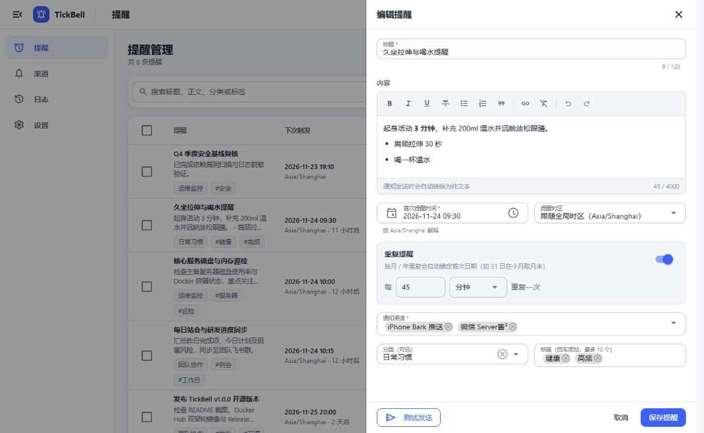
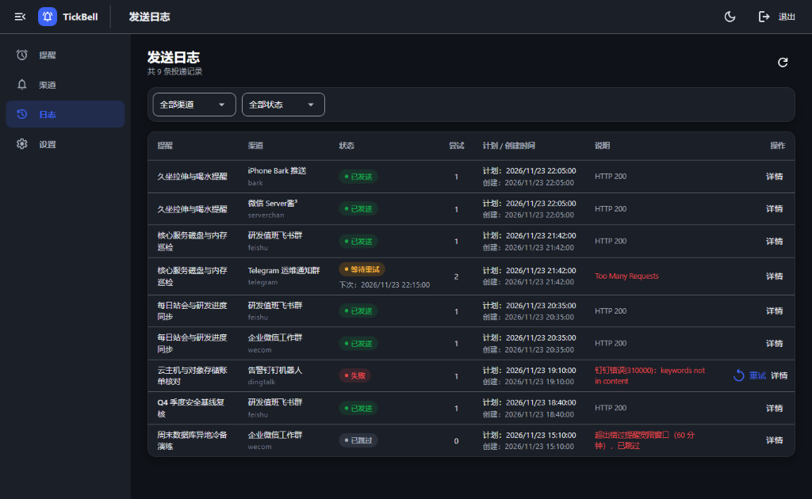
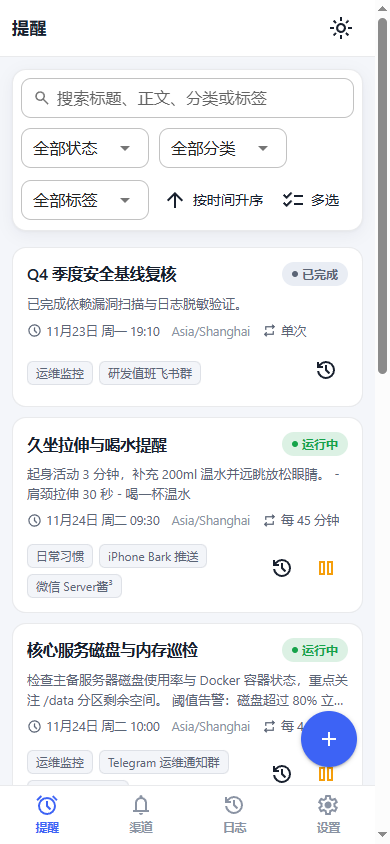

# TickBell

轻量、可靠、单机自部署的多渠道提醒系统（滴答铃）。基于 **NestJS + SQLite + Vue 3 + Quasar** 构建，零外部中间件依赖，一条命令即可通过 Docker 部署，支持 PC 与移动端（H5）完整体验。

## 核心特性

- **极简零配置部署**：无需在环境变量中填写管理密码或会话密钥；首次启动通过网页向导初始化并持久化到 SQLite，重启与升级零配置。
- **内置 7 种主流通知渠道（插件化架构）**：
  - **Bark**：支持官方或自建内网/公网服务，完整支持分组、通知级别、铃声、重复响铃、重要警告音量、图标与历史记录
  - **Telegram Bot**：支持官方及自建 Bot API 代理、超级群组 Topic 话题、HTML 富文本排版、静默推送与防转发
  - **企业微信群机器人**：支持 `markdown`、`markdown_v2`、`text` 消息类型及 `@成员` / `@所有人`
  - **钉钉群机器人**：支持加签（HMAC-SHA256）与自定义关键词安全校验、`markdown` / `text` 及 `@成员` / `@所有人`
  - **飞书群机器人**：支持飞书/Lark 签名校验与关键词、交互式富文本卡片（可自定义主题色，延迟送达自动标橙）与 `@所有人`
  - **Server酱**：自动识别 Server酱³（`sctp{uid}t...`）与 Server酱 Turbo（`SCT...`），支持自定义推送通道与标签
  - **通用 Webhook**：支持 `POST` / `PUT`、标准 HMAC-SHA256 签名头（`X-Reminder-Timestamp` / `X-Reminder-Signature`）、自定义请求头与 JSON 模板
- **可靠的定时调度引擎**：
  - 进程内 15 秒轮询 + 单飞锁 + 数据库唯一键去重，同一提醒不重复触发
  - 精确 IANA 时区支持与重复规则（每 N 分钟 / 小时 / 天 / 月 / 年，自动处理月底锚定、闰年与夏令时）
  - 服务停机重启宽限窗口补偿（默认 60 分钟）
  - 瞬态/频控失败自动指数退避重试（`1 → 5 → 15` 分钟，最多 3 次），支持日志页手动重试
  - 每日 `VACUUM INTO` 在线一致性备份，支持可读明文 JSON 全量导出与一键恢复
- **PC + H5 全端适配**：一套 Vue 3 + Quasar 2 前端代码同时兼容桌面端（≥ 1024px）与移动端（360px 起），支持浅色 / 深色 / 跟随系统三种主题及 TipTap 富文本编辑器。

## 界面预览

### 提醒列表（PC 浅色）
支持搜索、状态/分类/标签筛选、批量操作以及分钟 / 小时 / 天 / 月 / 年重复规则展示：


### 富文本编辑与重复规则
内置 TipTap 富文本编辑器、独立时区覆盖、自定义重复间隔与多渠道组合测试发送：



### 7 种内置通知渠道
动态表单 + 卡片摘要展示，支持按类型筛选与一键在线测试：


### 投递日志与深色主题
完整记录每次投递状态（已发送 / 等待重试 / 失败 / 已跳过）、HTTP 状态码、错误详情与手动重试：



### 移动端 H5 适配
一套前端自适应 360px 起小屏设备，提供移动端卡片视图、底部导航栏与悬浮快捷按钮：

<p align="center">
  
</p>

## 快速部署（Docker Compose，推荐）

无需克隆源码，只需仓库根目录的 [`docker-compose.yml`](./docker-compose.yml) 一个文件（同时支持 `linux/amd64` 与 `linux/arm64`）：

```bash
mkdir -p tickbell/data && cd tickbell
chown -R 1000:1000 ./data   # Linux 宿主机授权给容器内 node 用户（uid=1000）
# 将本项目根目录的 docker-compose.yml 保存到当前目录后启动：
docker compose up -d
```

启动后访问 `http://<服务器IP>:3000`，首次打开按页面向导设置管理密码、系统密钥与默认时区即可使用。后续升级只需执行 `docker compose pull && docker compose up -d`。

> 如需从源码自行构建镜像或查看 SQLite 恢复运维说明，详见 [`deploy/README.md`](./deploy/README.md)。

## 目录结构

```text
tickbell/
├─ docker-compose.yml       单文件开箱部署模板（直接拉取 wishmelz/tickbell:latest）
├─ docs/
│  ├─ screenshots/          README 界面预览截图
│  ├─ API.md                前后端接口契约
│  ├─ 通知渠道扩展计划.md     通知渠道插件化设计与规格
│  └─ 重构方案.md            系统架构与设计决策记录
├─ web/                     前端项目（Vue 3 + TypeScript + Vite 8 + Quasar 2）
├─ server/                  后端项目（NestJS 11 + SQLite WAL）
├─ deploy/                  Dockerfile（源码构建）、.env.example、部署与运维指南
├─ CONTRIBUTING.md          开发与新增通知渠道贡献指南
└─ LICENSE                  MIT License
```

## 本地开发（双进程）

需要 Node.js 22+ 与 pnpm 10+。

终端 1 — 启动后端（`:3000`）：

```bash
cd server
pnpm install
pnpm run start:dev
```

终端 2 — 启动前端（`:5173`，自动代理 `/api` 到 `:3000`）：

```bash
cd web
pnpm install
pnpm run dev
```

浏览器访问 `http://localhost:5173`，首次打开会提示设置管理密码、会话密钥与默认时区。

## 单进程一体打包与运行

```bash
cd server
pnpm run build:all
pnpm run start:prod
```

启动后访问 `http://localhost:3000` 即可同时使用前端页面与 `/api` 接口。

## 参与贡献

欢迎提交 Issue 与 PR！如果你希望接入更多通知渠道（如 Gotify、ntfy、PushDeer、SMTP 邮件等），请阅读 [`CONTRIBUTING.md`](./CONTRIBUTING.md) 中的插件开发指南。

## 开源协议

本项目基于 [MIT License](./LICENSE) 开源。
