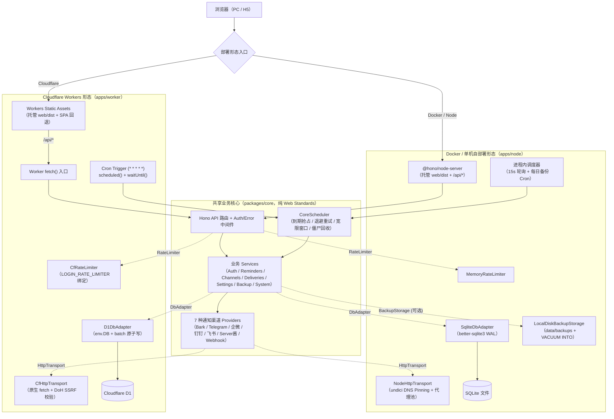
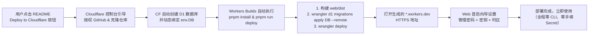

# TickBell 2.0 开发方案（支持 Cloudflare 部署与一键部署）

| 项 | 内容 |
| --- | --- |
| 文档版本 | v2.0-draft（2026-11-24） |
| 状态 | **方案待拍板**：核心设计已整理完成，待确认附录 A 中的决策项后进入开发 |
| 基线系统 | `../`（TickBell v1.0.4，NestJS + SQLite + Vue 3 / Quasar 2 单机自部署版） |
| 历史参考 | `../../Tips`（原 Cloudflare Workers + Hono + D1 + Cron Triggers 版本） |
| 关联文档 | [API.md](./API.md) · [重构方案.md](./重构方案.md) · [通知渠道扩展计划.md](./通知渠道扩展计划.md) |

> [!IMPORTANT]
> **本文件是 TickBell 2.0 开发的唯一方案依据。**
> - 核心目标：支持 **Cloudflare Workers + D1 部署**，并实现 **真·零配置「Deploy to Cloudflare」一键部署**，同时通过共享核心架构保持单仓可维护（可选兼容原有 Docker 单机自部署）。
> - 开发按第五节「实施路线」分阶段推进，每阶段以「验收标准」作为完成条件。
> - 决策点拍板后请更新文末「附录 A：决策记录」，并同步修改正文中受影响章节。

---

## 一、现有系统分析

### 1.0 一句话结论

- **`TipsNew`（TickBell v1.0.4）** 功能已非常完备（7 种插件化通知渠道、Web UI 首次零配置初始化、分钟级重复、自动退避重试、代理管理、明文 JSON 全量备份、PC+H5 Quasar 前端），但**后端深度绑定 Node.js 生态**（NestJS 11 + Express 5 + `better-sqlite3` 同步 API + `undici`/`node:net` + `node:fs` + `crypto.scryptSync`），无法直接运行在 Cloudflare Workers Isolate 中。
- **`Tips`（历史 CF 版）** 已在同工作区验证了 **Hono + Workers + D1 + Cron Triggers + Static Assets + Rate Limiting** 的可行性，但停留在早期功能集（仅 3 渠道、100 条硬上限、无自动重试、需手工 CLI 创建 D1 与录入 Secrets）。
- **2.0 的核心突破点**：TickBell 1.0 已实现的 **「Web UI 首次启动初始化管理员密码与密钥（持久化进数据库）」** 是实现 **Cloudflare 真·一键部署（无需配置任何 Secret）** 的天然基石；只需将后端从 NestJS 抽离为 **纯 Web Standards + Hono + 异步 DB 适配层**，即可一套核心代码跑通 Cloudflare Workers（及可选的 Docker 自部署）。

### 1.1 现有功能与能力对比清单

| 功能模块 | `TipsNew` v1.0.4（现状） | `Tips` 历史 CF 版 | 代码依据 |
| --- | --- | --- | --- |
| 提醒 CRUD / 批量操作 | ✅ 软删除、最多 500 条（可配）、批量启停/删除/替换渠道 | ✅ 上限 100 条、批量最多 100 条（无批量删除） | [reminders.repository.ts](../server/src/modules/reminders/reminders.repository.ts)、[API.md](./API.md) |
| 重复规则与时区 | ✅ 单次 / 每 N **分钟、小时、天、月、年**；Temporal 处理月底/闰年/DST；全局与单条独立 IANA 时区 | ✅ 无分钟级，仅小时/天/月/年 | [0002_add_minute_repeat_unit.sql](../server/migrations/0002_add_minute_repeat_unit.sql)、[repeat.ts](../server/src/common/repeat.ts) |
| 提前提醒 / 稍后提醒 | ❌ 无 | ❌ 无 | 全仓检索无相关字段 |
| 富文本与测试发送 | ✅ TipTap 3 富文本 + `xss`/`htmlparser2` 过滤；支持未保存提醒测试发送 & 渠道测试 | ✅ 同左 | [API.md](./API.md#L158-L196) |
| 通知渠道（插件化） | ✅ **7 种**：Bark、Telegram、企业微信、钉钉、飞书、Server酱、Webhook（支持 HMAC 签名 & 自定义模板）；动态表单元数据 `GET /api/channels/types` | ✅ 仅 3 种（Telegram、Bark、Webhook，无 HMAC 签名） | [channel-provider.interface.ts](../server/src/modules/notifications/channel-provider.interface.ts)、[dingtalk.provider.ts](../server/src/modules/notifications/providers/dingtalk.provider.ts) |
| 触发与重试机制 | ✅ 进程内 **15 秒** `setInterval` 轮询；单飞锁；60 分钟错过宽限窗口（超时 `skipped`，1–60 分钟标记 `isLate`）；瞬态错误指数退避自动重试（`1→5→15` 分钟，最多 3 次）+ 手动重试 | ✅ CF Cron `* * * * *`（1 分钟粒度）；无宽限窗口；at-most-once 不自动重试；`pending` 超 5 分钟标失败 | [scheduler.service.ts](../server/src/modules/scheduler/scheduler.service.ts)、[deliveries.service.ts](../server/src/modules/deliveries/deliveries.service.ts)、[cron/reminders.ts](../../Tips/src/cron/reminders.ts) |
| 出站代理 & SSRF | ✅ HTTP/HTTPS/SOCKS5 代理池 + 按渠道绑定；默认允许内网（`ALLOW_PRIVATE_URLS=true`）；严格模式用 OS DNS + `undici` DNS Pinning | ❌ 无代理；强制公网（`global_fetch_strictly_public` + `cloudflare-dns.com` DoH 预检） | [proxy-dispatcher.ts](../server/src/modules/notifications/http/proxy-dispatcher.ts)、[pinned-fetch.ts](../server/src/modules/notifications/http/pinned-fetch.ts) |
| 认证与初始化 | ✅ **零配置首启向导**（`POST /api/auth/setup` 将 `scrypt` 哈希与密钥存入 SQLite `settings`）；支持在线改密；内存限流 5 次/60s | ⚠️ 强依赖 `wrangler secret put` 录入 `ADMIN_PASSWORD` 与 `CONFIG_ENCRYPTION_KEY`；Workers 原生 `LOGIN_RATE_LIMITER` | [auth.service.ts](../server/src/modules/auth/auth.service.ts)、[wrangler.jsonc](../../Tips/wrangler.jsonc) |
| 备份与恢复 | ✅ 明文 JSON v2 导出/预览/恢复（兼容 v1 加密备份）；磁盘定时 JSON 备份（`data/backups/`）；每日 SQLite `VACUUM INTO` | ✅ 仅浏览器端加密全量备份 v1 + D1 手工 SQL 导出 | [backup.service.ts](../server/src/modules/backup/backup.service.ts) |
| 前端与状态监控 | ✅ Vue 3 + Quasar 2（PC+H5 自适应、暗黑主题）；分页投递日志；`/api/health` 与 `/api/system/status` | ✅ Vue 3 + TDesign；投递日志固定前 200 条不分页 | [SettingsPage.vue](../web/src/pages/SettingsPage.vue)、[system.controller.ts](../server/src/modules/system/system.controller.ts) |

### 1.2 现有数据模型与状态流转

`TipsNew` 当前包含 6 张业务表（另加 `schema_migrations`）：`settings`、`proxies`、`channels`、`reminders`、`reminder_channels`、`deliveries`、`delivery_receipts`（见 [0001_init.sql](../server/migrations/0001_init.sql)、[0002_add_minute_repeat_unit.sql](../server/migrations/0002_add_minute_repeat_unit.sql)、[0003_add_proxies.sql](../server/migrations/0003_add_proxies.sql)）。

- **提醒状态流转**：`active (enabled=1, completed=0)` ↔ `paused (enabled=0, completed=0)`；单次触发后进入 `completed (enabled=0, completed=1)`；任何状态均可软删除（`deleted_at != NULL`）。
- **投递状态流转**：`pending` → `sent` | `retrying (next_retry_at)` | `failed`；超出宽限窗口直接写入 `skipped`；`failed` 支持手动重试（复用同一 `event_id`）。

### 1.3 `TipsNew` 迁入 Cloudflare 的阻塞点清单（全量代码审计）

通过对 `server/src` 扫描全部外部与 `node:*` 依赖，得出 **11 项 CF 兼容性阻塞点**：

| # | 阻塞项 | 代码位置 | 无法直接在 CF 运行的原因 |
| --- | --- | --- | --- |
| 1 | NestJS 11 + Express 5 + `helmet` + `cookie-parser` + `pino` | [main.ts](../server/src/main.ts)、`*.controller.ts` | 依赖 `reflect-metadata` 与 Node HTTP Server，非 Fetch API，体积与冷启动无法满足 Workers 10ms CPU 限制 |
| 2 | `better-sqlite3` 同步驱动与交互式事务 | [database.service.ts](../server/src/modules/database/database.service.ts)、各 `*.repository.ts` | 原生 C++ 插件不可在 Workers 运行；D1 为**异步**接口且**不支持交互式事务**，只支持 `db.batch([...])` |
| 3 | `crypto.scryptSync` 密码哈希 | [auth.service.ts](../server/src/modules/auth/auth.service.ts#L23-L41) | Workers Free Plan 单请求上限 **10ms CPU**，`scryptSync` 易触发 CPU 超限或依赖重型 polyfill |
| 4 | `node:crypto`（HMAC / UUID） | [dingtalk.provider.ts](../server/src/modules/notifications/providers/dingtalk.provider.ts)、[feishu.provider.ts](../server/src/modules/notifications/providers/feishu.provider.ts)、`webhook.provider.ts` | 应统一替换为原生 Web Crypto API（`crypto.subtle` + `crypto.randomUUID`），零 polyfill 负担 |
| 5 | `undici` + `node:net` / `node:tls` / `node:dns` / `AsyncLocalStorage` | [proxy-dispatcher.ts](../server/src/modules/notifications/http/proxy-dispatcher.ts)、[pinned-fetch.ts](../server/src/modules/notifications/http/pinned-fetch.ts) | CF Workers 不允许任意原始 TCP 代理隧道与自定义 socket DNS pinning；需切换为原生 `fetch` + DoH 预检 |
| 6 | 进程内 15 秒 `setInterval` & `cron` 包 | [scheduler.service.ts](../server/src/modules/scheduler/scheduler.service.ts#L100-L120) | Workers 无常驻进程；最小原生 Cron 触发间隔为 **1 分钟**（`* * * * *`） |
| 7 | `node:fs` 磁盘自动备份 & `VACUUM INTO` | [backup.service.ts](../server/src/modules/backup/backup.service.ts)、[database.service.ts](../server/src/modules/database/database.service.ts#L116-L126) | Workers 无持久化本地文件系统；D1 不支持 `VACUUM INTO` 本地路径 |
| 8 | `@nestjs/throttler` 内存限流 | [auth-throttler.guard.ts](../server/src/modules/auth/auth-throttler.guard.ts) | Workers 边缘节点无跨请求共享内存；需改用 Workers 原生 `ratelimits` 绑定 |
| 9 | `0002_add_minute_repeat_unit.sql` 建表迁移 | [0002_add_minute_repeat_unit.sql](../server/migrations/0002_add_minute_repeat_unit.sql) | SQL 中执行 `DROP TABLE reminders` 却未在 SQL 内关闭外键检查（Node 端是在 TS 里 `pragma('foreign_keys = OFF')`），直接交给 `wrangler d1 migrations apply` 会报外键冲突 |
| 10 | 批量写 / 全量恢复循环单条 SQL | [backup.service.ts](../server/src/modules/backup/backup.service.ts#L562-L702) | Workers Free Plan 单请求上限 **50 次 D1 查询/子请求**；逐条 `INSERT` 500 条提醒必然爆配额，必须打包进 `db.batch()`（一次 `batch()` 仅计 1 次查询） |
| 11 | 前端硬编码自部署假设 | [SettingsPage.vue](../web/src/pages/SettingsPage.vue#L187-L251)、[BackupSection.vue](../web/src/components/settings/BackupSection.vue)、[ChannelEditorDialog.vue](../web/src/components/channels/ChannelEditorDialog.vue) | 页面固定展示「单机 NestJS + SQLite」、网络代理区与 `data/backups/` 自动备份区，缺少运行形态能力协商 |

### 1.4 历史 `Tips` 项目的 CF 依赖参考

历史项目 [wrangler.jsonc](../../Tips/wrangler.jsonc) 已验证了以下 CF 能力可直接服务于 2.0，且**全部兼容 Cloudflare Workers Free Plan（零费用、无需绑卡）**：

| CF 能力 | 2.0 复用结论 | Free Plan 限制 |
| --- | --- | --- |
| **Workers + Static Assets**（`run_worker_first: ["/api/*"]` + SPA fallback） | ✅ 复用，单 Worker 同时托管 Vue/Quasar 前端与 `/api/*` | 10 万次请求/天、10ms CPU/次 |
| **D1 数据库**（`d1_databases` 绑定 `DB`） | ✅ 复用，一键部署时由 CF 自动创建并注入 `database_id` | 500 万行读/天、10 万行写/天、5GB 存储、50 次查询/调用 |
| **Cron Triggers**（`* * * * *`） | ✅ 复用，每分钟驱动到期提醒、失败重试与超时回收 | 最多 3 个 Cron/Worker（本系统只需 1 个） |
| **Rate Limiting 绑定**（`ratelimits: LOGIN_RATE_LIMITER`） | ✅ 复用，保护登录/初始化/改密/备份导出与恢复 | Free Plan 免费支持 |
| **`global_fetch_strictly_public` + DoH** | ✅ 复用，防止出站 SSRF | 每次域名预检占 2 次子请求（共 50 次/调用） |
| **Worker Secrets**（`ADMIN_PASSWORD` 等） | 🔁 **降级为可选项**（默认改用 Web UI 首次初始化，消除一键部署门槛） | — |

---

## 二、需求确认与技术选型

### 2.1 2.0 需求分层

| 类别 | 功能/特性 | 说明 |
| --- | --- | --- |
| **必须保留（双端一致）** | 7 种通知渠道插件、提醒 CRUD/批量/富文本/时区/重复（含分钟）、幂等去重、指数退避自动重试 + 手动重试、错过宽限窗口、明文 JSON v2 全量导出与恢复（兼容 v1）、Web UI 零配置首次初始化、在线改密、PC+H5 Quasar 前端 | 保证 2.0 在 CF 上拥有与 1.0 同等完整的核心提醒体验，不倒退回 `Tips` |
| **必须新增（2.0 核心）** | Cloudflare Workers + D1 运行支持；**一键部署（Deploy to Cloudflare Button）**自动建库与迁移；运行形态能力协商（`capabilities`）；D1 批量写事务适配；Web Crypto PBKDF2 密码哈希；CF Cron 心跳持久化 | 解决「一键部署」与「CF 免费版稳定运行」 |
| **CF 端按能力裁剪** | 出站代理池（HTTP/HTTPS/SOCKS5）；本地磁盘自动备份（`data/backups/`）与 SQLite `VACUUM INTO`；15 秒级轮询（CF 为 1 分钟粒度）；内网自建地址直连 | CF 边缘节点本身直连公网且无本地磁盘；前端根据 `capabilities` 自动隐藏不适用模块，Docker 模式仍完整保留 |
| **明确不做（防过度设计）** | Durable Objects、Cloudflare Queues、KV、Workflows、Hyperdrive、外部 Cron 调度器、多租户体系 | 500 条提醒规模下完全无需引入额外云组件，避免增加付费风险与一键部署复杂度 |

> **非功能目标**：500 条提醒在 CF Free Plan 下零费用稳定运行；用户点击按钮后 **3 分钟内完成部署且零命令行操作**；单代码库单人可维护。

### 2.2 核心技术选型对比

#### 1. 整体架构与双端维护策略

| 方案 | 开发效率 | 复用现有代码程度 | 部署复杂度 | 社区生态 | 长期维护成本 |
| --- | --- | --- | --- | --- | --- |
| **方案 A（推荐）：单仓 pnpm Workspace，抽离 `packages/core`（Hono + 异步 DB 适配层），提供 `apps/worker`（CF）与 `apps/node`（Docker）双极薄入口** | 高（一次改完双端受益） | **极高**（前端 100%、7 渠道/重复/富文本/备份逻辑 ~90% 复用） | 低（CF 一键按钮 + 原 Docker Compose 并存） | 极佳 | **低**（仅维护一套业务与一套测试） |
| 方案 B：保留 NestJS 给自部署，另起一套 Hono 代码给 CF | 低（逻辑双写） | 中（仅能复粘贴工具函数） | 中 | 佳 | **高**（新增渠道或修 Bug 需同步改两套） |
| 方案 C：彻底删除 NestJS 与 Docker，做成纯 CF Workers 项目 | 最高 | 高 | 最低（仅 CF） | 佳 | 最低（但断掉 1.0 Docker 升级与内网/代理能力） |

**结论**：**推荐方案 A**。相比方案 C，多出一个 `apps/node` 极薄入口仅约 300–400 行适配代码（`@hono/node-server` + `better-sqlite3` 适配 + `setInterval` + 沿用现有 `pinned-fetch`/`proxy-dispatcher`），却能保住 1.0 Docker 用户的无痛升级路径、内网自建 Bark 推送与代理能力，同时让 CF 一键部署成为一等公民。*(若后续决定 2.0 彻底放弃自部署 Docker，可随时直接裁剪掉 `apps/node`，零架构返工。)*

#### 2. 后端 Web 框架

| 候选方案 | 开发效率 | 与现有技术栈复用 | CF Workers 兼容性 | 体积与冷启动 | 长期维护成本 |
| --- | --- | --- | --- | --- | --- |
| **Hono v4（推荐）** | 高（简洁直观，原生 TypeScript + Zod） | 高（原 `Tips` 已完整验证，团队熟悉） | **原生一等支持**，同时支持 `@hono/node-server` | 极小（~14KB），冷启动 < 2ms | 低 |
| NestJS 11（现有） | 中 | 最高（Node 端零改动） | ❌ **不可用**（Express/反射/体积不兼容 Workers） | 大 | — |
| itty-router / 原生 `fetch` | 中（中间件/Cookie/路由需手搓） | 低 | 原生支持 | 极小 | 中 |

**结论**：**选用 Hono v4**，统一承担 CF Workers 与 Node.js 的 HTTP 路由、Cookie 读写、错误处理与静态资源回退。

#### 3. 数据库访问层（SQLite / D1 统一抽象）

| 候选方案 | 开发效率 | 复用现有 SQL 程度 | D1 `batch()` 配额控制 | 包体积与 CPU 开销 | 长期维护成本 |
| --- | --- | --- | --- | --- | --- |
| **手写极简异步 `DbAdapter`（推荐）** | 高（封装 ~120 行） | **100% 直接复用现有 SQL**（仅把同步改 `async/await`） | **完全可控**（精准把多条 SQL 打包进单次 `batch()`） | 零依赖，CPU 开销最低 | 低 |
| Drizzle ORM | 中（需重写全部 Schema 与查询） | 低（需重写 6 个 Repository） | 一般（批量原子写仍需手动拼装 `db.batch`） | 中 | 中 |
| Prisma（D1 Adapter） | 低 | 低 | 弱 | 体积大、Workers 易超冷启动/CPU 预算 | 高 |

**结论**：**手写极简异步 `DbAdapter`**。`TipsNew` 的 6 张表 SQL 已非常干净稳定，直接抽象 `all / first / run / batch` 四个异步方法，底层分别对接 `D1Database` 与 `better-sqlite3`，无需引入重型 ORM。

#### 4. 密码哈希与加密原语

| 候选方案 | Workers Free Plan 10ms CPU 安全性 | 复用与兼容性 | 零外部依赖 |
| --- | --- | --- | --- |
| **Web Crypto `PBKDF2-SHA256`（推荐，带格式前缀兼容旧 `scrypt$`）** | **安全**（CF 运行时 BoringSSL 原生实现，100,000 次迭代远低于 10ms CPU 上限） | 新密码统一生成 `pbkdf2-sha256$<iter>$<salt>$<hash>`；Node 端保留对 1.0 旧 `scrypt$` 哈希的校验并在登录成功后自动无感升级 | ✅ 零依赖 |
| `nodejs_compat` `scryptSync` | ❌ 高风险（容易触发 Free Plan 10ms CPU 超限） | 兼容 1.0 | 依赖 polyfill |
| Argon2 WASM | ❌ 高风险（WASM 内存与 CPU 易超限、增大 Worker 包体） | 不兼容 1.0 | 需 WASM 依赖 |

**结论**：**全面改用 Web Crypto API**（`PBKDF2-SHA256` 存密码、`HMAC-SHA256` 签发会话与钉钉/飞书/Webhook 签名、`crypto.randomUUID()` 生成 ID），彻底摆脱 `node:crypto` 依赖。

#### 5. 定时调度与失败重试

| 候选方案 | CF Free Plan 可用性 | 部署复杂度 | 精度与可靠性 |
| --- | --- | --- | --- |
| **CF 原生 Cron Trigger `* * * * *`（+ Node 端保留 15s `setInterval`）（推荐）** | ✅ 免费（占用 1/3 配额） | 极低（写在 `wrangler.jsonc` 一键部署自动生效） | CF 1 分钟粒度 / Node 15 秒粒度；靠 DB 唯一键 + 退避重试保证可靠 |
| Cloudflare Workflows / Queues | ❌ Queues 需 Workers Paid 套餐 | 高（多资源编排，一键部署门槛高） | 高（但对 500 条提醒属过度设计） |
| 外部 Cron 服务（GitHub Actions / cron-job.org） | 免费但不可靠 | 高（需用户手动配置外部 Token 与定时任务，破坏一键部署） | 不稳定（GitHub Actions 延迟可达 5–15 分钟） |

**结论**：**CF 端使用原生 Cron Trigger `* * * * *`**，与 Node 端 `setInterval` 共用同一套核心调度算法。

#### 6. 前端与托管方式

| 候选方案 | 复用程度 | 体验与维护成本 |
| --- | --- | --- |
| **直接复用 `web/`（Vue 3 + Quasar 2 + Vite 8 + Pinia + TipTap）（推荐）** | **98% 直接复用**，仅增加 `capabilities` 能力判断 | 保持 PC+H5、深色模式、7 渠道动态表单完整体验；构建产物 `web/dist` 直接交给 Workers Static Assets 或 Node 托管 |
| 退回 `Tips` 的 TDesign 前端 | 低（缺少 4 种渠道、初始化向导、分页日志、暗黑主题） | 体验严重倒退 |

#### 7. 推荐最终技术栈总表

| 层级 | 推荐选型 |
| --- | --- |
| 仓库组织 | pnpm Workspace Monorepo（`packages/core` + `apps/worker` + `apps/node` + `web`） |
| 前端 | Vue 3 + TypeScript + Vite 8 + Quasar 2 + Pinia + TipTap 3（复用现有 `web/`） |
| 后端框架 | Hono v4（纯 Web Standards Fetch API） |
| 数据库访问 | 自研轻量异步 `DbAdapter`（CF 对接 D1，Node 对接 `better-sqlite3` WAL） |
| 加密与时间 | Web Crypto API（PBKDF2-SHA256 / HMAC-SHA256）+ `@js-temporal/polyfill` + `zod` v4 + `xss` + `htmlparser2` |
| 调度机制 | 共享 `CoreScheduler`：CF 用 Cron Trigger（`* * * * *`），Node 用 `setInterval`（15s） |
| 一键部署 | Cloudflare **Deploy Button**（根目录 `wrangler.jsonc` + 自动 D1 创建与迁移） + Docker Compose（保留） |

---

## 三、架构与数据设计

### 3.1 系统架构图



### 3.2 Monorepo 目录结构规划（为一键部署量身设计）

Cloudflare 的 **Deploy Button**（`deploy.workers.cloudflare.com`）如果指向子目录会隔离上下文，无法引用同级 `web/` 和 `packages/core/`。因此 **必须将 `wrangler.jsonc` 和 workspace 根 `package.json` 放在仓库根目录**：

```text
tickbell/
├─ package.json                # 根 workspace，提供 deploy / build / test / dev:cf / dev:node
├─ pnpm-workspace.yaml         # packages/*, apps/*, web
├─ wrangler.jsonc              # CF Workers 配置（放根目录，一键部署直接识别）
├─ migrations/
│  ├─ d1/                      # CF D1 迁移目录（0001_init.sql 干净 2.0 基线，无 DROP TABLE 风险）
│  └─ sqlite/                  # Node SQLite 迁移目录（保留 0001~0003 兼容 1.x 老用户 + 0004_v2_compat.sql）
├─ packages/
│  └─ core/                    # 零 Node 专属依赖（仅 Web Standards）
│     ├─ src/ports/            # DbAdapter / HttpTransport / RateLimiter / BackupStorage 接口
│     ├─ src/crypto/           # Web Crypto PBKDF2 / HMAC / timingSafeEqual
│     ├─ src/common/           # time / repeat / reminder-content / errors / ip
│     ├─ src/providers/        # 7 个渠道 Provider + ChannelRegistry
│     ├─ src/repositories/     # 全部异步化 SQL Repository（返回 Statement 支持 batch）
│     ├─ src/services/         # Auth / Settings / Channels / Reminders / Deliveries / Backup / CoreScheduler
│     └─ src/http/             # Hono app 工厂 createApp(deps) + 路由模块
├─ apps/
│  ├─ worker/                  # Cloudflare Workers 入口（~250 行）
│  │  └─ src/                  # index.ts ({ fetch, scheduled }), d1-adapter.ts, cf-transport.ts, cf-ratelimit.ts
│  └─ node/                    # Docker / 单机 Node 入口（~400 行）
│     └─ src/                  # main.ts, sqlite-adapter.ts, node-transport.ts, proxy-dispatcher.ts, disk-backup.ts
├─ web/                        # 复用现有 Vue 3 + Quasar 2 前端，按 capabilities 动态适配
├─ deploy/                     # Dockerfile（构建 apps/node + web）与运维文档
├─ docker-compose.yml          # 保留单文件 Docker 部署
└─ docs/                       # API.md / 2.0开发文案.md / 重构方案.md / 通知渠道扩展计划.md
```

### 3.3 核心模块与关键机制设计

#### 1. 异步 `DbAdapter` 与 D1 事务改造（核心难点）

D1 不支持跨 `await` 的交互式事务，只支持将一组预编译 SQL 通过 `env.DB.batch([...])` **原子执行并自动回滚**，且一次 `batch()` 仅计为 **1 次 D1 查询**。改造规范如下：

- **接口定义**：
  ```ts
  export interface SqlStatement { sql: string; params?: readonly unknown[] }
  export interface DbRunResult { changes: number }
  export interface DbAdapter {
    all<T>(stmt: SqlStatement): Promise<T[]>;
    first<T>(stmt: SqlStatement): Promise<T | null>;
    run(stmt: SqlStatement): Promise<DbRunResult>;
    batch(stmts: readonly SqlStatement[]): Promise<DbRunResult[]>; // D1 -> env.DB.batch(); SQLite -> db.transaction()
    ping(): Promise<boolean>;
  }
  ```
- **交互式事务 → `batch()` + 乐观锁映射**：

  | 业务场景 | 1.0（同步事务） | 2.0（D1/SQLite 统一异步方案） |
  | --- | --- | --- |
  | 首次初始化 `/api/auth/setup` | `transaction()` 内查未初始化后写入 | `INSERT OR IGNORE` 写入 `auth_password_hash`（利用主键唯一性防并发重复初始化），随后 `batch` 写 `session_secret` / `global_timezone` / `session_generation` |
  | 修改全局时区 `PUT /api/settings` | 事务内读全部继承提醒再更新 | 先读出所有 `timezone IS NULL` 的 `(id, starts_at, next_run_at, schedule_version)` 在内存中换算，再将全部 `UPDATE ... WHERE id=? AND schedule_version=?` 与更新 `settings` 打包进**单次 `batch()`**（并发修改时校验总影响行数或返回 409） |
  | 创建/编辑/批量操作提醒 | 事务内写 `reminders` + `reminder_channels` | 单次 `batch()` 原子提交；上限校验结合应用层预检 + 事务内条件插入（避免超出 500 条） |
  | 全量恢复 `POST /api/backup/restore` | 事务内清空并循环单条插入 | 校验通过后，采用**多行 `VALUES` 合并插入**（每 50 行拼一条 `INSERT`）并整体打包进**单次 `db.batch()`**，保证 500 条提醒 + 渠道 + 日志在 **1 次 D1 batch 内原子完成**（彻底规避 Free Plan 50 次查询限制且失败自动整批回滚） |
  | 并发恢复保护 | 内存中 `scheduler.pause()` | 沿用 `Tips` 的 `session_generation` 检查：恢复时轮换 `session_generation`（强制注销旧会话），Cron 写回前校验 `generation` 与 `schedule_version` |

#### 2. 提醒调度与重试机制（双模式统一引擎）

- **调度触发选型**：CF 使用原生 **Cron Trigger (`* * * * *`)** 触发 `scheduled()`，内部通过 `ctx.waitUntil(scheduler.runTick())` 执行；Node 继续使用 **15 秒 `setInterval`**。
- **时区与重复计算**：100% 复用 [repeat.ts](../server/src/common/repeat.ts)（`@js-temporal/polyfill`），按首次锚点 `starts_at` 与生效 IANA 时区推进，正确处理月底、闰年与 DST。
- **幂等去重（不重复发送）**：
  1. 抢占前通过 `schedule_version` 乐观锁推进 `reminders.next_run_at`（或单次提醒标 `completed=1`），并在**同一次 `batch()`** 中对每个渠道执行 `INSERT OR IGNORE INTO deliveries ... WHERE NOT EXISTS (SELECT 1 FROM delivery_receipts ...)` + `INSERT OR IGNORE INTO delivery_receipts`。
  2. 仅对实际抢占成功的 `deliveries` 发起外部 HTTP 发送（事务外执行，避免锁库）。
- **服务中断 / 僵尸 `pending` 回收**：
  - CF 无进程启动事件，因此在**每次 `runTick` 开头**执行一条 SQL：将 `status = 'pending' AND updated_at <= now - 5分钟` 的记录标为 `failed`（注明「执行超时或中断，状态未知，停止自动重发」），严格贯彻防重复原则。
- **错过提醒补偿策略**：
  - 默认宽限窗口 `MISSED_GRACE_MINUTES = 60`（可通过 `wrangler.jsonc` `vars` 覆盖）。
  - 延迟 ≤ 60 分钟：正常补发，超过 1 分钟自动标记 `isLate = true`（飞书卡片标橙、文本附延迟说明），重复提醒推进到下一个未来时间点（不补发中间周期）。
  - 延迟 > 60 分钟：写入 `status = 'skipped'` 日志并推进到下一次未来时间。
- **发送失败重试策略**：
  - 网络连接错误 / DNS 瞬态错误 / HTTP `429/502/503/504` / 平台可重试错误码 → 写入 `status = 'retrying'`，按 **`1 → 5 → 15` 分钟** 指数退避设置 `next_retry_at`（最多自动重试 3 次）。
  - 超时或 HTTP 500（`unknown`）与配置错误（`permanent`）→ 直接 `failed`，不自动重试，保留日志页手动重试按钮。
- **CF Free Plan 配额保护（关键设计）**：
  - Workers Free Plan 单次调用最多 **50 次子请求**（D1 `batch` 算 1 次，每次通知 HTTP 请求算 1 次，DoH 预检若触发算 2 次）。
  - 因此 CF 模式下，单轮 `runTick` 设置**有界批大小**：默认每轮最多处理 **10 条到期投递 + 5 条到期重试**（可通过配置调高，如付费版调至 50）；超出部分留在数据库，**1 分钟后的下一轮 Cron 自动接续处理**，避免突发性并发到期导致 Cron 报 `Too many subrequests`。
  - **心跳与日志清理**：每次 Cron 结束写一条 `settings` 记录（`cron_heartbeat` JSON，含 `lastTickAt` / `lastTickDurationMs`），供 `/api/health` 与前端展示健康状态；当检测到距离上次清理已超 24 小时（或在 UTC 03:00–03:05 窗口）时，顺带执行 `DELETE FROM deliveries WHERE created_at < now - 90天`，无需额外占用 Cron 配额。

#### 3. 出站网络与 SSRF 策略

| 维度 | Cloudflare Workers (`CfHttpTransport`) | Docker / Node (`NodeHttpTransport`) |
| --- | --- | --- |
| 底层实现 | 原生 `fetch` + `AbortSignal.timeout(15_000)` + `redirect: 'manual'` | 沿用现有 [pinned-fetch.ts](../server/src/modules/notifications/http/pinned-fetch.ts) + [proxy-dispatcher.ts](../server/src/modules/notifications/http/proxy-dispatcher.ts) |
| SSRF 防护 | `global_fetch_strictly_public` + URL 静态拦截私网 + `cloudflare-dns.com/dns-query` DoH A/AAAA 校验（对官方固定域名如 `api.telegram.org`/`oapi.dingtalk.com`/`open.feishu.cn`/`qyapi.weixin.qq.com`/`sctapi.ftqq.com` 可跳过 DoH 以节省子请求配额） | 默认 `ALLOW_PRIVATE_URLS=true` 支持内网自建 Bark；关闭后启用 OS DNS Pinning |
| 网络代理 | ❌ 不支持（CF 全球网络直连 Telegram/Bark 等公网服务） | ✅ 完整支持 HTTP/HTTPS/SOCKS5 代理池 |

### 3.4 数据库设计（SQLite / D1 统一 Schema）

2.0 保持与 1.0 完全一致的 **6 张业务表**（`settings`、`proxies`、`channels`、`reminders`、`reminder_channels`、`deliveries`、`delivery_receipts`），无需为 CF 引入任何额外存储引擎：

| 表名 | 关键字段与索引 | 2.0 调整说明 |
| --- | --- | --- |
| `settings` | `key TEXT PRIMARY KEY, value TEXT, updated_at INTEGER` | 新增内部键 `cron_heartbeat`（存最近扫描时间与耗时，供 CF `/api/health` 读取）与 `last_cleanup_at`（记录日志清理时间戳）；继续存 `global_timezone`、`auth_password_hash`、`auth_session_secret`、`session_generation` |
| `proxies` | `id, name, protocol, host, port, username, password, enabled, created_at, updated_at` | 保留表结构以保持备份文件跨形态 100% 互通（CF 恢复包含代理的 Docker 备份时不报错，仅忽略启用） |
| `channels` | `id, name, type, enabled, config (JSON), proxy_id (FK SET NULL), created_at, updated_at`；索引 `idx_channels_type`、`idx_channels_proxy` | 与 1.0 完全一致 |
| `reminders` | `id, title, content, content_html, category, tags (JSON), timezone, starts_at, is_repeating, repeat_every, repeat_unit ('minute'\|'hour'\|'day'\|'month'\|'year'), enabled, completed, next_run_at, schedule_version, deleted_at, created_at, updated_at`；部分索引 `idx_reminders_due`、`idx_reminders_category` | 在 D1 基线 `migrations/d1/0001_init.sql` 中**直接包含 `'minute'` 约束**，彻底避开 1.0 `0002` 表重建在 D1 触发外键报错的问题 |
| `reminder_channels` | `PRIMARY KEY (reminder_id, channel_id)`；索引 `idx_reminder_channels_channel` | 与 1.0 完全一致 |
| `deliveries` | `id, event_id UNIQUE, reminder_id, scheduled_at, channel_id, status ('pending'\|'sent'\|'failed'\|'retrying'\|'skipped'), attempts, next_retry_at, http_status, error, response_summary, sent_at, created_at, updated_at`；`UNIQUE(reminder_id, scheduled_at, channel_id)`；索引 `idx_deliveries_created_at`、`idx_deliveries_reminder`、`idx_deliveries_retry` | 新增建议索引 `idx_deliveries_pending ON deliveries(updated_at) WHERE status = 'pending'`，加速 CF 每分钟僵尸 `pending` 回收查询 |
| `delivery_receipts` | `PRIMARY KEY (reminder_id, scheduled_at, channel_id)` | 与 1.0 完全一致，保证恢复备份后历史幂等不失效 |

#### 规模与配额评估（为什么 500 条不需要 PostgreSQL / MySQL / Redis）

- **D1 Free Plan 消耗估算**（500 条提醒、每分钟 1 次 Cron、1 天 1440 次扫描）：
  - 每次空扫通过部分索引 `idx_reminders_due`、`idx_deliveries_retry`、`idx_deliveries_pending` 仅扫描 0–10 行；
  - 每日读行数 ≈ `1440 × 15 ≈ 2.2 万行`（仅占 Free Plan 500 万行/天额度的 **0.4%**）；
  - 每日写行数 ≈ 实际触发与重试次数 + 心跳更新（< `3000 行/天`，仅占 Free Plan 10 万行/天额度的 **3%**）；
  - 数据总容量（500 条提醒 + 90 天日志）< 10 MB（占 5 GB 额度的 **0.2%**）。
- **SQLite / D1 注意事项**：
  - Node 端继续启用 `WAL` + `synchronous=NORMAL` + `busy_timeout=5000` + `foreign_keys=ON`；
  - D1 端天然串行写且默认开启外键，但无跨请求长事务，所有关联更新必须走 `db.batch()`；
  - 维护一套自动化 **Schema 一致性测试**，确保 `migrations/d1/` 与 `migrations/sqlite/` 跑完后表结构、索引、约束完全一致。

### 3.5 API 契约设计（完全向后兼容 1.0）

保留 [API.md](./API.md) 全部既有路径，仅做以下增量扩展与能力降级约定：

| 方法 | 路径 | 2.0 变更 / 说明 |
| --- | --- | --- |
| `GET` | `/api/auth/status` | 响应新增 `runtime: "cloudflare" \| "node"`，保持原有 `initialized/configured/authenticated/configurationIssue` 字段 |
| `POST` | `/api/auth/setup` · `/login` · `/change-password` · `/logout` | 保持不变；CF 端同样使用 Web UI 首启初始化，受 `LOGIN_RATE_LIMITER` 保护（5 次 / 60s） |
| `GET` | `/api/health` | 公开接口；CF 端通过 `settings.cron_heartbeat` 判断 Cron 心跳（超过 5 分钟无记录返回 `503 degraded`；刚部署首次运行前宽限 5 分钟） |
| `GET` | `/api/system/status` | 新增 **`runtime`** 与 **`capabilities`** 对象：`{ proxies, diskAutoBackup, sqliteVacuumBackup, minScheduleIntervalSec, allowPrivateUrls }`；CF 端 `nodeVersion` 返回 `"cloudflare-workers"`、`uptimeSeconds` 返回 `null` |
| `GET/POST/PUT/DELETE` | `/api/reminders*`、`/api/channels*`、`/api/deliveries*`、`/api/settings` | 100% 保持原契约不变 |
| `POST` | `/api/backup/export` · `/preview` · `/restore` | 100% 保持原契约不变；支持在 **Docker 版与 CF 版之间自由导入导出明文 JSON v2 备份无缝迁移** |
| `ALL` | `/api/proxies*`、`/api/backup/auto*` | Node 端完整可用；CF 端返回 `501`（`{ "error": "Cloudflare 部署模式不支持此功能" }`），前端根据 `capabilities` 自动隐藏对应 UI 区块 |

---

## 四、迁移与一键部署方案

### 4.1 双部署形态对照表（及自部署 ↔ CF 映射）

| 能力维度 | Cloudflare Workers 形态（2.0 新增） | Docker / 单机自部署形态（1.0 保留） |
| --- | --- | --- |
| 运行载体 | Cloudflare Workers（全球边缘无服务器） | 单容器 Node 24（Docker Compose） |
| 前端托管 | Workers Static Assets（`web/dist` + SPA 回退） | `@hono/node-server` 静态托管（`public/`） |
| 数据库 | Cloudflare D1（云端托管 SQLite） | 本地 SQLite 文件（WAL 模式，挂载 `/data`） |
| 定时调度 | CF Cron Trigger（`* * * * *`，1 分钟精度） | 进程内 `setInterval`（15 秒精度）+ 每日维护 Cron |
| 登录限流 | Workers 原生 `LOGIN_RATE_LIMITER` 绑定（免费） | 进程内内存限流 |
| HTTPS / 域名 | 自动提供免费 `*.workers.dev` HTTPS，支持自定义域名一键绑 SSL | 需自行配 Caddy / Nginx 反向代理申请证书 |
| 出站网络 | 公网直连（天然可直连 Telegram 等）+ DoH SSRF 校验 | 支持内网自建 Bark + HTTP/HTTPS/SOCKS5 代理池 |
| 数据备份 | 网页手动明文 JSON 导出/恢复 + CF D1 Time Travel（自动时间点恢复） | 网页手动导出 + 磁盘定时 JSON 自动备份 + 每日 `VACUUM INTO` |
| 日志观测 | Cloudflare Dashboard Workers Observability / `wrangler tail` | 容器 stdout 结构化 JSON 日志（`docker compose logs`） |
| 成本 | **\$0 / 月（Free Plan 足够个人 500 条提醒）** | 自备 VPS / NAS |

### 4.2 Cloudflare 真·一键部署全流程设计（核心亮点）



#### 1. 仓库根目录 `wrangler.jsonc` 关键配置草案

```jsonc
{
  "$schema": "node_modules/wrangler/config-schema.json",
  "name": "tickbell",
  "main": "apps/worker/src/index.ts",
  "compatibility_date": "2026-09-01",
  "compatibility_flags": ["global_fetch_strictly_public"],
  "observability": {
    "enabled": true
  },
  "assets": {
    "directory": "./web/dist",
    "binding": "ASSETS",
    "not_found_handling": "single-page-application",
    "run_worker_first": ["/api/*"]
  },
  "d1_databases": [
    {
      "binding": "DB",
      "database_name": "tickbell-db",
      "database_id": "",
      "migrations_dir": "migrations/d1"
    }
  ],
  "ratelimits": [
    {
      "name": "LOGIN_RATE_LIMITER",
      "namespace_id": "1001",
      "simple": { "limit": 5, "period": 60 }
    }
  ],
  "triggers": {
    "crons": ["* * * * *"]
  },
  "vars": {
    "MAX_REMINDERS": "500",
    "MISSED_GRACE_MINUTES": "60",
    "DELIVERY_RETENTION_DAYS": "90",
    "CRON_MAX_DELIVERIES_PER_TICK": "10",
    "CRON_MAX_RETRIES_PER_TICK": "5"
  }
}
```

#### 2. 一键部署防踩坑的 4 个关键设计

1. **按绑定名 `DB` 执行迁移（而非写死库名）**：
   根 `package.json` 的部署脚本固定写作：
   `"deploy": "pnpm --filter tickbell-web build && wrangler d1 migrations apply DB --remote && wrangler deploy"`
   Cloudflare 官方 Deploy Button 会直接调用根 `package.json` 的 `deploy` 脚本；使用绑定名 `DB` 可确保即使用户在向导里把数据库改名，迁移也能 100% 成功。
2. **`database_id` 留空由一键部署自动注入**：
   不硬编码任何开发者的 `database_id`，让 CF Deploy Wizard 自动为新用户创建并绑定专属 D1。同时在文档中说明命令行手动部署用户执行 `wrangler d1 create tickbell-db` 后填入即可。
3. **零必填 Secrets（突破旧 `Tips` 最大痛点）**：
   旧版 `Tips` 必须手动在 CF 控制台添加 `ADMIN_PASSWORD` 和 `CONFIG_ENCRYPTION_KEY`，无法做到真正的一键开箱。2.0 沿用 TickBell 1.0 的首启向导，部署完成访问网页即可设置密码和随机密钥并持久化进 D1（同时保留环境变量/Secret 兜底能力，供高级用户预置密码）。
4. **README 一键部署按钮**：
   ```markdown
   [](https://deploy.workers.cloudflare.com/?url=https://github.com/<owner>/<repo>)
   ```

#### 3. 运维、安全、备份与升级

- **HTTPS 与自定义域名**：默认自带 `https://<name>.<subdomain>.workers.dev`；在 CF Dashboard Workers → Settings → Domains & Routes 可一键绑定自定义域名并自动签发 SSL；Cookie `Secure` 标志自动开启。
- **密钥与配置安全**：密码以随机盐 `PBKDF2-SHA256` 哈希存储；会话 Cookie 为 `HttpOnly; SameSite=Strict; Secure`；所有 `/api/*` 带 `Cache-Control: no-store`；支持在 CF 自定义域名上叠加 Cloudflare Access 作为二层防护。
- **备份与恢复**：
  - **应用层**：系统设置页随时导出明文 JSON v2 全量备份，支持跨 CF ↔ Docker 互通恢复；
  - **数据库层**：D1 自带 **Time Travel**（Free Plan 支持最近 7 天按任意时间点回滚），也支持 CLI `wrangler d1 export DB --remote`。
- **日志与自愈**：Workers 天然高可用、无单点宕机重启问题；通过 `observability.enabled = true` 在 CF 控制台直接检索请求与 Cron 日志，异常可接入 CF 告警。
- **后续版本升级**：通过 Deploy Button 部署的用户在 GitHub 上拥有同步副本，点击 GitHub **Sync fork** 即可由 Workers Builds 自动触发构建、增量 D1 迁移与无停机发布。
- **Docker 自部署兼容**：继续提供根目录 `docker-compose.yml` 与多架构镜像（`linux/amd64`、`linux/arm64`），1.0 用户拉取 2.0 镜像后自动执行 `migrations/sqlite/` 并平滑兼容原有 `scrypt$` 密码哈希与数据卷。

---

## 五、实施路线

### 5.1 分阶段拆解（MVP → 完整双端 2.0）

| 阶段 | 核心工作内容 | 交付物 | 验收标准 |
| --- | --- | --- | --- |
| **Phase 0：工程骨架与迁移规范** | 建立根 pnpm Workspace（`packages/core`、`apps/worker`、`apps/node`、`web`）；整理 `migrations/d1/0001_init.sql`（干净 2.0 基线）与 `migrations/sqlite/`；建立双轨 Schema 一致性测试 | Workspace 配置、双轨 migration、Schema 对比单测 | `pnpm install` 一次通过；D1 SQL 与 SQLite SQL 生成的表/索引/约束校验 100% 一致 |
| **Phase 1：`packages/core` 异步化与 Hono 重构** | 定义 4 个端口接口（`DbAdapter`、`HttpTransport`、`RateLimiter`、`BackupStorage`）；将全部 Repository 改造为异步 + `batch()`；将 7 个渠道 Provider 与 Auth 改造为纯 Web Crypto（`PBKDF2` + `HMAC`）；用 Hono 实现全部 `/api/*` 路由（含 `capabilities`） | `packages/core` 完整源码与单元测试（Repeat / Validation / 7 Providers / Backup / API 契约测试） | `packages/core` 零 `node:*` / `@nestjs` / `better-sqlite3` 导入；全部单测与 API 契约测试通过 |
| **Phase 2：Cloudflare Worker 适配（MVP 核心交付）** | 实现 `apps/worker`（`D1DbAdapter`、`CfHttpTransport` + DoH 预检、`CfRateLimiter`、`{ fetch, scheduled }`）；编写根目录 `wrangler.jsonc` 与 `deploy` 脚本；配置 Cron 限流批处理与心跳记录 | `apps/worker`、`wrangler.jsonc`、本地 `wrangler dev` + Miniflare D1 端到端集成测试 | `wrangler dev` 下完成首启初始化、创建提醒、7 渠道测试、手动触发 `/__scheduled` 验证 Cron 触发/重试/宽限跳过、500 条备份导出恢复（验证不超 Free Plan 50 次查询限制） |
| **Phase 3：前端 `capabilities` 自适应** | 修改 `web` 的 `SettingsPage`、`BackupSection`、`ChannelEditorDialog`、`LoginPage`，根据 `capabilities` 自动隐藏 CF 不支持的代理池与磁盘自动备份，优化运行状态卡片与 D1 备份提示 | 更新后的 `web/` 及前端测试 | CF 模式下界面无报错、无失效按钮；Node 模式下原有功能 100% 保持 |
| **Phase 4：Node/Docker 入口迁移与 1.x 兼容** | 实现 `apps/node`（`@hono/node-server`、`SqliteDbAdapter`、保留 `undici` 代理与本地磁盘自动备份、保留 `scrypt$` 老密码验证兼容）；更新 `deploy/Dockerfile`（去掉 NestJS 依赖，镜像更轻更快）；归档清理旧 `server/` | `apps/node`、更新后的 `Dockerfile` 与 e2e 测试 | 挂载 1.0 真实 `tickbell.db` 启动 2.0 容器：老密码可直接登录、既有提醒/渠道/代理/自动备份完全正常 |
| **Phase 5：真实 CF 一键部署验收与文档发布** | 推送至 GitHub，使用全新免费 Cloudflare 账号点击 **Deploy to Cloudflare** 按钮全链路实测；验证升级迁移、自定义域名、Cron 定时真实触达；更新 `README.md`、`docs/API.md` | 可点击的一键部署按钮、2.0 正式文档与发布说明 | 全新 CF 免费账号点击按钮后零命令行完成部署，打开网页完成初始化并收到真实渠道提醒 |

### 5.2 主要风险与应对

| 风险点 | 影响 | 应对措施 |
| --- | --- | --- |
| **CF Free Plan 50 子请求 / 10ms CPU 超限** | 大量提醒同时到期或全量恢复 500 条数据时请求失败 | 全量恢复使用多行 `VALUES` + 单次 `db.batch()`；Cron 单轮限流（默认 10 投递 + 5 重试，余量顺延下分钟）；密码使用原生 BoringSSL `PBKDF2`；主流官方 Webhook 域名跳过 DoH 预检 |
| **Deploy Button 找不到工作区依赖或迁移失败** | 用户点击一键部署直接构建报错 | `wrangler.jsonc` 与根 `package.json` 置顶于仓库根目录；迁移命令严格使用绑定名 `DB`；Phase 5 用全新免费账号真机实测 |
| **同一份备份同时在 Docker 与 CF 启用** | 两端同时发送重复提醒 | 沿用 1.0 安全策略：全量恢复后所有提醒**强制置为暂停**，并提示用户不要在两个环境同时开启同一批提醒 |
| **分钟级重复提醒在 CF 上误差** | CF Cron 最小粒度为 1 分钟，无法像 Node 做到 15 秒级 | 在文档与 UI（CF 模式下）明确提示调度精度为 1 分钟；依赖 `next_run_at <= now` 保证只延迟不漏发 |
| **1.x 老数据库 `scrypt$` 密码与 CF 备份互通** | 备份本身不含密码哈希（已在 `INTERNAL_SETTING_KEYS` 排除），不影响跨形态恢复 | Node 端保留 `scrypt$` 校验与登录自动迁移至 `pbkdf2-sha256$` |

---

## 六、待确认问题

| 编号 | 问题 | 建议默认值 | 影响范围 |
| --- | --- | --- | --- |
| **Q1** | 是否在同一仓库同时保留 Docker 单机自部署形态？ | **是**（方案 A：`packages/core` + `apps/worker` + `apps/node`） | 决定是否实施 Phase 4 及保留代理池/本地备份 |
| **Q2** | 代码目录策略：直接在 `TipsNew` 原仓库开 `v2` 分支演进，还是另建新目录？ | **直接在 `TipsNew` 仓库演进为 v2.0** | 保持 Git 历史、Docker Hub 与开源仓库连续性 |
| **Q3** | CF 模式下定时自动备份是否需要接入 R2？ | **2.0 MVP 不接入 R2**（R2 需绑卡，影响免费账号一键部署体验；用手动 JSON + D1 Time Travel，R2 放 2.1 可选） | `wrangler.jsonc` 绑定与一键部署门槛 |
| **Q4** | CF 免费版 1 分钟调度精度与单轮批大小（10 投递 + 5 重试）是否可接受？ | **接受**（可通过 `wrangler.jsonc` `vars` 调大） | 调度器默认配额参数 |
| **Q5** | 一键部署按钮目标 GitHub 仓库 URL 及首启认证策略？ | 确认仓库地址；默认采用 **零 Secret 的 Web UI 首启初始化**（保留可选 `ADMIN_PASSWORD` Secret 兜底） | `README.md` 按钮链接与认证初始化逻辑 |

---

## 附录 A：决策记录

> 拍板后在此填写结论，并同步更新正文。「状态」取值：待定 / 已确认 / 已变更。

| 编号 | 议题 | 建议 | 最终结论 | 状态 | 日期 |
| --- | --- | --- | --- | --- | --- |
| V2-D1 | 双端支持策略（Q1） | 单仓共享 `core`，同时支持 CF Workers 与 Docker | | 待定 | |
| V2-D2 | 仓库演进路径（Q2） | 直接在 `TipsNew` 仓库升级 v2.0 | | 待定 | |
| V2-D3 | CF 自动备份与 R2（Q3） | MVP 不强依赖 R2，保持零绑卡一键部署 | | 待定 | |
| V2-D4 | CF 调度精度与批大小（Q4） | 1 分钟 Cron，每轮 10 投递 + 5 重试（可配置） | | 待定 | |
| V2-D5 | 一键部署仓库与认证方式（Q5） | Web UI 零 Secret 首启初始化 + 确认 GitHub 仓库 URL | | 待定 | |

## 附录 B：变更记录

| 版本 | 日期 | 变更内容 |
| --- | --- | --- |
| v2.0-draft | 2026-11-24 | 初稿：基于 `TipsNew` v1.0.4 与 `Tips` 历史源码，整理 2.0 支持 Cloudflare Workers + D1 与真·零配置一键部署的完整开发方案 |
