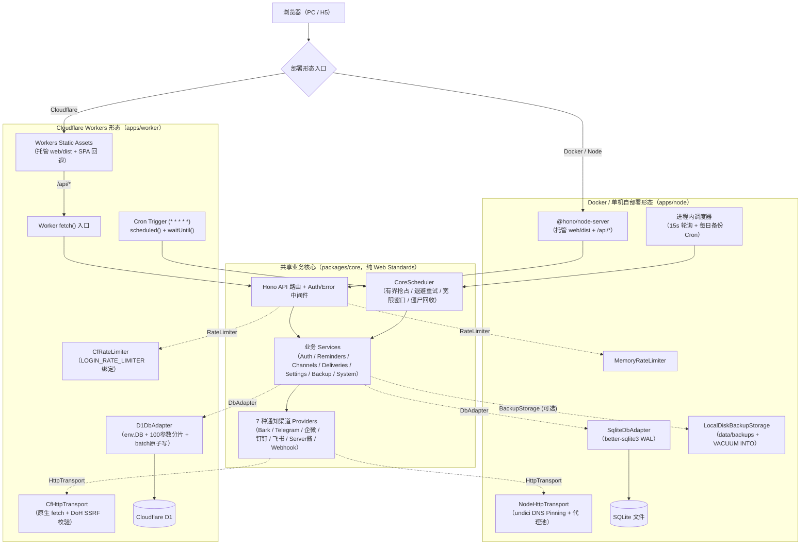
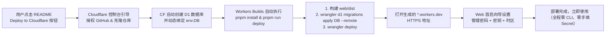

# TickBell 2.0 开发方案（支持 Cloudflare 部署与一键部署）

| 项 | 内容 |
| --- | --- |
| 文档版本 | v2.1（2026-11-24，适配「取消提醒数量上限」并完成 `dev` 分支 2.0 代码交付） |
| 状态 | **已实现（待真实 CF 账号点击按钮验收）**：已完成 Phase 0–4 全部代码、测试、本地 D1 迁移与 `wrangler deploy --dry-run` 验证 |
| 基线系统 | `../`（TickBell v1.0.4+ / commit `d91c032`，NestJS + SQLite + Vue 3 / Quasar 2，**已移除提醒数量与批量操作条数上限**） |
| 历史参考 | `../../Tips`（原 Cloudflare Workers + Hono + D1 + Cron Triggers 版本） |
| 关联文档 | [API.md](./API.md) · [重构方案.md](./重构方案.md) · [通知渠道扩展计划.md](./通知渠道扩展计划.md) |

> [!IMPORTANT]
> **本文件是 TickBell 2.0 开发的唯一方案依据。**
> - 核心目标：支持 **Cloudflare Workers + D1 部署**，实现 **真·零配置「Deploy to Cloudflare」一键部署**，并在**不设提醒条数上限**的前提下安全规避 Cloudflare Workers / D1 的平台硬限制（单条 SQL 最多 100 绑定参数、Free Plan 单次调用 50 子请求 / 10ms CPU）。
> - 开发按第五节「实施路线」分阶段推进，每阶段以「验收标准」作为完成条件。
> - 决策点拍板后请更新文末「附录 A：决策记录」，并同步修改正文中受影响章节。

---

## 一、现有系统分析

### 1.0 一句话结论

- **`TipsNew`（TickBell v1.0.4+，`d91c032`）** 已具备完整业务能力（7 种插件化通知渠道、Web UI 首次零配置初始化、分钟级重复、自动退避重试、代理池、明文 JSON 全量备份、PC+H5 Quasar 前端），且**刚刚移除了 `MAX_REMINDERS` 及批量操作条数限制**（`GET /api/reminders` 不再 `LIMIT`、`POST /api/reminders/batch` 不限 `ids` 数量、查询侧改用 `SQL_IN_CHUNK_SIZE = 500` 分块）。
- 后端当前与 **Node.js / 本地 SQLite 生态深度绑定**（NestJS 11 + Express 5 + `better-sqlite3` 同步事务 + `undici`/`node:net` + `node:fs` + `crypto.scryptSync`），无法直接部署到 Cloudflare Workers。
- **取消上限后在 Cloudflare D1 上暴露出 3 个新增架构风险**：
  1. 现有 `SQL_IN_CHUNK_SIZE = 500` 会直接撞穿 **D1 单条 SQL 最多 100 个绑定参数**的硬上限（必报 `too many SQL variables`）；
  2. `GET /api/reminders` 全量无分页返回、`POST /api/reminders/batch` 无限 `ids`、`POST /api/backup/restore` 无条数限制，在数据量增长到数千条后容易触发 **Workers 内存 / 10ms CPU / Free Plan 50 次子请求** 限制；
  3. 同一分钟若集中到期大量提醒，无配额保护的 Cron 会直接报 `Too many subrequests`。
- **2.0 的核心突破点**：复用 1.0 已实现的 **「Web UI 首次启动初始化管理员密码与密钥」** 作为 **CF 真·零配置一键部署** 基石，并将后端重构为 **纯 Web Standards + Hono + 异步 `DbAdapter`（原生感知 D1 100 参数上限与 `batch()` 原子批处理）**，一套核心代码同时服务 Cloudflare Workers 与 Docker 自部署。

### 1.1 现有功能与能力对比清单

| 功能模块 | `TipsNew` 最新基线（`d91c032`） | `Tips` 历史 CF 版 | 代码依据 |
| --- | --- | --- | --- |
| 提醒条数与批量上限 | ✅ **无硬上限**（已移除 `MAX_REMINDERS`，`findAll` 无 `LIMIT`，`batch` 不限 `ids` 长度，备份恢复不限条数） | ⚠️ 硬上限 100 条（含 DB 触发器限制） | [reminders.service.ts](../server/src/modules/reminders/reminders.service.ts)、[reminders.repository.ts](../server/src/modules/reminders/reminders.repository.ts)、[reminders.validation.ts](../server/src/modules/reminders/reminders.validation.ts)、[backup.service.ts](../server/src/modules/backup/backup.service.ts) |
| 提醒 CRUD / 批量操作 | ✅ 软删除、批量启停/删除/替换渠道；`findByIds`/`getChannelIdsMap` 按 `SQL_IN_CHUNK_SIZE = 500` 分块 | ✅ 批量最多 100 条（无批量删除） | [reminders.repository.ts](../server/src/modules/reminders/reminders.repository.ts#L39-L138)、[API.md](./API.md#L176-L195) |
| 重复规则与时区 | ✅ 单次 / 每 N **分钟、小时、天、月、年**；Temporal 处理月底/闰年/DST；全局与单条独立 IANA 时区 | ✅ 无分钟级，仅小时/天/月/年 | [0002_add_minute_repeat_unit.sql](../server/migrations/0002_add_minute_repeat_unit.sql)、[repeat.ts](../server/src/common/repeat.ts) |
| 提前提醒 / 稍后提醒 | ❌ 无 | ❌ 无 | 全仓检索无相关字段 |
| 富文本与测试发送 | ✅ TipTap 3 富文本（纯文本 ≤ 4000 / HTML ≤ 64000）+ `xss`/`htmlparser2` 过滤；支持未保存提醒测试发送 & 渠道测试 | ✅ 同左 | [API.md](./API.md#L158-L195) |
| 通知渠道（插件化） | ✅ **7 种**：Bark、Telegram、企业微信、钉钉、飞书、Server酱、Webhook（支持 HMAC 签名 & 自定义模板）；动态表单元数据 `GET /api/channels/types` | ✅ 仅 3 种（Telegram、Bark、Webhook，无 HMAC 签名） | [channel-provider.interface.ts](../server/src/modules/notifications/channel-provider.interface.ts)、[dingtalk.provider.ts](../server/src/modules/notifications/providers/dingtalk.provider.ts) |
| 触发与重试机制 | ✅ 进程内 **15 秒** `setInterval` 轮询（每轮 `findDue` 上限 200 条、并发 5）；60 分钟错过宽限窗口（超时 `skipped`，1–60 分钟标 `isLate`）；瞬态错误指数退避重试（`1→5→15` 分钟，最多 3 次）+ 手动重试 | ✅ CF Cron `* * * * *`（1 分钟粒度）；无宽限窗口；at-most-once 不自动重试；`pending` 超 5 分钟标失败 | [scheduler.service.ts](../server/src/modules/scheduler/scheduler.service.ts)、[deliveries.service.ts](../server/src/modules/deliveries/deliveries.service.ts)、[cron/reminders.ts](../../Tips/src/cron/reminders.ts) |
| 出站代理 & SSRF | ✅ HTTP/HTTPS/SOCKS5 代理池 + 按渠道绑定；默认允许内网（`ALLOW_PRIVATE_URLS=true`）；严格模式用 OS DNS + `undici` DNS Pinning | ❌ 无代理；强制公网（`global_fetch_strictly_public` + `cloudflare-dns.com` DoH 预检） | [proxy-dispatcher.ts](../server/src/modules/notifications/http/proxy-dispatcher.ts)、[pinned-fetch.ts](../server/src/modules/notifications/http/pinned-fetch.ts) |
| 认证与初始化 | ✅ **零配置首启向导**（`POST /api/auth/setup` 将 `scrypt` 哈希与密钥存入 SQLite `settings`）；支持在线改密；内存限流 5 次/60s | ⚠️ 强依赖 `wrangler secret put` 录入 `ADMIN_PASSWORD` 与 `CONFIG_ENCRYPTION_KEY`；Workers 原生 `LOGIN_RATE_LIMITER` | [auth.service.ts](../server/src/modules/auth/auth.service.ts)、[wrangler.jsonc](../../Tips/wrangler.jsonc) |
| 备份与恢复 | ✅ 明文 JSON v2 导出/预览/恢复（兼容 v1 加密备份，32 MB 体积上限）；磁盘定时 JSON 备份（`data/backups/`）；每日 SQLite `VACUUM INTO` | ✅ 仅浏览器端加密全量备份 v1 + D1 手工 SQL 导出 | [backup.service.ts](../server/src/modules/backup/backup.service.ts) |
| 前端与状态监控 | ✅ Vue 3 + Quasar 2（PC+H5、暗黑主题）；提醒列表前端全量拉取+前端分页；投递日志后端分页；`/api/system/status` 已移除 `limits.maxReminders` | ✅ Vue 3 + TDesign；投递日志固定前 200 条不分页 | [SettingsPage.vue](../web/src/pages/SettingsPage.vue#L206-L209)、[system.controller.ts](../server/src/modules/system/system.controller.ts#L77-L80) |

### 1.2 现有数据模型与状态流转

`TipsNew` 当前包含 6 张业务表（另加 `schema_migrations`）：`settings`、`proxies`、`channels`、`reminders`、`reminder_channels`、`deliveries`、`delivery_receipts`（见 [0001_init.sql](../server/migrations/0001_init.sql)、[0002_add_minute_repeat_unit.sql](../server/migrations/0002_add_minute_repeat_unit.sql)、[0003_add_proxies.sql](../server/migrations/0003_add_proxies.sql)）。

- **提醒状态流转**：`active (enabled=1, completed=0)` ↔ `paused (enabled=0, completed=0)`；单次触发后进入 `completed (enabled=0, completed=1)`；任何状态均可软删除（`deleted_at != NULL`）。
- **投递状态流转**：`pending` → `sent` | `retrying (next_retry_at)` | `failed`；超出宽限窗口直接写入 `skipped`；`failed` 支持手动重试（复用同一 `event_id`）。

### 1.3 `TipsNew` 迁入 Cloudflare 的阻塞点清单（全量代码审计，共 13 项）

| # | 阻塞项 | 代码位置 | 在 Cloudflare Workers + D1 下的冲突点 |
| --- | --- | --- | --- |
| 1 | NestJS 11 + Express 5 + `helmet` + `cookie-parser` + `pino` | [main.ts](../server/src/main.ts)、`*.controller.ts` | 依赖 `reflect-metadata` 与 Node HTTP Server，非 Web Fetch API，体积与冷启动无法满足 Workers 10ms CPU 限制 |
| 2 | `better-sqlite3` 同步驱动与交互式事务 | [database.service.ts](../server/src/modules/database/database.service.ts)、各 `*.repository.ts` | 原生 C++ 插件无法运行于 Workers；D1 为**异步**接口且**不支持交互式事务**，仅支持 `db.batch([...])` |
| 3 | **`SQL_IN_CHUNK_SIZE = 500` 分块参数超限（无上限新增风险）** | [reminders.repository.ts](../server/src/modules/reminders/reminders.repository.ts#L39) | **Cloudflare D1 单条 SQL 最多仅支持 100 个绑定参数**（单条 SQL 最长 100 KB）；500 个 `?` 占位符在 D1 会直接抛错 |
| 4 | **无上限下的全量列表、无限批量写与大备份恢复（无上限新增风险）** | [reminders.service.ts](../server/src/modules/reminders/reminders.service.ts)、[backup.service.ts](../server/src/modules/backup/backup.service.ts) | 提醒增长至数千条时：① `GET /api/reminders` 全量返回易造成响应体过大与高 D1 读消耗；② 逐条循环 `INSERT`/`UPDATE` 会迅速击穿 Free Plan **50 次 D1 查询/请求**限制；③ 单条多行 `INSERT` 若超 100 参数同样报错 |
| 5 | `crypto.scryptSync` 密码哈希 | [auth.service.ts](../server/src/modules/auth/auth.service.ts#L23-L41) | Workers Free Plan 单请求上限 **10ms CPU**，`scryptSync` 极易触发 CPU 超限 |
| 6 | `node:crypto`（HMAC / UUID） | [dingtalk.provider.ts](../server/src/modules/notifications/providers/dingtalk.provider.ts)、[feishu.provider.ts](../server/src/modules/notifications/providers/feishu.provider.ts)、`webhook.provider.ts` | 需统一替换为原生 Web Crypto API（`crypto.subtle` + `crypto.randomUUID`） |
| 7 | `undici` + `node:net` / `node:tls` / `node:dns` / `AsyncLocalStorage` | [proxy-dispatcher.ts](../server/src/modules/notifications/http/proxy-dispatcher.ts)、[pinned-fetch.ts](../server/src/modules/notifications/http/pinned-fetch.ts) | CF Workers 不允许任意原始 TCP 代理隧道与自定义 socket DNS pinning；需切换为原生 `fetch` + DoH 预检 |
| 8 | 进程内 15 秒 `setInterval` & `cron` 包 | [scheduler.service.ts](../server/src/modules/scheduler/scheduler.service.ts#L100-L120) | Workers 无常驻进程，原生 Cron 最小粒度为 **1 分钟**（`* * * * *`）；且单次 Cron 需严格控制子请求配额，避免集中到期爆配额 |
| 9 | `node:fs` 磁盘自动备份 & `VACUUM INTO` | [backup.service.ts](../server/src/modules/backup/backup.service.ts)、[database.service.ts](../server/src/modules/database/database.service.ts#L116-L126) | Workers 无持久化本地文件系统；D1 不支持 `VACUUM INTO` 本地路径 |
| 10 | `@nestjs/throttler` 内存限流 | [auth-throttler.guard.ts](../server/src/modules/auth/auth-throttler.guard.ts) | Workers 无跨请求共享内存，需改用 Workers 原生 `ratelimits` 绑定 |
| 11 | `0002_add_minute_repeat_unit.sql` 建表迁移 | [0002_add_minute_repeat_unit.sql](../server/migrations/0002_add_minute_repeat_unit.sql) | SQL 中直接 `DROP TABLE reminders` 而未关闭外键（Node 端在 TS 里手动 `pragma('foreign_keys = OFF')`），交给 `wrangler d1 migrations apply` 会触发外键约束错误 |
| 12 | 提醒列表前端未对接服务端分页 | [RemindersPage.vue](../web/src/pages/RemindersPage.vue)、[API.md](./API.md#L176-L178) | 取消提醒上限后，前端若永远拉取全量列表，在 CF 边缘环境数据量增大后体验与配额均不理想 |
| 13 | 前端硬编码自部署假设 | [SettingsPage.vue](../web/src/pages/SettingsPage.vue#L187-L251)、[BackupSection.vue](../web/src/components/settings/BackupSection.vue)、[ChannelEditorDialog.vue](../web/src/components/channels/ChannelEditorDialog.vue) | 固定展示「单机 NestJS + SQLite」、网络代理区与 `data/backups/` 自动备份区，缺少运行形态能力协商 |

### 1.4 历史 `Tips` 项目的 CF 依赖参考

历史项目 [wrangler.jsonc](../../Tips/wrangler.jsonc) 验证了以下 CF 能力**全部支持 Cloudflare Workers Free Plan（零费用、无需绑卡）**：

| CF 能力 | 2.0 复用结论 | Free Plan / D1 关键配额 |
| --- | --- | --- |
| **Workers + Static Assets**（`run_worker_first: ["/api/*"]` + SPA fallback） | ✅ 复用，单 Worker 同时托管 Vue/Quasar 前端与 `/api/*` | 10 万次请求/天、10ms CPU/次、128MB 内存 |
| **D1 数据库**（`d1_databases` 绑定 `DB`） | ✅ 复用，一键部署时由 CF 自动创建并注入 `database_id` | 500 万行读/天、10 万行写/天、5GB 存储；**单条 SQL ≤ 100 绑定参数 / ≤ 100KB**；**Free Plan 单次调用 ≤ 50 次查询（一次 `db.batch()` 仅计 1 次）** |
| **Cron Triggers**（`* * * * *`） | ✅ 复用，每分钟驱动到期提醒、失败重试与超时回收 | 最多 3 个 Cron/Worker（本系统仅用 1 个） |
| **Rate Limiting 绑定**（`ratelimits: LOGIN_RATE_LIMITER`） | ✅ 复用，保护登录/初始化/改密/备份导出与恢复 | Free Plan 免费支持 |
| **`global_fetch_strictly_public` + DoH** | ✅ 复用，防止出站 SSRF | 每次域名预检占 2 次子请求（计入 50 次子请求上限） |
| **Worker Secrets**（`ADMIN_PASSWORD` 等） | 🔁 **降级为可选项**（默认沿用 1.0 Web UI 首次初始化，消除一键部署门槛） | — |

---

## 二、需求确认与技术选型

### 2.1 2.0 需求分层

| 类别 | 功能/特性 | 说明 |
| --- | --- | --- |
| **必须保留（双端一致）** | **不设提醒条数上限**；7 种通知渠道插件；提醒 CRUD/批量/富文本/时区/重复（含分钟）；幂等去重；指数退避自动重试 + 手动重试；错过宽限窗口；明文 JSON v2 全量导出与恢复（兼容 v1）；Web UI 零配置首次初始化；在线改密；PC+H5 Quasar 前端 | 保证 2.0 在 CF 上完整继承最新基线能力，不人为加回条数上限 |
| **必须新增（2.0 核心）** | Cloudflare Workers + D1 支持；**一键部署（Deploy to Cloudflare Button）**自动建库与迁移；**D1 100 参数/50 查询安全分片引擎**；运行形态能力协商（`capabilities`）；Web Crypto PBKDF2 密码哈希；CF Cron 有界批处理与心跳持久化；**提醒列表可选服务端分页**（平滑支撑数千条以上数据） | 既支持一键部署，又保证取消条数上限后在 CF Free Plan 下不崩、不爆配额 |
| **CF 端按能力裁剪** | 出站代理池（HTTP/HTTPS/SOCKS5）；本地磁盘自动备份（`data/backups/`）与 SQLite `VACUUM INTO`；15 秒级轮询（CF 为 1 分钟粒度）；内网自建地址直连 | CF 边缘节点本身直连公网且无本地磁盘；前端根据 `capabilities` 自动隐藏不适用模块，Docker 模式仍完整保留 |
| **明确不做（防过度设计）** | Durable Objects、Cloudflare Queues、KV、Workflows、Hyperdrive、外部 Cron 服务、多租户体系 | 个人/小规模场景下不引入重型云组件，保持零绑卡一键部署与单人可维护 |

> **非功能目标**：常规个人使用（数百至数千条提醒）在 CF Free Plan 下稳定零费用运行；点击部署按钮 **3 分钟内完成上线且零 CLI 操作**；单代码库单人可维护。

### 2.2 核心技术选型对比

#### 1. 整体架构与双端维护策略

| 方案 | 开发效率 | 复用现有代码程度 | 部署复杂度 | 社区生态 | 长期维护成本 |
| --- | --- | --- | --- | --- | --- |
| **方案 A（推荐）：单仓 pnpm Workspace，抽离 `packages/core`（Hono + 异步 `DbAdapter`），提供 `apps/worker`（CF）与 `apps/node`（Docker）双极薄入口** | 高（一次改完双端受益） | **极高**（前端 ~95%、7 渠道/重复/富文本/备份逻辑 ~90% 复用） | 低（CF 一键按钮 + 原 Docker Compose 并存） | 极佳 | **低**（仅维护一套业务与一套测试） |
| 方案 B：保留 NestJS 给自部署，另起一套 Hono 代码给 CF | 低（逻辑双写） | 中（只能复制工具函数） | 中 | 佳 | **高**（新增渠道或修 Bug 需同步改两套） |
| 方案 C：彻底删除 NestJS 与 Docker，做成纯 CF Workers 项目 | 最高 | 高 | 最低（仅 CF） | 佳 | 最低（但断掉 1.0 Docker 升级与内网/代理能力） |

**结论**：**推荐方案 A**。保留 `apps/node` 极薄入口仅约 300–400 行适配代码（`@hono/node-server` + `better-sqlite3` + `setInterval` + 沿用 `pinned-fetch`/`proxy-dispatcher`），即可让 1.0 Docker 用户无痛升级、保留内网自建 Bark 与代理能力，同时让 CF 一键部署成为一等公民。

#### 2. 后端 Web 框架

| 候选方案 | 开发效率 | 与现有技术栈复用 | CF Workers 兼容性 | 体积与冷启动 | 长期维护成本 |
| --- | --- | --- | --- | --- | --- |
| **Hono v4（推荐）** | 高（简洁直观，原生 TypeScript + Zod） | 高（原 `Tips` 已完整验证） | **原生一等支持**，同时支持 `@hono/node-server` | 极小（~14KB），冷启动 < 2ms | 低 |
| NestJS 11（现有） | 中 | 最高（Node 端零改动） | ❌ **不可用**（Express/反射/体积不兼容 Workers） | 大 | — |
| itty-router / 原生 `fetch` | 中（中间件/Cookie/路由需手搓） | 低 | 原生支持 | 极小 | 中 |

**结论**：**选用 Hono v4**，统一承担 CF Workers 与 Node.js 的 HTTP 路由、Cookie 读写、错误处理与静态资源回退。

#### 3. 数据库访问层（SQLite / D1 统一抽象）

| 候选方案 | 开发效率 | 复用现有 SQL 程度 | D1 100 参数 & `batch()` 精确控制 | 包体积与 CPU 开销 | 长期维护成本 |
| --- | --- | --- | --- | --- | --- |
| **手写极简异步 `DbAdapter` + 参数分片工具（推荐）** | 高（封装 ~150 行） | **100% 复用现有 SQL**（仅改 `async/await` + 适配参数分片） | **完全可控**（按列数自动切分多行 `INSERT` 与 `IN` 查询并打入单次 `db.batch()`） | 零依赖，CPU 开销最低 | 低 |
| Drizzle ORM | 中（需重写全部 Schema 与查询） | 低 | 一般（D1 100 参数限制下仍需手动切分批量写） | 中 | 中 |
| Prisma（D1 Adapter） | 低 | 低 | 弱 | 体积大、Workers 易超冷启动/CPU 预算 | 高 |

**结论**：**手写极简异步 `DbAdapter`**，并内置 **`batch` 自动分片助手**（按 `maxBindParams = 90` 安全余量自动切片），从根本上解决无提醒上限后的 D1 参数与查询数限制。

#### 4. 密码哈希与加密原语

| 候选方案 | Workers Free Plan 10ms CPU 安全性 | 复用与兼容性 | 零外部依赖 |
| --- | --- | --- | --- |
| **Web Crypto `PBKDF2-SHA256`（推荐，带格式前缀兼容旧 `scrypt$`）** | **安全**（CF 运行时 BoringSSL 原生执行，100,000 次迭代远低于 10ms CPU 上限） | 新密码统一生成 `pbkdf2-sha256$<iter>$<salt>$<hash>`；Node 端保留 1.0 旧 `scrypt$` 校验并在登录成功后自动平滑升级 | ✅ 零依赖 |
| `nodejs_compat` `scryptSync` | ❌ 高风险（易触发 Free Plan 10ms CPU 超限） | 兼容 1.0 | 依赖 polyfill |
| Argon2 WASM | ❌ 高风险（WASM 内存与 CPU 易超限、增大 Worker 包体） | 不兼容 1.0 | 需 WASM 依赖 |

**结论**：**全面改用 Web Crypto API**（`PBKDF2-SHA256`、`HMAC-SHA256`、`crypto.randomUUID()`），彻底移除核心层对 `node:crypto` 的依赖。

#### 5. 定时调度与失败重试

| 候选方案 | CF Free Plan 可用性 | 无上限突发行情抗压能力 | 部署复杂度 |
| --- | --- | --- | --- |
| **CF 原生 Cron Trigger `* * * * *` + 有界流控批处理（+ Node 端保留 15s `setInterval`）（推荐）** | ✅ 免费（占 1/3 Cron 配额） | **稳健**（按子请求预算限流，未发完的留到下 1 分钟自动接续，不丢不错） | 极低（一键部署自动生效） |
| Cloudflare Workflows / Queues | ❌ Queues 需 Paid 套餐 | 高 | 高（多资源编排，破坏零绑卡一键部署） |
| 外部 Cron 服务 | 免费但不可靠 | 差 | 高（需手工配 Token 与回调） |

**结论**：**CF 端使用原生 Cron Trigger `* * * * *` + 子请求预算流控**，Node 端保留 15s `setInterval`。

#### 6. 提醒列表查询策略（因取消提醒上限新增选型）

| 候选方案 | 数百条体验 | 数千条以上体验（CF D1） | 改造代价 |
| --- | --- | --- | --- |
| **方案 1（推荐）：`GET /api/reminders` 默认兼容原全量返回，同时新增服务端分页模式（`page` + `pageSize`），前端列表页切换为服务端分页** | 极快 | **极快**（单次仅读当前页 20–50 条 + 聚合计数，D1 读行数恒定 O(pageSize)） | 低（仅 `RemindersPage.vue` 与 `reminders.repository.ts` 改动） |
| 方案 2：维持前端全量拉取 + 前端分页 | 快 | ⚠️ 劣化（5,000 条带富文本时 JSON 可达数 MB，每次刷新消耗数千 D1 行读并拖慢 H5） | 零 |

**结论**：**推荐方案 1**，接口向后兼容（不传 `page` 时仍返回全量数组，传 `page`/`pageSize` 时返回分页对象 `{ items, total, page, pageSize, categories, tags }`），前端 `RemindersPage.vue` 在 Phase 3 接入服务端分页，彻底消除无上限带来的列表瓶颈。

#### 7. 推荐最终技术栈总表

| 层级 | 推荐选型 |
| --- | --- |
| 仓库组织 | pnpm Workspace Monorepo（`packages/core` + `apps/worker` + `apps/node` + `web`） |
| 前端 | Vue 3 + TypeScript + Vite 8 + Quasar 2 + Pinia + TipTap 3（复用现有 `web/`，列表页支持服务端分页 + `capabilities` 自适应） |
| 后端框架 | Hono v4（纯 Web Standards Fetch API） |
| 数据库访问 | 自研轻量异步 `DbAdapter` + D1 100 参数安全分片工具（CF 对接 D1，Node 对接 `better-sqlite3` WAL） |
| 加密与时间 | Web Crypto API（PBKDF2-SHA256 / HMAC-SHA256）+ `@js-temporal/polyfill` + `zod` v4 + `xss` + `htmlparser2` |
| 调度机制 | 共享 `CoreScheduler`：CF 用 Cron Trigger（`* * * * *` + 子请求预算流控），Node 用 `setInterval`（15s） |
| 一键部署 | Cloudflare **Deploy Button**（根目录 `wrangler.jsonc` + 自动 D1 创建与迁移） + Docker Compose（保留） |

---

## 三、架构与数据设计

### 3.1 系统架构图



### 3.2 Monorepo 目录结构规划（为一键部署量身设计）

Cloudflare 的 **Deploy Button**（`deploy.workers.cloudflare.com`）如果指向子目录会隔离上下文，无法引用同级 `web/` 和 `packages/core/`。因此 **必须将 `wrangler.jsonc` 和 workspace 根 `package.json` 放在仓库根目录**：

```text
tickbell/
├─ package.json                # 根 workspace，提供 deploy / build / test / dev:cf / dev:node
├─ pnpm-workspace.yaml         # packages/*, apps/*, web
├─ wrangler.jsonc              # CF Workers 配置（放根目录，一键部署直接识别）
├─ migrations/
│  ├─ d1/                      # CF D1 迁移目录（0001_init.sql 干净 2.0 基线，无 DROP TABLE 风险）
│  └─ sqlite/                  # Node SQLite 迁移目录（保留 0001~0003 兼容 1.x 老用户 + 0004_v2_compat.sql）
├─ packages/
│  └─ core/                    # 零 Node 专属依赖（仅 Web Standards）
│     ├─ src/ports/            # DbAdapter / HttpTransport / RateLimiter / BackupStorage 接口
│     ├─ src/db/               # SQL 分片助手（按 maxBindParams<=90 自动切分 IN 与多行 INSERT）
│     ├─ src/crypto/           # Web Crypto PBKDF2 / HMAC / timingSafeEqual
│     ├─ src/common/           # time / repeat / reminder-content / errors / ip
│     ├─ src/providers/        # 7 个渠道 Provider + ChannelRegistry
│     ├─ src/repositories/     # 全部异步化 SQL Repository（返回 Statement 支持 batch）
│     ├─ src/services/         # Auth / Settings / Channels / Reminders / Deliveries / Backup / CoreScheduler
│     └─ src/http/             # Hono app 工厂 createApp(deps) + 路由模块
├─ apps/
│  ├─ worker/                  # Cloudflare Workers 入口（~250 行）
│  │  └─ src/                  # index.ts ({ fetch, scheduled }), d1-adapter.ts, cf-transport.ts, cf-ratelimit.ts
│  └─ node/                    # Docker / 单机 Node 入口（~400 行）
│     └─ src/                  # main.ts, sqlite-adapter.ts, node-transport.ts, proxy-dispatcher.ts, disk-backup.ts
├─ web/                        # 复用现有 Vue 3 + Quasar 2 前端（列表分页 + capabilities 自适应）
├─ deploy/                     # Dockerfile（构建 apps/node + web）与运维文档
├─ docker-compose.yml          # 保留单文件 Docker 部署
└─ docs/                       # API.md / 2.0开发文案.md / 重构方案.md / 通知渠道扩展计划.md
```

### 3.3 核心模块与无上限专项防护设计

#### 1. 异步 `DbAdapter` 与 D1 100 参数 / 50 查询防护（核心重构点）

由于系统已不设提醒条数上限，而 Cloudflare D1 存在 **「单条 SQL ≤ 100 绑定参数、单条 SQL ≤ 100 KB、Free Plan 单次调用 ≤ 50 查询（一次 `db.batch()` 仅计 1 次）」** 的硬约束，2.0 必须采用以下统一设计：

- **统一接口**：
  ```ts
  export interface SqlStatement { sql: string; params?: readonly unknown[] }
  export interface DbRunResult { changes: number }
  export interface DbAdapter {
    readonly maxBindParams: number; // D1: 90（留安全余量）; SQLite: 500
    all<T>(stmt: SqlStatement): Promise<T[]>;
    first<T>(stmt: SqlStatement): Promise<T | null>;
    run(stmt: SqlStatement): Promise<DbRunResult>;
    batch(stmts: readonly SqlStatement[]): Promise<DbRunResult[]>;
    batchQuery<T>(stmts: readonly SqlStatement[]): Promise<T[][]>; // 多个分片 SELECT 合并为 1 次 D1 batch 查询！
    ping(): Promise<boolean>;
  }
  ```
- **5 类无上限高频/大批量场景的 D1 安全改造**：

  | 业务场景 | 1.0（`d91c032`）现状 | 2.0（D1 + SQLite 统一安全方案） |
  | --- | --- | --- |
  | `findByIds` / `getChannelIdsMap` | 循环按 `500` 个分块发 `IN (?,...)` | 改按 `db.maxBindParams`（D1 为 **90**）切分，并将全部切片 `SELECT` 放进**单次 `db.batchQuery()`** 执行（哪怕传 2,000 个 ID 也只占 **1 次** D1 查询，绝不触发 100 参数报错） |
  | `GET /api/reminders` 列表与渠道关联 | 无 `LIMIT` 拉全部 + 分块 `IN` 查渠道 | 支持服务端分页（`page`/`pageSize`），当前页仅查 20–50 条的渠道（1 条 SQL 搞定）；兼容旧全量模式时改用 `INNER JOIN reminders` 单条 SQL 查出有效关联，彻底消除 `IN` 列表分片 |
  | `POST /api/reminders/batch`（不限 `ids`） | 事务内逐条更新 | 先用单次 `batchQuery` 读目标提醒，再将所有 `UPDATE` / `DELETE` / 多行 `INSERT INTO reminder_channels`（每条最多 `floor(90/2)=45` 行）打包进**单次 `db.batch()`** 原子提交；单次 `batch` 超过 1,000 条提醒时仍严格满足 100 参数与原子回滚（建议前端批量操作对超大选中集给出进度或分组提示） |
  | `PUT /api/settings`（修改全局时区） | 事务内循环更新全部继承提醒 | 读出所有 `timezone IS NULL` 的 `(id, starts_at, next_run_at, schedule_version)`，在内存重算后打包进**单次 `db.batch()`** + `schedule_version` 乐观锁校验 |
  | `POST /api/backup/restore`（不限条数） | 事务内逐条 `INSERT` | 按表列数自动计算多行 `INSERT` 切片大小（`reminders` 18 列 → 每条 **5 行 / 90 参数**；`deliveries` 14 列 → **6 行 / 84 参数**；`channels` 8 列 → **11 行 / 88 参数**；`reminder_channels` 2 列 → **45 行 / 90 参数**；`delivery_receipts` 3 列 → **30 行 / 90 参数**），全部装入**单次 `db.batch()`** 原子提交，确保数千条数据恢复既不超 100 参数、也不超 50 查询、失败整批回滚 |
  | 首次初始化 `/api/auth/setup` | 事务内查后写 | `INSERT OR IGNORE` 写 `auth_password_hash` 防并发重入，随后 `db.batch()` 原子写入密钥、时区与 `session_generation` |

#### 2. 提醒调度与重试机制（无上限下的流控与防重）

- **触发方式**：CF 使用原生 **Cron Trigger (`* * * * *`)** 驱动 `scheduled()` + `ctx.waitUntil(scheduler.runTick())`；Node 端继续用 **15 秒 `setInterval`**。
- **核心保障不变**：
  - **重复与时区**：100% 复用 [repeat.ts](../server/src/common/repeat.ts)（`@js-temporal/polyfill`），按 `starts_at` 锚点推进，正确处理月底、闰年、DST。
  - **幂等防重**：`schedule_version` 乐观锁推进 `reminders` + 同一次 `batch()` 中 `INSERT OR IGNORE` 抢占 `deliveries` 与 `delivery_receipts`；仅抢占成功的记录在事务外执行 HTTP 推送。
  - **僵尸 `pending` 回收**：每次 `runTick` 开头回收 `status = 'pending' AND updated_at <= now - 5分钟` 的记录并标为 `failed`（不自动重发，严守防重底线）。
  - **宽限窗口**：默认 `MISSED_GRACE_MINUTES = 60`；延迟 1–60 分钟补发并标记 `isLate = true`，超 60 分钟写 `skipped` 并推进到下次未来时间。
  - **指数退避重试**：瞬态网络/429/502/503/504/平台限流错误写 `retrying`，按 **`1 → 5 → 15` 分钟** 最多自动重试 3 次；超时/HTTP 500（`unknown`）与配置错误（`permanent`）直接 `failed`，保留日志页手动重试。
- **无上限下的 CF 子请求预算流控（关键机制）**：
  - 由于不再限制提醒总数，可能出现同一分钟集中到期数十甚至上百条提醒（且每条提醒可能关联多个渠道）。
  - Workers Free Plan 单次调用上限 **50 次子请求**（D1 每次查询/batch 计 1 次、每次外发 HTTP 计 1 次、每次 DoH 预检计 2 次）。
  - **精准预算调度算法**：
    1. 每次 Cron 拉取到期提醒候选集（如 `LIMIT 50`）及其渠道数；
    2. 维护本轮剩余子请求预算（CF Free Plan 默认预留给投递的预算为 **12 次新投递 + 5 次重试**，可通过 `wrangler.jsonc` `vars` 调大，Paid Plan 可直接调至 200+）；
    3. 按 `next_run_at ASC` 逐条检查：仅当「该提醒的渠道数 ≤ 剩余预算」时，才将其纳入本轮 `batch()` 抢占与推进；**超出本轮预算的到期提醒保持原样不动**，由 1 分钟后的下一轮 Cron 自动接续处理；
    4. 结合 60 分钟宽限窗口，即使偶发 60 条提醒集中在同一分钟到期，也能在 4–5 分钟内全部平滑发完，绝不触发 `Too many subrequests` 崩溃，也不丢失任何一条！
  - **心跳与日志清理**：每次 Cron 结束写一条 `settings.cron_heartbeat`（供 `/api/health` 与状态页使用）；距离上次清理满 24 小时后顺带按批删除超 `DELIVERY_RETENTION_DAYS`（默认 90 天）的旧日志，不额外占用 Cron 配额。

#### 3. 出站网络与 SSRF 策略

| 维度 | Cloudflare Workers (`CfHttpTransport`) | Docker / Node (`NodeHttpTransport`) |
| --- | --- | --- |
| 底层实现 | 原生 `fetch` + `AbortSignal.timeout(15_000)` + `redirect: 'manual'` | 沿用 [pinned-fetch.ts](../server/src/modules/notifications/http/pinned-fetch.ts) + [proxy-dispatcher.ts](../server/src/modules/notifications/http/proxy-dispatcher.ts) |
| SSRF 防护 | `global_fetch_strictly_public` + URL 静态拦截私网 + `cloudflare-dns.com/dns-query` DoH A/AAAA 校验；**官方固定公网域名白名单**（`api.telegram.org`、`oapi.dingtalk.com`、`open.feishu.cn`、`open.larksuite.com`、`qyapi.weixin.qq.com`、`sctapi.ftqq.com`、`api.day.app`）跳过 DoH，为单轮 Cron 节省 2/3 子请求预算 | 默认 `ALLOW_PRIVATE_URLS=true` 支持内网自建 Bark；关闭后启用 OS DNS Pinning |
| 网络代理 | ❌ 不支持（CF 全球网络直连公网） | ✅ 完整支持 HTTP/HTTPS/SOCKS5 代理池 |

### 3.4 数据库设计（SQLite / D1 统一 Schema）

保持与 1.0 完全一致的 **6 张业务表**（`settings`、`proxies`、`channels`、`reminders`、`reminder_channels`、`deliveries`、`delivery_receipts`）：

| 表名 | 关键字段与索引 | 2.0 调整说明 |
| --- | --- | --- |
| `settings` | `key TEXT PRIMARY KEY, value TEXT, updated_at INTEGER` | 新增内部键 `cron_heartbeat`、`last_cleanup_at`；继续存 `global_timezone`、`auth_password_hash`、`auth_session_secret`、`session_generation` |
| `proxies` | `id, name, protocol, host, port, username, password, enabled, created_at, updated_at` | 保留表结构确保跨形态 JSON 备份 100% 互通 |
| `channels` | `id, name, type, enabled, config (JSON), proxy_id (FK SET NULL), created_at, updated_at`；索引 `idx_channels_type`、`idx_channels_proxy` | 与 1.0 完全一致 |
| `reminders` | 无条数上限；完整保留 1.0 全部字段（含 `repeat_unit` 支持 `'minute'`）；部分索引 `idx_reminders_due`、`idx_reminders_category` | `migrations/d1/0001_init.sql` 直接建出包含 `'minute'` 的最终表，避免 `0002` 表重建在 D1 触发外键报错；新增部分索引 `idx_reminders_list ON reminders(next_run_at) WHERE deleted_at IS NULL` 加速无上限下的分页排序 |
| `reminder_channels` | `PRIMARY KEY (reminder_id, channel_id)`；索引 `idx_reminder_channels_channel` | 与 1.0 完全一致 |
| `deliveries` | 保留全部字段与 `UNIQUE(reminder_id, scheduled_at, channel_id)`；现有 3 个索引 | 新增部分索引 `idx_deliveries_pending ON deliveries(updated_at) WHERE status = 'pending'` 加速每分钟僵尸任务回收 |
| `delivery_receipts` | `PRIMARY KEY (reminder_id, scheduled_at, channel_id)` | 与 1.0 完全一致，保障备份恢复后去重不失效 |

#### 不同提醒规模下的 D1 配额边界评估（取消上限后必看）

| 活跃提醒规模 | 每分钟空扫读行数 | 每日 Cron 估算读行数（免费额度 500 万/天） | 每日估算写行数（免费额度 10 万/天） | 推荐套餐 |
| --- | --- | --- | --- | --- |
| **≤ 500 条**（个人轻度） | 0–10 行（走部分索引） | ~2 万行（0.4%） | < 3,000 行（3%） | **CF Free Plan（\$0）** |
| **500 – 3,000 条**（个人重度/小团队） | 0–30 行（走部分索引） | ~5–15 万行（1%–3%） | ~5,000–20,000 行（5%–20%） | **CF Free Plan（\$0）**（列表需开服务端分页） |
| **> 3,000 条或高并发分钟级触发** | 视同分钟并发量而定 | 仍在 Free 读额度内，但单轮子请求 50 上限会拉长排队 | 若大量分钟级提醒日写超 10 万行则触发限制 | **Workers Paid（\$5/月）**（1,000 查询/调用、10,000 子请求、5000 万写/月） |

> **关键结论**：只要坚持使用部分索引 + 服务端分页 + 子请求预算流控，**即使不设提醒条数上限，数千条规模依然无需 PostgreSQL/MySQL/Redis**；并且当用户规模真的超出 Free Plan 时，只需在 CF 控制台升级 Workers Paid 套餐并调大 `CRON_MAX_DELIVERIES_PER_TICK` 环境变量，**零代码改动即可平滑扩容**。

### 3.5 API 契约变更清单（100% 向后兼容 `d91c032`）

基于最新 [API.md](./API.md)（已移除 `limits.maxReminders`），2.0 仅做以下增量扩展：

| 方法 | 路径 | 2.0 变更 / 说明 |
| --- | --- | --- |
| `GET` | `/api/auth/status` | 新增 `runtime: "cloudflare" \| "node"` |
| `GET` | `/api/health` | 公开接口；CF 端读取 `settings.cron_heartbeat` 判断调度健康度（超 5 分钟无心跳返回 `503 degraded`；刚部署首 5 分钟宽限） |
| `GET` | `/api/system/status` | 保持 `limits: { missedGraceMinutes, deliveryRetentionDays }`（无 `maxReminders`）；新增 **`runtime`** 与 **`capabilities`**：`{ proxies, diskAutoBackup, sqliteVacuumBackup, minScheduleIntervalSec, allowPrivateUrls }` |
| `GET` | `/api/reminders` | **向后兼容 + 可选服务端分页**：不传 `page` 时仍返回 `ReminderView[]`；传入 `page` / `pageSize`（1–100）时返回 `{ items: ReminderView[], total, page, pageSize, categories: string[], tags: string[] }`，前端列表页改用分页模式以适配无上限 |
| `POST` | `/api/reminders/batch` | 保持不限 `ids` 条数；内部自动按 `maxBindParams` 分片打入原子 `batch()` |
| `POST` | `/api/backup/export` · `/preview` · `/restore` | 保持无提醒条数限制（仅保留 32 MB 文件体积保护）；支持 Docker ↔ CF 双向明文 JSON v2 备份迁移 |
| `ALL` | `/api/proxies*`、`/api/backup/auto*` | Node 端完整可用；CF 端返回 `501`（`{ "error": "Cloudflare 部署模式不支持此功能" }`），前端按 `capabilities` 自动隐藏 |

---

## 四、迁移与一键部署方案

### 4.1 双部署形态对照表

| 能力维度 | Cloudflare Workers 形态（2.0 新增） | Docker / 单机自部署形态（1.0 保留） |
| --- | --- | --- |
| 运行载体 | Cloudflare Workers（全球边缘无服务器） | 单容器 Node 24（Docker Compose） |
| 前端托管 | Workers Static Assets（`web/dist` + SPA 回退） | `@hono/node-server` 静态托管（`public/`） |
| 数据库 | Cloudflare D1（云端托管 SQLite，**无提醒条数上限**） | 本地 SQLite 文件（WAL 模式，挂载 `/data`，**无提醒条数上限**） |
| 定时调度 | CF Cron Trigger（`* * * * *`，1 分钟精度 + 子请求预算流控） | 进程内 `setInterval`（15 秒精度）+ 每日维护 Cron |
| 登录限流 | Workers 原生 `LOGIN_RATE_LIMITER` 绑定（免费） | 进程内内存限流 |
| HTTPS / 域名 | 自动提供免费 `*.workers.dev` HTTPS，自定义域名一键签发 SSL | 需自行配 Caddy / Nginx 反代申请证书 |
| 出站网络 | 公网直连（天然可连 Telegram 等）+ DoH SSRF 校验 | 支持内网自建 Bark + HTTP/HTTPS/SOCKS5 代理池 |
| 数据备份 | 网页手动明文 JSON 导出/恢复 + CF D1 Time Travel（7 天自动时间点回滚） | 网页手动导出 + 磁盘定时 JSON 自动备份 + 每日 `VACUUM INTO` |
| 日志观测 | Cloudflare Dashboard Workers Observability / `wrangler tail` | 容器 stdout 结构化 JSON 日志 |
| 成本 | **\$0 / 月（Free Plan 覆盖数千条以下日常使用）**；超大规模可无痛升 Paid | 自备 VPS / NAS |

### 4.2 Cloudflare 真·一键部署全流程设计



#### 1. 仓库根目录 `wrangler.jsonc` 配置草案（已同步移除 `MAX_REMINDERS`）

```jsonc
{
  "$schema": "node_modules/wrangler/config-schema.json",
  "name": "tickbell",
  "main": "apps/worker/src/index.ts",
  "compatibility_date": "2026-09-01",
  "compatibility_flags": ["global_fetch_strictly_public"],
  "observability": {
    "enabled": true
  },
  "assets": {
    "directory": "./web/dist",
    "binding": "ASSETS",
    "not_found_handling": "single-page-application",
    "run_worker_first": ["/api/*"]
  },
  "d1_databases": [
    {
      "binding": "DB",
      "database_name": "tickbell-db",
      "database_id": "",
      "migrations_dir": "migrations/d1"
    }
  ],
  "ratelimits": [
    {
      "name": "LOGIN_RATE_LIMITER",
      "namespace_id": "1001",
      "simple": { "limit": 5, "period": 60 }
    }
  ],
  "triggers": {
    "crons": ["* * * * *"]
  },
  "vars": {
    "MISSED_GRACE_MINUTES": "60",
    "DELIVERY_RETENTION_DAYS": "90",
    "CRON_MAX_DELIVERIES_PER_TICK": "12",
    "CRON_MAX_RETRIES_PER_TICK": "5"
  }
}
```

#### 2. 一键部署防踩坑的 4 个关键设计

1. **按绑定名 `DB` 执行迁移**：
   根 `package.json` 的部署脚本固定为：
   `"deploy": "pnpm --filter tickbell-web build && wrangler d1 migrations apply DB --remote && wrangler deploy"`
   即使用户在一键部署向导里修改了数据库名，按绑定名 `DB` 迁移依然 100% 成功。
2. **`database_id` 留空由一键部署自动注入**：
   不硬编码任何开发者的 `database_id`，CF Deploy Wizard 自动创建并绑定专属 D1；CLI 手动部署用户按文档运行 `wrangler d1 create tickbell-db` 填入即可。
3. **零必填 Secrets**：
   沿用 TickBell 1.0 首启向导，部署后首次打开页面即可设置管理员密码与密钥并写入 D1（同时保留可选 `ADMIN_PASSWORD` / `SESSION_SECRET` Secret 兜底）。
4. **README 一键部署按钮**：
   ```markdown
   [](https://deploy.workers.cloudflare.com/?url=https://github.com/<owner>/<repo>)
   ```

#### 3. 运维、安全、备份与升级

- **HTTPS 与自定义域名**：自动提供 `*.workers.dev` HTTPS，可在 CF 控制台一键绑定自定义域名与 SSL；Cookie 自动启用 `HttpOnly; SameSite=Strict; Secure`。
- **备份与恢复**：网页端随时明文 JSON v2 导出/恢复（支持 Docker ↔ CF 跨形态迁移），底层叠加 D1 自带 7 天 **Time Travel** 与 `wrangler d1 export DB --remote`。
- **日志与升级**：Workers 原生高可用无需守护进程；日志通过 CF Dashboard Observability 实时查看；一键部署用户只需在 GitHub 点击 **Sync fork** 即可自动触发重新构建、增量 D1 迁移与无停机发布。
- **Docker 自部署兼容**：继续提供根目录 `docker-compose.yml` 与多架构镜像（`linux/amd64`、`linux/arm64`），1.0 用户拉取 2.0 镜像后自动应用 `migrations/sqlite/` 并平滑兼容旧 `scrypt$` 密码与数据卷。

---

## 五、实施路线

### 5.1 分阶段拆解（MVP → 完整双端 2.0）

| 阶段 | 核心工作内容 | 交付物 | 验收标准 |
| --- | --- | --- | --- |
| **Phase 0：工程骨架与双轨迁移** | 建立根 pnpm Workspace（`packages/core`、`apps/worker`、`apps/node`、`web`）；编写 `migrations/d1/0001_init.sql`（含 `minute` 与新增分页/pending 索引）和 `migrations/sqlite/0004_v2_indexes.sql`；编写双轨 Schema 一致性测试 | Workspace 配置、双轨 migration、Schema 对比单测 | `pnpm install` 一次通过；D1 与 SQLite 执行完迁移后表结构、索引、约束校验 100% 一致 |
| **Phase 1：`packages/core` 异步化、D1 参数分片与 Hono 重构** | 定义 4 个端口接口与 `maxBindParams` 分片工具（`batchQuery` + 按列数自动切分多行 `INSERT`）；将全部 Repository/Service 异步化并去掉所有 `MAX_REMINDERS` 遗留假设；7 个渠道与 Auth 迁至 Web Crypto（`PBKDF2` + `HMAC`）；用 Hono 实现全部 API（含 `GET /api/reminders` 可选服务端分页与 `capabilities`） | `packages/core` 完整源码与单元测试（含大批量 1,500 条提醒分片读写、恢复、Repeat、7 Providers 测试） | `packages/core` 零 `node:*` / `@nestjs` / `better-sqlite3` 导入；模拟 100 参数硬上限的测试器下，1,500 条提醒批量操作与备份恢复 100% 通过 |
| **Phase 2：Cloudflare Worker 适配（MVP 核心交付）** | 实现 `apps/worker`（`D1DbAdapter`、`CfHttpTransport` + 官方域名 DoH 白名单、`CfRateLimiter`、`{ fetch, scheduled }`）；实现子请求预算流控调度器与心跳记录；配置根目录 `wrangler.jsonc` 与 `deploy` 脚本 | `apps/worker`、`wrangler.jsonc`、基于 `wrangler dev` / Miniflare D1 的端到端测试 | `wrangler dev` 下完成首启初始化、7 渠道测试、触发 `/__scheduled` 验证集中到期 50 条提醒分多轮平滑发完不爆子请求、以及 1,500 条备份导出恢复验证 |
| **Phase 3：前端服务端分页与 `capabilities` 自适应** | `RemindersPage.vue` 接入 `GET /api/reminders` 服务端分页（保持跨页多选与批量操作体验）；`SettingsPage` / `BackupSection` / `ChannelEditorDialog` 按 `capabilities` 动态隐藏代理与磁盘自动备份，更新 CF 运行状态展示 | 更新后的 `web/` 及前端测试 | CF 模式下无报错、无失效模块；2,000+ 条模拟提醒下 PC/H5 列表流畅无卡顿；Node 模式原有功能 100% 保留 |
| **Phase 4：Node/Docker 入口迁移与 1.x 无损升级** | 实现 `apps/node`（`@hono/node-server`、`SqliteDbAdapter`、保留 `undici` 代理与本地自动备份、保留 `scrypt$` 老密码验证与登录自动升级）；精简 `deploy/Dockerfile`（去掉 NestJS）；清理旧 `server/` | `apps/node`、新版 `Dockerfile` 与 e2e 测试 | 挂载 1.0 真实 `tickbell.db` 启动 2.0 容器：老密码可直接登录并平滑升级哈希，既有提醒/渠道/代理/自动备份完整可用 |
| **Phase 5：真实 CF 一键部署验收与文档发布** | 推送至 GitHub，用全新免费 Cloudflare 账号点击 **Deploy to Cloudflare** 按钮全链路实测；验证自定义域名、Cron 真实触达与 Sync fork 升级；更新 `README.md`、`docs/API.md` | 一键部署按钮、2.0 正式文档与发布说明 | 全新 CF 免费账号点击按钮零命令行完成部署，打开网页初始化并收到真实渠道提醒 |

### 5.2 主要风险与应对

| 风险点 | 影响 | 应对措施 |
| --- | --- | --- |
| **无上限触发 D1 单条 SQL 100 绑定参数上限** | `IN` 列表查询、批量操作或备份恢复直接报 `too many SQL variables` | `D1DbAdapter` 强制 `maxBindParams = 90`；所有 `IN` 查询走 `batchQuery` 切片；所有多行 `INSERT` 按列数动态计算每条行数并合入单次 `db.batch()`；单测注入「>100 参数即抛错」的严格模拟驱动做回归防线 |
| **集中到期大量提醒击穿 Free Plan 50 子请求限制** | 整轮 Cron 报错中断 | 调度器按剩余子请求预算精准抢占（默认每轮 12 新投递 + 5 重试），未抢占的保持到期状态由下分钟 Cron 接续；官方固定渠道域名跳过 DoH 预检 |
| **无上限下全量列表拖垮内存或 D1 读配额** | 数千条含富文本提醒时接口慢、H5 卡顿 | Phase 1/3 为 `GET /api/reminders` 增加服务端分页并新增 `idx_reminders_list` 索引，前端切换服务端分页 |
| **Deploy Button 找不到工作区依赖或迁移失败** | 一键部署构建报错 | `wrangler.jsonc` 与根 `package.json` 置顶于仓库根目录；迁移命令严格使用绑定名 `DB`；Phase 5 用全新免费账号真机实测 |
| **同一份备份在 Docker 与 CF 同时启用** | 两端同时发送重复提醒 | 沿用 1.0 安全策略：全量恢复后所有提醒**强制暂停**，并在页面提示勿在两处同时启用 |
| **分钟级重复提醒在 CF 上误差** | CF Cron 最小粒度 1 分钟，无法达到 Node 15 秒级 | UI 与文档明确标注 CF 调度粒度为 1 分钟，依靠 `next_run_at <= now` 保证只延迟不漏发 |

---

## 六、待确认问题

| 编号 | 问题 | 建议默认值 | 影响范围 |
| --- | --- | --- | --- |
| **Q1** | 是否在同一仓库同时保留 Docker 单机自部署形态？ | **是**（方案 A：`packages/core` + `apps/worker` + `apps/node`） | 决定是否实施 Phase 4 及保留代理池/本地备份 |
| **Q2** | 代码目录策略：直接在 `TipsNew` 原仓库开 `v2` 分支演进，还是另建新目录？ | **直接在 `TipsNew` 仓库演进为 v2.0** | 保持 Git 历史、Docker Hub 与开源仓库连续性 |
| **Q3** | 取消提醒上限后，是否同意将 `RemindersPage.vue` 切换为**服务端分页**（`GET /api/reminders?page=&pageSize=`，同时保持无参数调用的向后兼容）？ | **是**（彻底避免数千条提醒下全量拉取导致的性能与 D1 读配额问题） | Phase 1 后端分页接口与 Phase 3 前端列表改造 |
| **Q4** | CF 模式下定时自动备份是否需要接入 R2？ | **2.0 MVP 不接入 R2**（R2 需绑卡，影响免费账号一键部署体验；用手动 JSON + D1 Time Travel，R2 放 2.1 可选） | `wrangler.jsonc` 绑定与一键部署门槛 |
| **Q5** | CF 免费版 1 分钟调度精度与单轮流控预算（12 投递 + 5 重试，超出自动顺延下分钟）是否可接受？ | **接受**（可通过 `wrangler.jsonc` `vars` 随时调大） | 调度器默认流控参数 |
| **Q6** | 一键部署按钮目标 GitHub 仓库 URL 及首启认证策略？ | 确认仓库地址；默认采用 **零 Secret 的 Web UI 首启初始化**（保留可选 `ADMIN_PASSWORD` Secret 兜底） | `README.md` 按钮链接与认证初始化逻辑 |

---

## 附录 A：决策记录

> 拍板后在此填写结论，并同步更新正文。「状态」取值：待定 / 已确认 / 已变更。

| 编号 | 议题 | 建议 | 最终结论 | 状态 | 日期 |
| --- | --- | --- | --- | --- | --- |
| V2-D1 | 双端支持策略（Q1） | 单仓共享 `core`，同时支持 CF Workers 与 Docker | 采用建议：`packages/core` + `apps/worker` + `apps/node` | 已确认（默认值） | 2026-11-24 |
| V2-D2 | 仓库演进路径（Q2） | 直接在 `TipsNew` 仓库升级 v2.0 | 采用建议：在 `dev` 分支演进为 v2.0 | 已确认 | 2026-11-24 |
| V2-D3 | 无上限列表分页策略（Q3） | `GET /api/reminders` 新增服务端分页（向后兼容），前端列表切换服务端分页 | 采用建议：新增 `page`/`pageSize`/`sort` 服务端分页与 facets 返回 | 已确认（默认值） | 2026-11-24 |
| V2-D4 | CF 自动备份与 R2（Q4） | MVP 不强依赖 R2，保持零绑卡一键部署 | 采用建议：CF 模式提供手动 JSON 导出恢复 + D1 Time Travel | 已确认（默认值） | 2026-11-24 |
| V2-D5 | CF 调度精度与流控预算（Q5） | 1 分钟 Cron，每轮 12 投递 + 5 重试（可配置，超出自动顺延） | 采用建议：写入 `wrangler.jsonc` `vars` | 已确认（默认值） | 2026-11-24 |
| V2-D6 | 一键部署仓库与认证方式（Q6） | Web UI 零 Secret 首启初始化 + 确认 GitHub 仓库 URL | 采用建议：`https://github.com/WishMelz/tickbell`，零 Secret 首启初始化 | 已确认 | 2026-11-24 |

## 附录 B：变更记录

| 版本 | 日期 | 变更内容 |
| --- | --- | --- |
| v2.0-draft | 2026-11-24 | 初稿：基于 `TipsNew` v1.0.4 与 `Tips` 历史源码，整理 2.0 支持 Cloudflare Workers + D1 与真·零配置一键部署的完整开发方案 |
| v2.1-draft | 2026-11-24 | 同步 commit `d91c032`（移除 `MAX_REMINDERS` 及批量条数上限）：移除方案与 `wrangler.jsonc` 中所有 `MAX_REMINDERS` 配置；新增 D1 单条 SQL 100 绑定参数与 50 查询限制审计（修复 `SQL_IN_CHUNK_SIZE = 500` 在 D1 报错隐患）；新增按列数切分多行 `INSERT`、`batchQuery` 合并查询、Cron 子请求预算流控、提醒列表服务端分页选型（Q3）及分规模 D1 配额边界评估 |
| v2.1 | 2026-11-24 | 完成 `dev` 分支 2.0 核心开发与自动化验收：`@tickbell/core`、`apps/worker`、`apps/node`、`web` 能力自适应与服务端分页、双轨迁移一致性校验、`wrangler d1 migrations apply DB --local` 及 `wrangler deploy --dry-run` 全部通过 |
