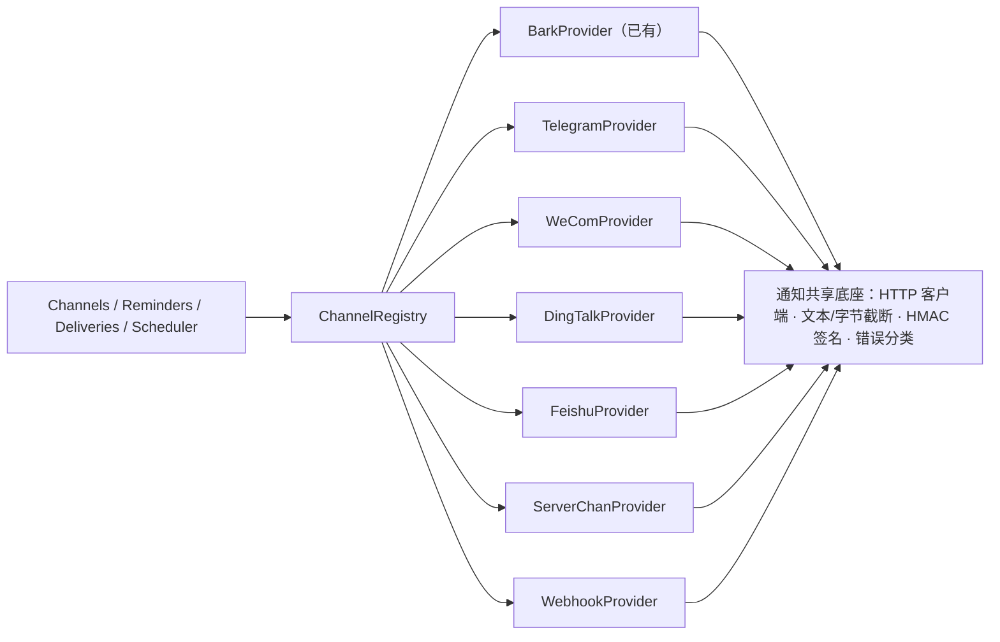
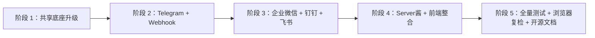

# TickBell 通知渠道扩展开发计划

| 项 | 内容 |
| --- | --- |
| 文档版本 | v1.0（2026-11-23） |
| 状态 | **已完成**（6 个新增渠道、前端卡片动态化、单元测试/E2E 与开源文档均已落地验收） |
| 适用项目 | TickBell（面向开源发布的单机自部署提醒系统） |
| 覆盖渠道 | Telegram Bot、企业微信群机器人、钉钉群机器人、飞书群机器人、Server酱、通用 Webhook（与现有 Bark 共同构成 7 个内置渠道） |
| 设计原则 | **不参考历史旧源码**，完全按各平台官方公开接口规范与开源通知生态（Apprise / Uptime Kuma / Message Pusher 等）主流实践设计；插件化、低耦合、便于外部开发者通过 PR 贡献新渠道 |

---

## 一、总体架构与开源设计原则

### 1.1 插件化扩展架构

系统核心流程（定时扫描、投递抢占、退避重试、日志记录、备份恢复、前端配置表单）全部面向抽象接口 `ChannelProvider` 与 `ChannelRegistry`，**不感知任何具体渠道**：

- **零数据库迁移**：`channels.type` 无硬编码 `CHECK` 约束，`channels.config` 为 JSON 字段，新增任何渠道均无需数据库 migration。
- **前端零定制表单**：后端通过 `GET /api/channels/types` 下发每个渠道的元数据（`meta`）与字段描述（`fields`，支持分组 `group` 与条件显隐 `showWhen`），前端 [ChannelConfigForm.vue](../web/src/components/channels/ChannelConfigForm.vue) 自动渲染 PC 与 H5 表单。
- **卡片摘要后端驱动**：每个 Provider 负责生成自身的关键摘要项 `summary`，前端卡片直接遍历渲染，彻底消除前端对特定渠道字段名的硬编码。

### 1.2 统一规范（面向开源发布）

| 规范维度 | 统一标准 |
| --- | --- |
| **配置表单体验** | 统一按 `group` 分为 **「连接与鉴权」** 与 **「通知配置」** 两段；所有字段明文保存与回填（`secret: false`），方便自部署管理员查看与编辑 |
| **网络与自建兼容** | 默认允许访问本机、Docker 服务名、局域网与反代地址（`ALLOW_PRIVATE_URLS=true`）；同时保留 `ALLOW_PRIVATE_URLS=false` + `ALLOWED_PRIVATE_HOSTS` 给公网部署场景防 SSRF |
| **日志脱敏（开源安全基线）** | 服务端日志（Pino）与错误摘要严禁明文打印 URL 中的 `bot<token>`、`key=`、`access_token=`、`sendkey` 等凭据，统一在共享 HTTP 层对错误文本中的敏感查询参数做脱敏 |
| **错误与重试分类** | 每个 Provider 的 `send()` 必须返回标准 `errorClass`： • `retryable`：DNS/连接/TLS 错误、HTTP `429/502/503/504`、以及平台官方频控错误码（进入 1 → 5 → 15 分钟退避重试，最多 3 次） • `permanent`：配置错误、鉴权/签名/关键词校验失败、HTTP 4xx（不重试，避免无意义请求） • `unknown`：读响应超时或 HTTP 500（默认不自动重试，防止重复推送） |
| **时间与延迟提示** | 统一通过共享格式化工具拼接时间行：正点为 `提醒时间：YYYY/MM/DD HH:mm`，延迟超过 1 分钟为 `原定 YYYY/MM/DD HH:mm，延迟送达` |
| **外部贡献友好** | 代码注释与错误文案保持独立完整、不提及历史私有项目；每个 Provider 单文件独立、附带独立单元测试，外部贡献者新增一个渠道只需「1 个 Provider 文件 + 1 行注册 + 1 份单测」 |

---

## 二、6 个通知渠道详细开发计划

### 2.1 Telegram Bot（`type: 'telegram'`）

| 项 | 规格说明 |
| --- | --- |
| **Provider 文件** | `server/src/modules/notifications/providers/telegram.provider.ts` |
| **排序 / 图标** | `order: 2` / `icon: 'send'` |
| **连接与鉴权字段** | • `apiBaseUrl`（`url`，选填，默认 `https://api.telegram.org`，支持自建 Bot API Server 或反向代理） • `botToken`（`text`，必填，格式校验 `^\d+:[A-Za-z0-9_-]{20,}$`） • `chatId`（`text`，必填，支持用户 ID、群组负 ID 或 `@channel_username`） |
| **通知配置字段** | • `messageThreadId`（`number`，选填，超级群组 Topic 话题 ID） • `parseMode`（`select`，默认 `none`：纯文本 / `HTML`） • `disableNotification`（`switch`，默认 `false`，静默推送） • `disableWebPagePreview`（`switch`，默认 `true`，关闭网页链接预览） • `protectContent`（`switch`，默认 `false`，禁止转发与保存） |
| **接口与载荷** | `POST {apiBaseUrl}/bot{botToken}/sendMessage`，JSON body：`chat_id`、`text`、`message_thread_id?`、`parse_mode?`、`disable_notification?`、`link_preview_options: { is_disabled }`（兼容官方 Bot API 7.0+，同时向下兼容）、`protect_content?` |
| **消息排版与截断** | • `none` 模式：标题 + 空行 + 纯文本正文 + 空行 + 时间行 • `HTML` 模式：`<b>转义标题</b>` + 净化后适配 Telegram HTML 子集的文本（保留 `b/i/u/s/a/blockquote`，列表与段落转换行）+ 时间行 • 严格限制 ≤ **4096 字符**：超长时保留标题与时间行，安全截断正文（不切碎 UTF-16 代理对 emoji）并追加 `\n[内容已截断]` |
| **响应校验与重试** | 校验 `response.ok && body.ok === true`。 • `retryable`：HTTP `429` / `502` / `503` / `504` • `permanent`：HTTP `400` / `401` / `403` / `404` 或 `body.ok === false`（如 Bot 被踢、Chat ID 不存在） |
| **卡片摘要** | `Chat ID`、`API 地址`（非默认官方地址时显示）、`格式 / 静默状态` |

---

### 2.2 企业微信群机器人（`type: 'wecom'`）

| 项 | 规格说明 |
| --- | --- |
| **Provider 文件** | `server/src/modules/notifications/providers/wecom.provider.ts` |
| **排序 / 图标** | `order: 3` / `icon: 'chat'` |
| **连接与鉴权字段** | • `webhookUrl`（`url`，必填，例如 `https://qyapi.weixin.qq.com/cgi-bin/webhook/send?key=...`，支持自建反代地址） |
| **通知配置字段** | • `msgType`（`select`，默认 `markdown`：`markdown` / `markdown_v2` / `text`） • `mentionedMobileList`（`text`，选填，逗号分隔手机号，仅 `text` 模式显示 `showWhen: { field: 'msgType', in: ['text'] }`） • `mentionedList`（`text`，选填，逗号分隔企业微信 UserID，仅 `text` 模式显示） • `mentionAll`（`switch`，默认 `false`，`@所有人`，仅 `text` 模式显示） |
| **接口与载荷** | `POST {webhookUrl}`，JSON body： • `markdown`：`{ msgtype: 'markdown', markdown: { content } }`（`### 标题\n正文\n> 提醒时间`） • `markdown_v2`：`{ msgtype: 'markdown_v2', markdown_v2: { content } }`（适配企业微信新版标准 Markdown） • `text`：`{ msgtype: 'text', text: { content, mentioned_list?, mentioned_mobile_list? } }`（勾选 `mentionAll` 时自动在 `mentioned_list` 中追加 `@all`） |
| **长度与截断** | 企业微信按 **UTF-8 字节数** 校验（`text` ≤ **2048 字节**，`markdown` / `markdown_v2` ≤ **4096 字节**）。使用按 UTF-8 字节边界安全截断工具，保证不截断多字节中文或 emoji |
| **响应校验与重试** | 校验 `body.errcode === 0`。 • `retryable`：HTTP `429/502/503/504`，或业务码 `45009`（单机器人每分钟 20 条限流）、`-1`（系统繁忙） • `permanent`：`93000`（无效 Webhook）、`40058`（参数超长）等其他非 0 错误码 |
| **卡片摘要** | `Webhook 域名`、`消息格式`、`@提醒设置` |

---

### 2.3 钉钉群机器人（`type: 'dingtalk'`）

| 项 | 规格说明 |
| --- | --- |
| **Provider 文件** | `server/src/modules/notifications/providers/dingtalk.provider.ts` |
| **排序 / 图标** | `order: 4` / `icon: 'campaign'` |
| **连接与鉴权字段** | • `webhookUrl`（`url`，必填，`https://oapi.dingtalk.com/robot/send?access_token=...`） • `secret`（`text`，选填，群机器人开启「加签」安全设置时填写，通常以 `SEC` 开头） • `keyword`（`text`，选填，开启「自定义关键词」时填写；若标题与正文均不含该词，发送时自动拼接为前缀） |
| **通知配置字段** | • `msgType`（`select`，默认 `markdown`：`markdown` / `text`） • `atMobiles`（`text`，选填，逗号分隔需要 `@` 的手机号） • `atUserIds`（`text`，选填，逗号分隔需要 `@` 的钉钉 UserID） • `isAtAll`（`switch`，默认 `false`，`@所有人`） |
| **官方加签算法** | 若填写 `secret`： 1. `timestamp = String(Date.now())`（毫秒级） 2. `stringToSign = `${timestamp}\n${secret}`` 3. `sign = encodeURIComponent(HMAC_SHA256(key = secret, data = stringToSign).toString('base64'))` 4. 追加 `timestamp` 与 `sign` 到 `webhookUrl` 的查询参数中 |
| **接口与载荷** | `POST {signedUrl}`，JSON body： • `markdown`：`{ msgtype: 'markdown', markdown: { title, text }, at: { atMobiles, atUserIds, isAtAll } }`（钉钉客户端要求 `markdown.text` 内包含 `@手机号` 才会触发高亮提醒，发送时自动在末尾补全） • `text`：`{ msgtype: 'text', text: { content }, at: { atMobiles, atUserIds, isAtAll } }` |
| **响应校验与重试** | 校验 `body.errcode === 0`。 • `retryable`：HTTP `429/502/503/504`，或业务码 `130101`（每分钟 20 条限流）、`45009`、`-1` • `permanent`：`310000`（加签错误、关键词不匹配、IP 不在白名单）等 |
| **卡片摘要** | `安全模式`（加签 / 关键词 / 无）、`消息格式`、`@提醒设置` |

---

### 2.4 飞书群机器人（`type: 'feishu'`）

| 项 | 规格说明 |
| --- | --- |
| **Provider 文件** | `server/src/modules/notifications/providers/feishu.provider.ts` |
| **排序 / 图标** | `order: 5` / `icon: 'notifications_active'` |
| **连接与鉴权字段** | • `webhookUrl`（`url`，必填，支持国内 `https://open.feishu.cn/open-apis/bot/v2/hook/...` 与国际版 Lark `https://open.larksuite.com/open-apis/bot/v2/hook/...`） • `secret`（`text`，选填，机器人开启「签名校验」时填写） • `keyword`（`text`，选填，开启「自定义关键词」时填写，自动确保消息包含该词） |
| **通知配置字段** | • `msgType`（`select`，默认 `interactive`：`interactive` 消息卡片 / `text` 纯文本） • `cardHeaderColor`（`select`，默认 `blue`：`blue` 蓝 / `turquoise` 青 / `green` 绿 / `orange` 橙 / `red` 红 / `indigo` 靛，仅 `interactive` 显示） • `mentionAll`（`switch`，默认 `false`，`@所有人`） |
| **官方加签算法（重点）** | 飞书签名与其他平台密钥方向相反，需严格按官方文档实现： 1. `timestamp = String(Math.floor(Date.now() / 1000))`（**秒级**） 2. `stringToSign = `${timestamp}\n${secret}`` 3. `sign = HMAC_SHA256(key = stringToSign, data = Buffer.alloc(0)).toString('base64')` 4. 将 `timestamp` 与 `sign` 写入 JSON 请求体顶层字段 |
| **接口与载荷** | `POST {webhookUrl}`： • `interactive`：`msg_type: 'interactive'`，标准飞书卡片（标题栏带主题色，延迟补发自动切为 `orange`；正文使用 `markdown` 模块；底部 `note` 元素展示提醒时间；开启 `mentionAll` 时在正文前附 `<at id=all></at>`） • `text`：`msg_type: 'text'`，`content: { text }`（开启 `mentionAll` 时附 `<at user_id="all">所有人</at>`） |
| **响应校验与重试** | 飞书接口历史与新版响应字段不统一，同时校验 `body.code === 0 \|\| body.StatusCode === 0`（无 `code` 且无 `StatusCode` 视为格式无效）。 • `retryable`：HTTP `429/502/503/504`，或业务码 `11232`（频控限制）、`9499` • `permanent`：`19021`（签名校验失败）、`19024`（关键词不匹配）、`19001`（参数错误） |
| **卡片摘要** | `安全模式`（签名校验 / 关键词 / 无）、`消息形态`（消息卡片 / 纯文本） |

---

### 2.5 Server酱（`type: 'serverchan'`）

| 项 | 规格说明 |
| --- | --- |
| **Provider 文件** | `server/src/modules/notifications/providers/serverchan.provider.ts` |
| **排序 / 图标** | `order: 6` / `icon: 'key'` |
| **连接与鉴权字段** | • `sendKey`（`text`，必填，支持 Server酱 Turbo 的 `SCT...` 与 Server酱³ 的 `sctp{uid}t...`） • `apiUrl`（`url`，选填，留空按官方规则自动推导；填写则直连自建/反代地址） |
| **通知配置字段** | • `channel`（`text`，选填，Turbo 指定推送通道号，如 `9` 方糖服务号、`98` 企微应用，多个用 `\|` 分隔） • `tags`（`text`，选填，Server酱³ 消息标签，多个用 `\|` 分隔） • `short`（`text`，选填，卡片简短描述，≤ 64 字符） • `noip`（`switch`，默认 `false`，隐藏调用方 IP） |
| **官方路由推导** | 1. 若填写了 `apiUrl`，直接使用 `apiUrl`。 2. 若 `sendKey` 匹配 `/^sctp(\d+)t/i`（Server酱³），目标为 `https://${uid}.push.ft07.com/send/${sendKey}.send`。 3. 否则（Server酱 Turbo），目标为 `https://sctapi.ftqq.com/${sendKey}.send`。 |
| **接口与载荷** | `POST {targetUrl}`，JSON body：`{ title, desp, short?, channel?, tags?, noip?: 1 }`。 • `title` 上限 32 字符（Turbo 官方硬限制）：超长时自动截断为 32 字符，并将完整标题置入 `desp` 第一行避免丢失信息 • `desp` 上限 32 KB，Markdown 格式并附带提醒时间 |
| **响应校验与重试** | 校验 `body.code === 0 \|\| body.errno === 0`。 • `retryable`：HTTP `429/502/503/504`，或业务码 `40001`（频率超限） • `permanent`：SendKey 无效、配额耗尽等业务错误 |
| **卡片摘要** | `版本/网关`（Server酱³ / Turbo / 自定义地址）、`SendKey`、`通道/标签` |

---

### 2.6 通用 Webhook（`type: 'webhook'`）

| 项 | 规格说明 |
| --- | --- |
| **Provider 文件** | `server/src/modules/notifications/providers/webhook.provider.ts` |
| **排序 / 图标** | `order: 7` / `icon: 'webhook'` |
| **连接与鉴权字段** | • `url`（`url`，必填，支持任意公网或自建内网 HTTP(S) 接口） • `method`（`select`，默认 `POST`：`POST` / `PUT`） • `secret`（`text`，选填，用于标准 HMAC-SHA256 签名验证） • `headersText`（`textarea`，选填，每行 `Header-Name: value`，例如 `Authorization: Bearer xxx`；服务端校验合法 Header 名并禁止覆盖 `host`、`content-length`、`transfer-encoding`） |
| **通知配置字段** | • `bodyTemplate`（`textarea`，选填，留空发送默认标准 JSON；填写自定义 JSON 模板时支持占位符：`{{title}}`、`{{content}}`、`{{scheduledAt}}`、`{{scheduledLocal}}`、`{{triggeredAt}}`、`{{timezone}}`、`{{eventId}}`、`{{reminderId}}`、`{{isLate}}`） |
| **签名与幂等头** | • 固定携带 `Content-Type: application/json` 与 `X-Reminder-Event-Id: <eventId>`（重试时复用同一 ID，供接收方做幂等） • 若配置了 `secret`：额外携带 `X-Reminder-Timestamp: <unixSeconds>` 与 `X-Reminder-Signature: sha256=<HMAC_SHA256(secret, "${ts}.${body}").hex>`（遵循 Stripe / GitHub 风格行业标准签名） |
| **默认载荷与模板安全** | • 默认载荷：`{ event: 'reminder.triggered', event_id, reminder: { id, title, content }, scheduled_at, triggered_at, timezone, is_late, is_test }` • 自定义模板渲染：使用 JSON 字符串安全转义替换变量（保证正文含双引号、反斜杠或换行符时不会破坏 JSON 语法），并在保存配置时对模板进行语法预检 |
| **响应校验与重试** | 任意 HTTP `2xx` 即成功。 • `retryable`：HTTP `429/502/503/504` 与连接/DNS 错误 • `permanent`：其他 4xx、SSRF 拦截 • `unknown`：HTTP `500` 或读响应超时 |
| **卡片摘要** | `方法与地址`（如 `POST https://...`）、`签名 / 自定义请求头 / 模板状态` |

---

## 三、项目整合方案

### 3.1 后端共享底座升级（改动集中在 `modules/notifications/`）

| 改动文件 | 具体内容 |
| --- | --- |
| [channel-provider.interface.ts](file:///e:/project/提醒系统/TipsNew/server/src/modules/notifications/channel-provider.interface.ts) | 1. 新增 `ChannelSummaryItem = { label: string; value: string }`，在 `MaskedChannelConfig` 中增加 `summary: ChannelSummaryItem[]`。 2. 导出统一的 `NOTIFICATION_HTTP_POST` 注入令牌，供全部 7 个 Provider 共享注入（测试中只需覆盖一个令牌即可拦截所有渠道出站请求）。 |
| [pinned-fetch.ts](file:///e:/project/提醒系统/TipsNew/server/src/modules/notifications/http/pinned-fetch.ts) | 1. `PinnedPostOptions` 新增可选 `method?: 'POST' \| 'PUT'`（默认 `'POST'`）。 2. 新增 `sanitizeUrlForLog(url)` 工具，确保错误日志与异常信息中不会泄露 `bot<token>`、`key=`、`access_token=`、`sendkey`。 |
| 新建 `http/message-format.ts` | 提供全部渠道共用的纯函数： • `formatTimeLine(message)`（正常 / 延迟补发时间行） • `truncateByChars(text, maxChars, suffix?)`（安全处理 UTF-16 代理对） • `truncateByUtf8Bytes(text, maxBytes, suffix?)`（安全处理 UTF-8 多字节字符） • `parseCommaList(value)`（去重、去空逗号分隔列表） • `ensureKeyword(title, body, keyword)`（钉钉 / 飞书关键词兜底） |
| [bark.provider.ts](file:///e:/project/提醒系统/TipsNew/server/src/modules/notifications/providers/bark.provider.ts) | 补齐 `summary` 返回项（地址、密钥、分组/级别），复用 `NOTIFICATION_HTTP_POST` 与 `formatTimeLine`。 |
| [channels.service.ts](file:///e:/project/提醒系统/TipsNew/server/src/modules/channels/channels.service.ts) | `ChannelView` 增加 `summary: ChannelSummaryItem[]`，由对应 `provider.maskConfig()` 生成；未支持渠道返回 `[]`。 |
| [notifications.module.ts](file:///e:/project/提醒系统/TipsNew/server/src/modules/notifications/notifications.module.ts) | 注册全部 7 个 Provider 到 `CHANNEL_PROVIDERS` 多值令牌中；保持 `ChannelRegistry` 零修改。 |

### 3.2 前端整合（保持 100% 数据驱动）

| 改动文件 | 具体内容 |
| --- | --- |
| [api/types.ts](file:///e:/project/提醒系统/TipsNew/web/src/api/types.ts) | `ChannelView` 新增 `summary?: Array<{ label: string; value: string }>`。 |
| [icons.ts](file:///e:/project/提醒系统/TipsNew/web/src/icons.ts) | 确认 7 个渠道所需的 Material Symbols Outlined SVG 图标均已在 `channelIconMap` 中有清晰区分。 |
| [ChannelsPage.vue](file:///e:/project/提醒系统/TipsNew/web/src/pages/ChannelsPage.vue) | 1. 卡片信息区改为遍历 `ch.summary` 展示（彻底删除对 Bark 字段名的硬编码）。 2. 更新页头副标题与空状态按钮文案（「新建通知渠道」）。 3. 当已创建渠道涵盖多种类型时，在顶部增加按渠道类型筛选的轻量过滤条（兼容 PC 与 H5）。 |
| [ChannelEditorDialog.vue](file:///e:/project/提醒系统/TipsNew/web/src/components/channels/ChannelEditorDialog.vue) | 新建渠道选择类型时展示每个渠道的图标、名称与简介；编辑时若后续升级新增了可选字段，自动与字段 `default` 合并回填。 |
| [ReminderEditorDialog.vue](file:///e:/project/提醒系统/TipsNew/web/src/components/reminders/ReminderEditorDialog.vue) & [BackupSection.vue](file:///e:/project/提醒系统/TipsNew/web/src/components/settings/BackupSection.vue) | 移除文案中「Bark」的单一渠道限定词，改为「通知渠道 / 可用渠道」。 |

### 3.3 开源文档与测试规范

| 项 | 具体内容 |
| --- | --- |
| **单元测试** | 为每个渠道建立独立测试或结构化套件 `server/test/providers/`（涵盖：字段校验、默认值与边界值、明文回填与 `summary`、签名算法黄金测试向量、按字符/UTF-8 字节截断、响应解析与 `retryable / permanent / unknown` 错误分类）。 |
| **集成测试** | 更新 `server/test/app.e2e.test.ts`： • 验证 `GET /api/channels/types` 返回全部 7 个渠道及其字段定义； • 验证同一提醒同时绑定多个不同类型渠道（例如 Bark + 钉钉 + 飞书 + Webhook）时的单轮并发投递与日志记录； • 用虚构类型（如 `custom-unknown`）测试「未支持渠道保留停用」兜底逻辑。 |
| **开源仓库文档** | 1. 更新 [docs/API.md](./API.md)（补充 `ChannelView.summary` 与 7 个渠道的类型契约）。 2. 更新 [docs/重构方案.md](./重构方案.md)（登记版本变更）。 3. 在根目录新增 `LICENSE`（MIT）与 `CONTRIBUTING.md`（包含「如何贡献一个新通知渠道 Provider」标准模板，降低开源协作门槛）。 4. 全面检查代码注释与 README，清理对旧私有项目路径或内部背景的引用。 |

---

## 四、分阶段实施路线

| 阶段 | 交付内容 | 验收标准 |
| --- | --- | --- |
| **阶段 1：共享底座** | `ChannelSummaryItem`、`NOTIFICATION_HTTP_POST`、`pinned-fetch` 支持 `method` 与 URL 日志脱敏、`message-format.ts`、Bark 适配 `summary` | 既有 19 个服务端测试全部通过；新增截断与脱敏单测通过 |
| **阶段 2：Telegram + Webhook** | `TelegramProvider`、`WebhookProvider` + 单元测试 | Telegram 4096 字截断 / HTML 模式 / 自定义反代通过；Webhook HMAC 签名、自定义 Header、JSON 模板渲染通过 |
| **阶段 3：企微 + 钉钉 + 飞书** | `WeComProvider`、`DingTalkProvider`、`FeishuProvider` + 单元测试 | 企微 UTF-8 字节截断通过；钉钉加签与关键词通过；飞书 `timestamp\nsecret` 签名、卡片与 `code/StatusCode` 兼容通过 |
| **阶段 4：Server酱 + 前端整合** | `ServerChanProvider`（Turbo + Server酱³）+ 前端 `ChannelsPage` 动态摘要渲染、筛选与文案清理 | 7 个渠道均可在 PC 与 H5 正常切换创建、编辑、回填和测试发送 |
| **阶段 5：验收与开源整理** | 集成测试、`pnpm run build:all`、PC/H5 浏览器实测、更新 `API.md` / `README.md` / `CONTRIBUTING.md` / `LICENSE` | `server` 与 `web` 类型检查、单测、构建、端到端冒烟全绿；日志无密钥泄露 |

---

## 五、开发前确认清单

1. **开源协议**：根目录 `LICENSE` 默认使用 **MIT** 协议，是否确认？
2. **Webhook 自定义模板**：默认发送标准 JSON，提供可选的自定义 JSON 模板（支持 `{{title}}` / `{{content}}` 等占位符），是否需要？
3. **默认消息形态**：企业微信与钉钉默认 `markdown`、飞书默认 `interactive`（彩色消息卡片）、Telegram 默认纯文本（可切 HTML），是否符合你的预期？
4. **旧渠道兼容策略**：既然不参考旧源码且面向开源，备份恢复里仍保留对旧版 JSON v1 的通用字段兼容（无任何私有代码依赖），还是只保留当前 TipsNew 的 v2 格式即可？
