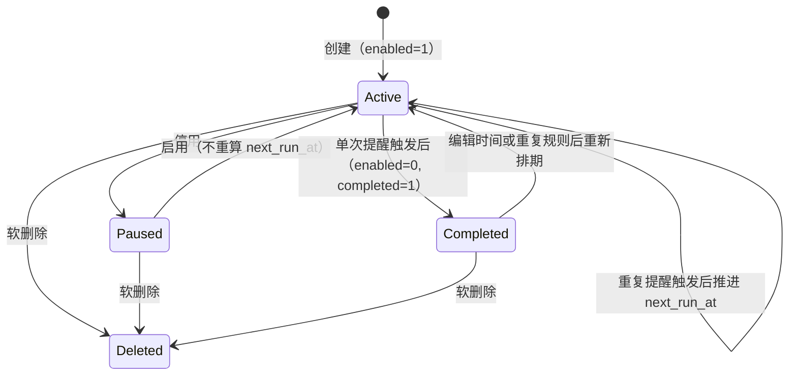
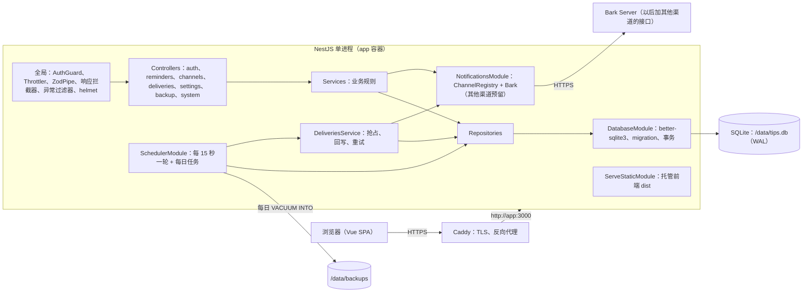
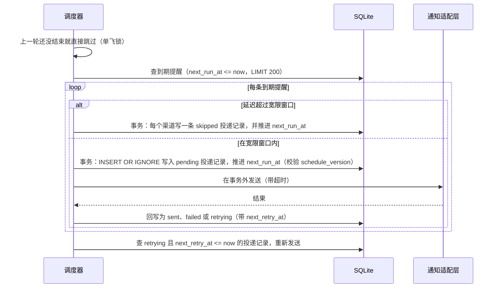
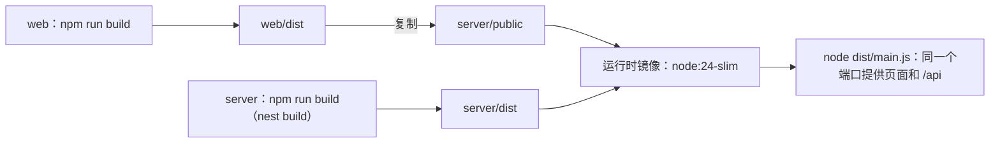
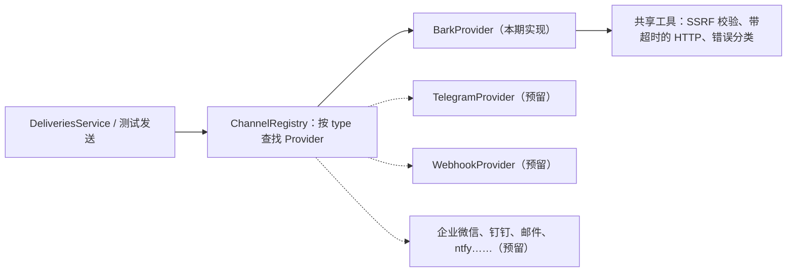
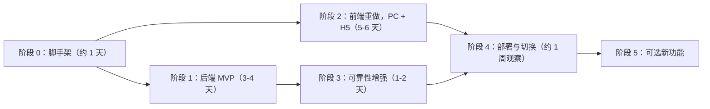

# TipsNew 提醒系统重构方案

| 项 | 内容 |
| --- | --- |
| 文档版本 | v1.2（开源就绪基线，2026-11-23） |
| 状态 | **已交付**：核心重构与 7 种内置通知渠道扩展均已实现并通过测试验收。接口契约见 [API.md](./API.md)，渠道扩展规格见 [通知渠道扩展计划.md](./通知渠道扩展计划.md) |
| 原系统 | `../../Tips`（Cloudflare Workers + D1） |
| 新系统 | `../`（TipsNew，单机自部署 + SQLite） |

> [!IMPORTANT]
> **本文件是 TipsNew 开发的唯一依据。**
> - 开发按第五节「实施路线」逐阶段推进，每个阶段以表中的「验收标准」作为完成条件。
> - 实现上要偏离本方案时，先修改本文件（更新版本号，并在文末「变更记录」里登记），再改代码。
> - 决策点和待确认问题拍板后，填进文末的「决策记录」，并同步修改正文中受影响的章节。

> [!NOTE]
> 工作区里实际的目录是 `Tips`（原系统）和 `TipsNew`（新系统，**目前是空目录**）。本文默认你说的 Trip / TripNew 就是这两个目录（见第六节 Q1）。
> 下面的分析都来自 `Tips` 的源码、migration、README 和测试。代码里看不出来的内容标为「未确认」。

---

## 一、现有系统分析

### 1.0 一句话结论

Tips = **Vue 3 + TDesign 前端** + **Hono API（Cloudflare Worker）** + **D1** + **每分钟一次的 Cron Trigger**，通知渠道有 **Telegram / Bark / Webhook** 三种，单管理员登录。业务逻辑本身和 CF 耦合不深（Hono、Temporal、zod、Web Crypto 在 Node 上都能直接跑），**真正和 CF 绑死的是 D1 的访问方式**：D1 不支持交互式事务，所以代码里写了一批绕路的机制。迁移时大部分代码可以复用，难点集中在数据层和调度层。

### 1.1 功能清单

| 功能 | 现状 | 代码依据 |
| --- | --- | --- |
| 创建 / 编辑 / 删除 | ✅ 删除是软删除（写 `deleted_at`，同时清空渠道关联） | [services/reminders.ts](../../Tips/src/services/reminders.ts#L124-L214) |
| 启用 / 停用 | ✅ 单条或批量（批量一次最多 100 条）；已完成的提醒不能直接启用 | [reminders.ts#L216-L263](../../Tips/src/services/reminders.ts#L216-L263) |
| 重复规则 | ✅ 只有两类：单次，或「每 N 个 **小时 / 天 / 月 / 年**」（N 取 1–9999） | [repeat.ts](../../Tips/src/services/repeat.ts) |
| 每周 / 按星期几 / 自定义 cron | ❌ **没有**。每周只能写成「每 7 天」，不能指定星期几，也没有结束日期或次数上限 | 同上 |
| 月底 / 闰年 / 夏令时 | ✅ 用 Temporal 处理；按月重复会锚定首次日期（例如 31 号在小月取月末） | [repeat.ts#L23-L33](../../Tips/src/services/repeat.ts#L23-L33) |
| 时区 | ✅ 有全局 IANA 时区（默认 UTC），每条提醒可以单独覆盖；改全局时区时，跟随全局的提醒保持原来的本地时刻 | [settings.ts](../../Tips/src/services/settings.ts) |
| 提前提醒 | ❌ **没有** | 全仓搜索无相关字段 |
| 稍后提醒（Snooze） | ❌ **没有**（也没有「已读 / 确认」） | 同上 |
| 分类 / 标签 / 搜索 | ✅ 分类最多 80 字符；标签最多 10 个、每个最多 30 字符；搜索用 LIKE，覆盖标题、正文、分类、标签 | [reminders.ts#L80-L111](../../Tips/src/services/reminders.ts#L80-L111) |
| 富文本正文 | ✅ 用 TipTap 编辑，服务端白名单过滤 XSS，发通知时转成纯文本 | [reminder-content.ts](../../Tips/src/utils/reminder-content.ts) |
| 测试发送 | ✅ 提醒表单可以用未保存的内容测试发送；渠道也有单独的测试按钮 | [api/reminders.ts](../../Tips/src/api/reminders.ts) |
| 多渠道实例 | ✅ 同一种渠道可以配多个实例；一条提醒可以关联多个渠道 | migration 0003 |
| 发送日志 | ✅ 可按提醒 / 渠道 / 状态筛选，**固定只返回最近 200 条，不能分页** | [api/deliveries.ts](../../Tips/src/api/deliveries.ts) |
| 备份 / 恢复 | ✅ 共三套：① 全量加密备份（浏览器端 PBKDF2 + AES-GCM，原子覆盖恢复）；② 提醒 JSON 备份 v1/v2；③ 渠道 JSON 备份 | [backup.ts](../../Tips/src/services/backup.ts)、`frontend/src/importExport.ts` |
| 登录 | ✅ 单管理员密码（读环境变量），HMAC 签名 Cookie，有效期 7 天，登录限流每分钟 5 次 | [services/auth.ts](../../Tips/src/services/auth.ts) |
| 数量上限 | ⚠️ 未删除的提醒**硬性上限 100 条**，在 5 处分别写死 | migration 0002 触发器、`reminders.ts#L131`、`backup.ts#L75`、列表 `LIMIT 100`、Cron `LIMIT 100` |

### 1.2 提醒触发机制

| 项 | 现状 |
| --- | --- |
| 触发源 | CF Cron Trigger `* * * * *`，调用 `scheduled()` 后用 `waitUntil(processDueReminders)` 执行（[index.ts#L74-L79](../../Tips/src/index.ts#L74-L79)） |
| 扫描频率 | 每分钟一次，精度约 1 分钟 |
| 到期判断 | `enabled=1 AND completed=0 AND deleted_at IS NULL AND next_run_at <= now`，按 `next_run_at` 升序，**每轮最多处理 100 条** |
| 处理流程 | 逐条提醒处理，同一提醒的多个渠道并行发送。先插入一条 `INSERT OR IGNORE` 的 pending 投递记录「抢占」，抢到才真正发送，发完回写结果 → 如果没有 pending 记录了就推进 `next_run_at` |
| 幂等 | `deliveries` 表有唯一键 `UNIQUE(reminder_id, scheduled_at, channel_id)`，另有 `delivery_receipts` 去重凭据表（恢复备份后也不会被清掉）；再加 `schedule_version`：提醒一被编辑，旧的 Cron 写回就失效 |
| 错过的提醒 | 下一轮 Cron 发现 `next_run_at <= now` 时**补发一次**（不管延迟了多久），然后直接跳到下一个未来的时间点，**中间错过的周期不补、也不记录** |
| 失败重试 | **不重试**，策略是 at-most-once（宁可漏发也不重复发）。一次失败就记为 `failed`；pending 超过 5 分钟会被标为失败，然后推进提醒（[cron/reminders.ts#L12](../../Tips/src/cron/reminders.ts#L12)） |
| 观察到的副作用 | 暂停后再启用一个重复提醒时**不会重算 `next_run_at`**。如果原时间已经过去，启用后的下一轮 Cron 会立刻补发一次（[reminders.ts#L216-L226](../../Tips/src/services/reminders.ts#L216-L226)） |

### 1.3 通知渠道（逐个）

| 渠道 | 实现方式 | 特性 |
| --- | --- | --- |
| Telegram | `POST api.telegram.org/bot{token}/sendMessage`，超时 15 秒 | 消息超过 4096 字时截断；改 Chat ID 必须重新填 Token |
| Bark | `POST {serverUrl}/push`，默认服务器 `https://api.day.app` | 支持 level（active/passive/timeSensitive/critical）、铃声、重复响铃、音量；发送前做 SSRF 检查 |
| Webhook | `POST` JSON，请求头带 `X-Reminder-Event-Id` | 事件名 `reminder.triggered`；**请求没有签名（HMAC）**；发送前做 SSRF 检查 |
| 邮件 / Web Push / 短信 / 企业微信等 | ❌ 没有 | — |

SSRF 防护：URL 校验会拒绝私网、localhost 和 `.local`；每次发送前还会通过 **`cloudflare-dns.com` 的 DoH 接口**解析 A/AAAA 记录，要求全部解析结果都是公网地址（[notifications/shared.ts](../../Tips/src/notifications/shared.ts)）。

### 1.4 数据模型

| 表 | 关键字段 | 作用 |
| --- | --- | --- |
| `settings` | key / value | 目前只存 `global_timezone`，改时区时也会临时写入 guard key |
| `reminders` | title, content, content_html, category, tags(JSON), timezone(可空 = 跟随全局), starts_at(首次锚点), is_repeating, repeat_every, repeat_unit, enabled, completed, next_run_at, deleted_at, schedule_version | 提醒主表，时间统一存 UTC 毫秒 |
| `channels` | name, type, enabled, config(**明文 JSON**), legacy_encrypted_config | 渠道实例；旧版加密配置在第一次读取时转成明文 |
| `reminder_channels` | (reminder_id, channel_id) | 多对多关联 |
| `deliveries` | event_id, reminder_id, scheduled_at, channel_id, status(pending/sent/failed), attempts, http_status, error, response_summary, sent_at | 投递日志，同时承担幂等抢占 |
| `delivery_receipts` | (reminder_id, scheduled_at, channel_id) | 历史去重凭据，由触发器自动写入 |
| `runtime_state` | generation | 数据版本号：恢复备份后旧会话和旧写入全部失效 |

还有两个触发器：`limit_active_reminders_before_insert`（100 条上限）和 `reminders_schedule_version`（任何 UPDATE 都会让版本号 +1）。



投递状态：`pending → sent | failed`；pending 超过 5 分钟转为 `failed`（标注「状态未知」）；恢复备份时 pending 一律改为 `failed`。

### 1.5 Cloudflare 依赖清单

| # | CF 能力 | 配置 / 代码位置 | 在系统中承担的职责 |
| --- | --- | --- | --- |
| 1 | **Workers 运行时** | `wrangler.jsonc` main、`export default { fetch, scheduled }` | 运行 API 和定时任务 |
| 2 | **Workers Static Assets** | `assets`（ASSETS 绑定、SPA 回退、`run_worker_first: /api/*`） | 托管 Vue 构建产物，SPA 路由回退 |
| 3 | `public/_headers` | CSP / X-Frame-Options 等 | 静态资源的安全响应头 |
| 4 | **Cron Triggers** | `triggers.crons: * * * * *` + `ctx.waitUntil` | 唯一的调度源 |
| 5 | **D1** | `d1_databases` 绑定 DB、`wrangler d1 migrations` | 全部业务数据和 migration |
| 6 | D1 `batch()` 当事务用 | 各 service 中的 `env.DB.batch([...])` | 多语句原子提交（D1 没有交互式事务） |
| 7 | 围绕 D1 的绕路机制 | `database-guard.ts`（Proxy 在每次写前插入 guard 语句）、`runtime_state` 写 NULL 触发 NOT NULL 失败、settings 临时 guard key、`schedule_version` 触发器 | 并发控制：恢复备份期间阻止旧请求和旧 Cron 写回，改时区时做乐观锁 |
| 8 | **Rate Limiting 绑定** | `ratelimits: LOGIN_RATE_LIMITER` | 登录 / 导出 / 恢复的密码尝试限流 |
| 9 | `CF-Connecting-IP` 请求头 | [api/auth.ts#L40](../../Tips/src/api/auth.ts#L40) | 限流时识别客户端 IP |
| 10 | `global_fetch_strictly_public` | compatibility_flags | 出站请求强制走公网路由（SSRF 的一层兜底） |
| 11 | `cloudflare-dns.com` DoH | `notifications/shared.ts` | 发送前的 DNS 公网校验 |
| 12 | **Worker Secrets** / `.dev.vars` | `ADMIN_PASSWORD`、`CONFIG_ENCRYPTION_KEY` | 存放密钥 |
| 13 | Observability | `observability.enabled` | 日志（`console.error`），未确认是否有告警 |
| 14 | Wrangler 工具链 | dev / deploy / d1 命令，`@cloudflare/workers-types` | 本地开发和发布 |
| 15 | 域名 / HTTPS | wrangler 中**没有配置 routes** | 未确认用的是 workers.dev 还是控制台里配的自定义域名 |

没有用到 KV、R2、Durable Objects、Queues、Pages Functions。

### 1.6 现有问题

| 类别 | 问题 | 影响 |
| --- | --- | --- |
| 耦合 / 复杂度 | 为弥补 D1 没有交互式事务，写了 `guardDatabase` Proxy、`runtime_state` NULL 失败、guard key 等绕路机制 | 代码难读难改，错误靠匹配字符串 `'NOT NULL constraint failed: runtime_state.generation'` 识别；换到 SQLite 的真事务后可以整体删掉 |
| 容量 | 100 条上限分散写在 5 处 | 达不到 500 条的目标，必须统一改 |
| 可靠性 | 失败一律不重试 | 一次网络抖动就会漏发（**服务器放到国内后 Telegram 不可达会更明显**） |
| 可靠性 | 错过的提醒不管晚了多久都补发一次，跳过的周期不留记录 | 停机几天后恢复，会收到一批过期提醒，也没法追溯 |
| 可靠性 | 启用已暂停的提醒时不重算时间 | 可能立刻收到一条过期提醒 |
| 可维护性 | 发送日志无限增长，不能分页，也没有清理 | 时间长了日志页只能看最近 200 条 |
| 可维护性 | 三套备份格式并存，加上旧加密配置的兼容代码 | 维护成本高 |
| 安全 | 渠道密钥明文存库；Webhook 没有签名；`CONFIG_ENCRYPTION_KEY` 同时用于解密旧配置和派生会话密钥 | 数据库文件泄露就等于密钥泄露 |
| **迁移陷阱** | Cookie 的 `Secure` 取决于 `req.url` 是否为 https（[services/auth.ts#L73-L76](../../Tips/src/services/auth.ts#L73-L76)） | 放到反向代理后面时 req.url 是 http，**Cookie 会丢掉 Secure** |
| **迁移陷阱** | 限流只认 `CF-Connecting-IP` | 换到 Nginx/Caddy 后这个头为空，所有人共用一个 `unknown` 额度，**全局每分钟只能登录 5 次** |
| **迁移陷阱** | SSRF 规则禁止私网地址 | 如果你在同一台服务器上自建 bark-server，用内网地址会被拒绝 |

可以直接带走的资产：`tests/` 下有 7 个 vitest 文件（约 90 KB），而且 [tests/helpers/database.ts](../../Tips/tests/helpers/database.ts) **已经用 `node:sqlite` 模拟了 D1**。这说明业务代码在 Node + SQLite 上可以运行，也是迁移时的回归测试基线。

---

## 二、技术选型

### 2.0 需求确认

**功能需求**

| 必须保留 | 可以砍掉（等你确认） | 建议新增 |
| --- | --- | --- |
| 提醒增删改、启停、批量操作 | 提醒 JSON v1/v2、渠道 JSON 两套单项备份（全量备份已经覆盖） | 统一可配置的上限（默认 500） |
| 单次 + 每 N 小时 / 天 / 月 / 年，Temporal 时区与夏令时 | `legacy_encrypted_config` 懒迁移（导入时一次性处理掉） | 有限重试（只在确定没送达时重试） |
| 全局时区和单条覆盖 | `runtime_state` / `guardDatabase` 机制 | 错过提醒的宽限窗口，以及跳过记录 |
| 通知渠道多实例：**本期只实现 Bark**；渠道接口可扩展，Telegram / Webhook 以后接入（3.6） | | 发送日志分页和保留期清理 |
| 分类、标签、搜索、富文本 | | 健康检查和调度器状态（最近一次扫描时间） |
| 测试发送、发送日志 | | SQLite 每日自动备份 |
| 全量加密备份与恢复（**也是迁移数据的通道**） | | 可选：接入 Telegram / Webhook 等渠道、Webhook HMAC 签名、按星期重复、稍后提醒、提前提醒（见第六节 Q4） |
| 单管理员登录与登录限流 | | |

**非功能需求**

| 维度 | 目标 |
| --- | --- |
| 可靠性 | 到期 ≤ 15 秒内触发；服务重启后自动补偿；同一次触发在同一渠道上不重复发送 |
| 部署难度 | 一条 `docker compose up -d` 完成部署，HTTPS 自动签发证书 |
| 维护成本 | 单进程、单 SQLite 文件、无外部中间件；一个人能看懂全部代码 |
| 数据备份 | 每天自动在线备份 SQLite 并保留 N 天，可选异地同步；UI 全量加密备份继续可用 |
| 界面 | **PC 和 H5 都要完整兼容**（使用比例约 5:5，移动端 360px 起、PC 1280px 起）；支持浅色 / 深色 / 跟随系统三种主题 |

### 2.1 前端

**已确认（2026-11-23）**：用 Vite 构建，UI 重新设计（不再用 TDesign），支持亮色 / 暗色主题，**PC 和 H5 都要完整兼容**，两端使用比例约 **5:5**。

> [!IMPORTANT]
> 移动端占一半流量，所以 H5 是**一等公民**，不是「PC 页面缩小后能凑合用」。每个功能在两端都要用起来顺手，验收也按两端分别进行（见第五节阶段 2）。

**前端技术栈（定稿）**

| 层 | 选型 | 说明 |
| --- | --- | --- |
| 构建 | **Vite 8** + TypeScript 5.9 | 已确认；用 `@quasar/vite-plugin` 接入，`web/` 仍然是标准的 Vite 项目 |
| 框架 | **Vue 3.5**（`<script setup>`） | Tips 的类型定义、API 约定、加密备份逻辑都能复用 |
| UI 框架 | **Quasar 2**（只用组件库，不用 Quasar CLI） | 专门为「一套代码同时适配 PC 和移动端」设计：响应式布局、PC 和移动端两种交互形态的组件、内置暗色主题，适合 5:5 的使用场景（选型对比见下表） |
| 图标 | `@quasar/extras`（Material Symbols，本地字体） | 不走 CDN，符合 CSP |
| 路由 | vue-router 4（history 模式） | 页面级懒加载 |
| 状态 | Pinia | 只放登录态、主题偏好、全局设置 |
| 富文本 | TipTap 3（懒加载） | 沿用 Tips 的 HTML 白名单方案；移动端工具栏横向滚动 |
| 样式 | Quasar 的 Sass 变量 + CSS 变量 + 组件内 scoped 样式 | 不引入 Tailwind，避免两套样式体系并存 |
| HTTP | 原生 `fetch` 封装（沿用 Tips `api.ts` 的约定） | 返回 401 时跳转登录页 |
| 代码规范 / 测试 | ESLint + Prettier；vitest + `@vue/test-utils` | 只测关键逻辑 |

**为什么从 Naive UI 改成 Quasar**

| 方案 | PC 体验 | H5 体验 | 一套代码 | 暗色 | 日期时间输入 | 维护成本 | 结论 |
| --- | --- | --- | --- | --- | --- | --- | --- |
| **Quasar 2** | 好：QTable、Drawer、Dialog 齐全 | **好**：表格可切卡片模式、Dialog 可全屏或从底部弹出、滑动操作、下拉刷新、底部导航 | ✅ 用 `$q.screen` 断点切换 | 内置，支持跟随系统 | QDate/QTime 的值就是**字符串**，正好对应本地时间，不会被换算时区 | 低 | ✅ 选定 |
| Naive UI | 很好 | 中：组件只为桌面设计，表格、日期选择等在手机上都要大量自己改 | 要写不少适配层 | 内置 | 默认输出时间戳，要特别处理 | 中 | ❌ 移动端缺口太大 |
| Naive UI（PC）+ Vant 4（H5） | 很好 | 很好 | ❌ 两套页面、两套主题 | 两套都要配 | 两套 | **高**：每个页面写两遍 | ❌ 一个人维护负担太重 |
| shadcn-vue + Tailwind | 好 | 好（响应式优先） | ✅ | 支持 | 要自己组装 | 中：组件源码要自己维护，表格和选择器组装量大 | 备选 |

**响应式规范**

| 项 | 规范 |
| --- | --- |
| 断点 | 宽度 **< 1024px 用移动端布局**，≥ 1024px 用 PC 布局（基于 Quasar 的 `$q.screen.lt.md`）。600–1023px（平板、横屏手机）用移动端布局，列表卡片排两列 |
| 支持范围 | 手机 360px 起（iPhone SE 375×667、主流 390×844、Android 360×800）；PC 1280px 起（1366×768 到 1920×1080 及以上） |
| 导航 | PC：左侧常驻、可折叠的菜单。移动端：**底部标签栏**（提醒 / 渠道 / 日志 / 设置），顶栏放标题和主题切换 |
| 列表 | PC：`QTable` 表格（多选、排序、分页）。移动端：同一份数据用**卡片列表**展示；左滑卡片出现启用 / 停用 / 删除；下拉刷新；「加载更多」代替页码 |
| 批量操作 | PC：勾选后在表格上方出现操作栏。移动端：**长按**卡片进入多选模式，底部固定出现操作栏 |
| 编辑表单 | PC：右侧抽屉或居中对话框（宽约 640px）。移动端：**全屏对话框**，顶部固定「取消 / 保存」 |
| 选择器 | 日期时间用 QDate + QTime，PC 端是下拉弹出，移动端是底部弹出或全屏；单选、多选在移动端用底部弹出的选项列表 |
| 触控 | 可点区域至少 44×44px；表单输入字号至少 16px（防止 iOS 自动放大）；不依赖鼠标悬停（tooltip 里的信息在移动端要有其他展示方式） |
| 刘海屏和视口 | `viewport-fit=cover` + `env(safe-area-inset-*)` 适配刘海和底部手势条；全屏高度用 `100dvh`；弹出软键盘时当前输入框自动滚到可见区域 |
| 性能 | 页面级懒加载，TipTap 只在打开编辑器时才加载；首屏 JS（gzip）≤ 300KB；4G 网络下首屏 < 3 秒 |

**主题方案**

- 三种模式：**浅色 / 深色 / 跟随系统**。用 Quasar 的 `Dark.set('auto' | true | false)` 切换，默认跟随系统，用户选择后保存到 `localStorage`。
- 主色、圆角、字体都放在 Quasar 的 Sass 变量里，亮 / 暗两套 CSS 变量各一份。自定义区域（富文本编辑器、空状态等）只使用 CSS 变量，**不写死颜色**。
- 首屏前在 `index.html` 里用内联脚本读取偏好，先设置背景色和 `<meta name="theme-color">`，避免深色模式白屏闪烁，同时让移动端浏览器的地址栏颜色和主题一致。

**页面范围**（和 1.1 的功能清单一一对应，**每个页面都要有 PC 和移动端两种形态**）：登录、提醒列表（搜索、分类和标签筛选、批量操作）、提醒编辑（富文本、重复规则、时区、渠道、测试发送）、通知渠道（增删改、测试）、发送日志（筛选、分页 / 加载更多）、系统设置（全局时区、全量备份和恢复、系统状态）。

> [!IMPORTANT]
> **时区注意**：提醒的时区可能和浏览器所在时区不同。表单里的时间统一用 QDate/QTime 的字符串格式 `YYYY-MM-DDTHH:mm`（对应 Tips 的 `scheduledLocal`）收发，由后端按提醒时区换算。前端**不要**用 `new Date()` 把它转成时间戳。

> [!NOTE]
> 可选增强（放在阶段 5）：用 `vite-plugin-pwa` 做成 PWA，支持「添加到主屏幕」，打开后像 App 一样全屏显示。

### 2.2 后端

**已确认（2026-11-23）：NestJS。** 和原方案 Hono 的取舍记录如下：

| 维度 | NestJS（选定） | Hono（原方案） |
| --- | --- | --- |
| 结构 | 模块、控制器、Provider、依赖注入，分层清晰，约定统一 | 轻量，结构靠自觉 |
| 现成能力 | schedule、config、throttler、serve-static、pino 都有官方或成熟模块 | 要自己拼 |
| 与 Tips 的复用 | 路由和中间件层要重写；service、工具函数、通知适配器可以移植，约 60% | 约 85% |
| 体积 / 启动 | 依赖较多，启动约 1 秒 | 很轻 |
| 维护 | 要熟悉装饰器和 DI；功能变多后结构更规整 | 简单 |

代价是路由层多 1–2 天改写工作量，换来标准化的分层结构和模块生态。

**NestJS 选型细节**

| 关注点 | 选型 |
| --- | --- |
| 版本 | NestJS 11 + Node.js 24 LTS + TypeScript |
| HTTP 平台 | `@nestjs/platform-express`（默认，生态最全；这个规模用 Fastify 没有收益） |
| 路由前缀 | `app.setGlobalPrefix('api')` |
| 静态托管 | `@nestjs/serve-static`：生产环境托管前端 dist，排除 `/api/{*path}`，未命中的路径回退到 `index.html` |
| 配置 | `@nestjs/config` + zod 校验环境变量，启动时校验失败直接退出 |
| 参数校验 | 复用 Tips 的 zod 规则，写一个自定义 `ZodValidationPipe`（不改用 class-validator，避免重写校验逻辑） |
| 鉴权 | 全局 `AuthGuard` + `@Public()` 装饰器；会话 Cookie 签名逻辑复用 Tips；用 `cookie-parser` |
| 限流 | `@nestjs/throttler`（内存存储），只加在登录、备份导出、恢复这几个接口上，每个 IP 每分钟 5 次 |
| 真实 IP | Express 设置 `trust proxy = 1`，只信任 Caddy |
| 定时任务 | `@nestjs/schedule`：`@Interval(15000)` 扫描到期提醒，`@Cron` 跑每日备份和日志清理 |
| 响应格式 | 全局拦截器包装成 `{ data }`，全局异常过滤器输出 `{ error }`，和 Tips 的约定一致 |
| 安全头 | `helmet`（含 CSP，替代 `_headers`） |
| 日志 | `nestjs-pino`，JSON 输出到 stdout |
| 健康检查 | 一个简单的 `HealthController`，不引入 terminus |
| 优雅停机 | `app.enableShutdownHooks()`，调度器实现 `OnApplicationShutdown` |
| 测试 | vitest + `unplugin-swc`（Nest 依赖装饰器元数据，esbuild 不会生成，必须用 SWC），移植 Tips 的测试用例 |

### 2.3 数据库访问层

| 方案 | 开发效率 | 复用程度 | 部署复杂度 | 生态 | 长期维护 |
| --- | --- | --- | --- | --- | --- |
| **A. better-sqlite3 + 手写 SQL，封装成 `DatabaseModule` 和各模块的 Repository Provider** | ⭐⭐⭐⭐ | **高**，现有 SQL 原样移植 | 原生模块，官方提供 glibc 预编译包 | 成熟 | 低 |
| B. TypeORM（`@nestjs/typeorm` + better-sqlite3 驱动） | ⭐⭐⭐⭐ | 低，要改写成实体 | 低 | Nest 官方集成 | 中：部分索引、`json_each`、条件插入都要退回原生 SQL；自动 synchronize 有风险 |
| C. Drizzle ORM + better-sqlite3 | ⭐⭐⭐⭐ | 中 | 低 | 好 | 低到中 |
| D. Prisma | ⭐⭐⭐ | 低 | 高，带引擎二进制 | 好 | 中 |

**结论：选 A。** 事务用 `db.transaction()`。改用 NestJS 后，service 本来就要按模块重新组织，所以**不再做 D1 兼容层**，直接写 Repository（决策 D2 随之变更）。`DatabaseModule` 在 `onModuleInit` 里设置 PRAGMA，并执行 `migrations/*.sql`。

### 2.4 定时调度

| 方案 | 精度 | 复用程度 | 复杂度 | 重启补偿 | 结论 |
| --- | --- | --- | --- | --- | --- |
| **A. 进程内轮询：`@nestjs/schedule` 的 `@Interval`，每 15 秒一轮，单飞锁** | ≤ 15 秒 | 复用 `processDueReminders` 的逻辑 | 最低 | 天然具备：`onApplicationBootstrap` 时立即扫一轮 | ✅ 推荐 |
| B. 系统 cron / systemd timer 调用 CLI 或 HTTP | 1 分钟 | 高 | 多出一个入口，可能出现两个进程同时写 SQLite | 具备 | 备选 |
| C. 每条提醒一个动态定时器（`SchedulerRegistry` / `setTimeout`） | 毫秒级 | 低 | 编辑、删除、时区变更时都要同步定时器，状态不在数据库里 | 要重建全部定时器 | ❌ |
| D. BullMQ（`@nestjs/bullmq`） | 秒级 | 低 | 需要 Redis | 具备 | ❌ 违反「不要重型组件」 |

**结论：选 A。** 500 条数据加上部分索引，每轮查询是亚毫秒级。数据库是唯一的事实来源，所以进程重启、编辑提醒、恢复备份都不需要额外同步。

### 2.5 部署方式

| 方案 | 部署复杂度 | 运维 | 回滚 |
| --- | --- | --- | --- |
| **A. Docker Compose（app + Caddy）** | 低 | `restart` + healthcheck 自动拉起；Caddy 自动签发 HTTPS 证书 | 切换镜像 tag |
| B. systemd + Nginx / Caddy | 中，要在主机上装 Node 并编译原生模块 | journald | 手动 |
| C. PM2 + Nginx | 中 | 进程管理 + 日志 | 手动 |

**结论：选 A。** 生产环境**只有一个 app 容器**，Nest 同时提供 API 和前端页面。如果服务器上已经有 Nginx、宝塔或 1Panel，就不部署 Caddy，直接接到已有的反向代理上（Q2）。

### 2.6 推荐组合

| 层 | 选型 | 状态 |
| --- | --- | --- |
| 前端 | **Vue 3.5 + TypeScript + Vite 8 + Quasar 2**（`@quasar/vite-plugin`）+ vue-router + Pinia + TipTap；PC 和 H5 响应式一套代码，支持亮 / 暗主题 | 已确认 |
| 后端 | **NestJS 11**（Express 平台）+ Node.js 24 LTS + TypeScript + zod + Temporal polyfill | 已确认 |
| 数据访问 | better-sqlite3 + 手写 SQL（Repository Provider）+ 启动时执行 migration | 建议 |
| 数据库 | SQLite（WAL），单文件 | 已确认 |
| 调度 | `@nestjs/schedule`：每 15 秒一轮，单飞锁，启动时补偿一轮 | 建议 |
| 工程结构 | `web/` 和 `server/` 两个独立项目；本地分别启动；生产时把前端 dist 交给 Nest 托管（见 3.5） | 已确认 |
| 通知渠道 | 本期只做 **Bark**；`ChannelProvider` 接口 + 注册表预留扩展（3.6） | 已确认 |
| 部署 | Docker Compose：`app` + `caddy` | 建议 |
| 测试 | vitest + unplugin-swc | 建议 |

---

## 三、架构与数据设计

### 3.1 架构图



| Nest 模块 | 职责 | 主要 Provider | 来源 |
| --- | --- | --- | --- |
| `DatabaseModule`（全局） | 打开 SQLite，设置 PRAGMA，启动时执行 migration；提供 `DB` 注入令牌和事务工具 | `DatabaseService` | 新写 |
| `AuthModule` | 登录、退出、状态查询，会话 Cookie，全局 `AuthGuard`，登录限流 | `AuthService`、`AuthGuard` | 移植 `services/auth.ts` |
| `SettingsModule` | 全局时区读写，包括重算跟随全局时区的提醒 | `SettingsService` | 移植 `settings.ts`，guard key 改成事务 |
| `ChannelsModule` | 渠道增删改查、测试发送 | `ChannelsService`、`ChannelsRepository` | 移植 |
| `RemindersModule` | 提醒增删改查、批量操作、测试发送、搜索 | `RemindersService`、`RemindersRepository`、`RepeatService` | 移植 `reminders.ts`、`repeat.ts` |
| `NotificationsModule` | 渠道注册表、`ChannelProvider` 接口、**本期只有 BarkProvider**；共享的 SSRF 校验、HTTP 工具和错误分类（可重试 / 不可重试 / 状态未知），详见 3.6 | `ChannelRegistry`、`BarkProvider` | 移植 `notifications/bark.ts`、`shared.ts`，DoH 改成 `node:dns`；Telegram / Webhook 留作以后接入时的参考 |
| `DeliveriesModule` | 投递记录抢占、结果回写、重试排期、日志分页查询、保留期清理 | `DeliveriesService`、`DeliveriesRepository` | 由 `cron/reminders.ts` 改造 |
| `SchedulerModule` | 扫描到期提醒和待重试投递、启动补偿、每日备份和清理任务；可以暂停 | `SchedulerService` | 新写 |
| `BackupModule` | 全量备份的导出、预览、恢复（恢复时暂停调度器），每日 SQLite 文件备份 | `BackupService` | 移植 `backup.ts` |
| `SystemModule` | `/api/health`、`/api/system/status` | `SystemController` | 新写 |

依赖方向（单向）：`Reminders → Channels`；`Scheduler → Reminders / Deliveries / Notifications`；`Backup → Scheduler`（恢复时暂停调度）。所有模块都依赖 `Database`。

### 3.2 调度方案细节

**每一轮扫描（tick）的流程**



| 议题 | 方案 |
| --- | --- |
| 时区 | 数据库只存 UTC 毫秒；时区规则沿用「单条覆盖，否则用全局」；重复时间按提醒自己的 IANA 时区用 Temporal 计算（原 `repeat.ts` 直接复用）。容器里设 `TZ=UTC`，避免依赖主机时区；主机开 chrony / NTP 校时 |
| 重复计算 | 沿用 `calculateNextFutureRun`（只推进到未来的时间点）。**改动**：先推进 `next_run_at`，再在事务外发送，这样发送失败或重试不会阻塞提醒排期（原逻辑是 pending 未结束就不推进） |
| 幂等 | ① 抢占：`deliveries UNIQUE(reminder_id, scheduled_at, channel_id)` + `INSERT OR IGNORE`；② 推进时 `WHERE next_run_at = ? AND schedule_version = ?` 做乐观锁；③ 单飞锁防止两轮重叠；④ Webhook 带 `X-Reminder-Event-Id`，重试时**复用同一个 event_id**，接收方可以去重 |
| 重启补偿 | 启动时：① 把残留的 `pending` 标为 `failed`（「进程中断，状态未知」），不自动重发，保持原来防重复优先的原则；② 立即扫描一轮。延迟 ≤ `MISSED_GRACE_MINUTES`（建议默认 60 分钟）的补发一次，正文注明「原定 xx:xx，延迟送达」；超出宽限的记为 `skipped` 并推进；中间错过的多个周期合并成一条处理 |
| 发送失败重试 | 按错误类型分类：**确定没送达**的（DNS 失败、连接被拒、TLS 错误、HTTP 429/502/503/504）重试，最多 3 次，退避 1 → 5 → 15 分钟；**明确失败**的（4xx 配置错误，例如 Token 无效）不重试；**状态未知**的（读响应超时）默认不重试，避免 Bark 重复推送。分类由各渠道 Provider 的 `send` 返回（3.6） |
| 启用暂停的提醒 | 建议改为：启用时如果 `next_run_at` 已经过去，重算到下一个未来时间点；单次提醒则提示重新排期（见第六节 Q6） |
| 优雅停机 | 收到 SIGTERM 后停止新的扫描，等待正在进行的发送（最多 20 秒），再关闭数据库 |

### 3.3 SQLite 表结构草案

> 合并现有 7 个 migration 生成新的 `0001_init.sql`。字段尽量与 `tips-full-backup v1` 保持一致，保证旧系统的全量备份可以直接导入。

```sql
-- 连接级 PRAGMA（每次启动都要执行）
-- journal_mode=WAL; synchronous=NORMAL; foreign_keys=ON; busy_timeout=5000;

CREATE TABLE schema_migrations (version TEXT PRIMARY KEY, applied_at INTEGER NOT NULL);

CREATE TABLE settings (           -- global_timezone、session_generation 等
  key TEXT PRIMARY KEY, value TEXT NOT NULL, updated_at INTEGER NOT NULL
);

CREATE TABLE channels (
  id TEXT PRIMARY KEY,
  name TEXT NOT NULL CHECK (length(name) BETWEEN 1 AND 80),
  type TEXT NOT NULL,            -- 不加 CHECK，由应用层 ChannelRegistry 校验，新增渠道不需要 migration（3.6）
  enabled INTEGER NOT NULL DEFAULT 0 CHECK (enabled IN (0,1)),
  config TEXT,                    -- JSON，结构由各 Provider 的 configSchema 定义；是否加密由 D5 决定
  created_at INTEGER NOT NULL, updated_at INTEGER NOT NULL
);
CREATE INDEX idx_channels_type ON channels(type, created_at);

CREATE TABLE reminders (
  id TEXT PRIMARY KEY,
  title TEXT NOT NULL CHECK (length(title) BETWEEN 1 AND 120),
  content TEXT NOT NULL DEFAULT '' CHECK (length(content) <= 4000),
  content_html TEXT,
  category TEXT NOT NULL DEFAULT '' CHECK (length(category) <= 80),
  tags TEXT NOT NULL DEFAULT '[]' CHECK (json_valid(tags)),
  timezone TEXT,                  -- NULL = 跟随全局时区
  starts_at INTEGER NOT NULL,     -- 首次计划时间（UTC ms），按月/年重复的锚点
  is_repeating INTEGER NOT NULL DEFAULT 0,
  repeat_every INTEGER, repeat_unit TEXT CHECK (repeat_unit IN ('hour','day','month','year')),
  enabled INTEGER NOT NULL DEFAULT 1, completed INTEGER NOT NULL DEFAULT 0,
  next_run_at INTEGER NOT NULL,
  schedule_version INTEGER NOT NULL DEFAULT 0,   -- 改为在应用层自增，不再用触发器
  deleted_at INTEGER, created_at INTEGER NOT NULL, updated_at INTEGER NOT NULL,
  CHECK ((is_repeating=0 AND repeat_every IS NULL AND repeat_unit IS NULL)
      OR (is_repeating=1 AND repeat_every BETWEEN 1 AND 9999 AND repeat_unit IS NOT NULL))
);
CREATE INDEX idx_reminders_due ON reminders(next_run_at)
  WHERE enabled=1 AND completed=0 AND deleted_at IS NULL;
CREATE INDEX idx_reminders_category ON reminders(category) WHERE deleted_at IS NULL;

CREATE TABLE reminder_channels (
  reminder_id TEXT NOT NULL REFERENCES reminders(id) ON DELETE CASCADE,
  channel_id  TEXT NOT NULL REFERENCES channels(id)  ON DELETE RESTRICT,
  PRIMARY KEY (reminder_id, channel_id)
);
CREATE INDEX idx_reminder_channels_channel ON reminder_channels(channel_id);

CREATE TABLE deliveries (
  id TEXT PRIMARY KEY,
  event_id TEXT NOT NULL UNIQUE,              -- 重试时复用，供 Webhook 接收方去重
  reminder_id TEXT NOT NULL REFERENCES reminders(id),
  scheduled_at INTEGER NOT NULL,
  channel_id TEXT NOT NULL REFERENCES channels(id),
  status TEXT NOT NULL CHECK (status IN ('pending','sent','failed','retrying','skipped')),
  attempts INTEGER NOT NULL DEFAULT 0,
  next_retry_at INTEGER,                      -- 新增
  http_status INTEGER, error TEXT, response_summary TEXT,
  sent_at INTEGER, created_at INTEGER NOT NULL, updated_at INTEGER NOT NULL,
  UNIQUE (reminder_id, scheduled_at, channel_id)
);
CREATE INDEX idx_deliveries_created ON deliveries(created_at DESC);
CREATE INDEX idx_deliveries_reminder ON deliveries(reminder_id, scheduled_at DESC);
CREATE INDEX idx_deliveries_retry ON deliveries(next_retry_at) WHERE status='retrying';

CREATE TABLE delivery_receipts (  -- 日志被清理或恢复备份后仍能去重；兼容旧备份
  reminder_id TEXT NOT NULL, scheduled_at INTEGER NOT NULL, channel_id TEXT NOT NULL,
  PRIMARY KEY (reminder_id, scheduled_at, channel_id)
);
```

和 Tips 相比的变化：删除 `runtime_state`（会话版本号改存 `settings.session_generation`）；删除 100 条上限触发器，改为应用层配置 `MAX_REMINDERS`；删除 `legacy_encrypted_config`；`schedule_version` 不再用触发器维护；投递状态新增 `retrying` / `skipped` 和 `next_retry_at` 字段。

**为什么不需要 PostgreSQL / MySQL**：数据量是 500 条提醒加上每天几百条日志，总量在 MB 级；只有一个进程在写，写入频率是每 15 秒最多几十行；没有多实例和跨机访问的需求。引入 PG 会多出一个服务的部署、升级、备份和鉴权负担，换不来任何好处。

**SQLite 注意事项**

| 项 | 做法 |
| --- | --- |
| WAL | `journal_mode=WAL`，读写互不阻塞；`synchronous=NORMAL` 在 WAL 下是安全的 |
| 外键 | `foreign_keys=ON` 是**连接级**设置，每次打开连接都要执行 |
| 并发写入 | 同一时刻只能有一个写者。单进程单连接就不会冲突；**不要**再开第二个进程（例如外部 cron 脚本）写同一个库；设 `busy_timeout=5000` 兜底 |
| 存储位置 | 放本地磁盘的绑定挂载目录，**不要放 NFS 或 SMB** |
| 备份 | 用 `VACUUM INTO` 或 better-sqlite3 的 `db.backup()` 做在线一致性备份；**不要在运行中直接复制 `.db`**（会漏掉 `-wal` 文件里的数据） |
| 维护 | 每天备份后执行一次 `PRAGMA optimize`；日志清理后视需要 `VACUUM` |

### 3.4 API 清单

> 接口路径和 `{ data }` / `{ error }` 返回格式与 Tips 保持一致：新前端沿用同一套调用约定，也方便拿旧前端做回归对照。★ 表示新增。后端每组路径对应 3.1 中的一个 Nest Controller。

| 方法 | 路径 | 用途 |
| --- | --- | --- |
| GET | `/api/health` ★ | 无需鉴权，返回进程、数据库和调度器心跳，给容器 healthcheck 用 |
| GET | `/api/auth/status` | 是否已配置密码、是否已登录 |
| POST | `/api/auth/login` · `/api/auth/logout` | 登录、退出 |
| GET / POST | `/api/reminders` | 列表（search/category/tag，上限改为配置值）、创建 |
| GET / PUT / DELETE | `/api/reminders/:id` | 详情、更新、软删除 |
| POST | `/api/reminders/:id/enable` · `/disable` | 启用、停用 |
| POST | `/api/reminders/batch` | 批量启用、停用、替换渠道 |
| POST | `/api/reminders/test` | 用未保存的内容测试发送 |
| GET / PUT | `/api/settings` | 全局时区 |
| GET | /api/channels/types ★ | 已注册的渠道类型和字段描述（meta + ields），前端据此渲染表单；本期只返回 Bark |
| GET / POST | /api/channels | 渠道列表（敏感字段打码；暂不支持的类型带 supported:false）、创建 |
| PUT / DELETE | `/api/channels/:id` | 更新、删除（被引用时禁止删除） |
| POST | `/api/channels/:id/test` | 渠道测试 |
| GET | `/api/deliveries` | 日志，★ 新增 `page/pageSize` 或游标分页 |
| POST | `/api/deliveries/:id/retry` ★ | 手动重发一条失败的投递（可选） |
| GET | `/api/system/status` ★ | 版本、最近一次扫描时间、待重试数量、最近一次备份时间（替换侧栏的「Cloudflare Worker」文案） |
| POST | `/api/backup/export` · `/preview` · `/restore` | 全量备份（格式 `tips-full-backup v1` 保持兼容） |
| POST | `/api/reminders/:id/snooze` ★ | 稍后提醒，**等 Q4 确认后再做** |

---

### 3.5 工程结构与运行模式

**已确认（2026-11-23）**：前端和后端是两个独立项目。本地开发、测试时分别启动；打包时把前端构建成 dist，交给后端托管。

```text
TipsNew/
├─ docs/重构方案.md          本方案
├─ web/                      前端项目（Vue 3 + Vite + Quasar），独立 package.json
│  ├─ src/                   api/ layouts/（响应式主框架：PC 侧栏 / 移动端底部标签栏）pages/ components/ composables/（useResponsive 等）stores/ router/ css/（Quasar 变量、亮暗主题）
│  ├─ vite.config.ts         开发时把 /api 代理到 http://localhost:3000
│  └─ dist/                  构建产物（不入 Git）
├─ server/                   后端项目（NestJS），独立 package.json
│  ├─ src/                   main.ts、app.module.ts、modules/*、common/（guard、pipe、filter、interceptor）
│  ├─ migrations/            *.sql
│  ├─ test/                  vitest 用例
│  ├─ public/                打包时从 web/dist 复制过来（不入 Git）
│  └─ data/                  本地开发数据库（不入 Git）
├─ deploy/                   Dockerfile、docker-compose.yml、Caddyfile、.env.example
└─ README.md
```

两个项目各自安装依赖，不使用 monorepo 或 workspace。根目录可以放几个便捷脚本，这是可选的。

**运行模式**

| 项 | 本地开发 / 测试 | 生产 |
| --- | --- | --- |
| 进程 | 两个：`web` 里跑 `npm run dev`（Vite，端口 5173）；`server` 里跑 `npm run start:dev`（Nest watch，端口 3000） | 一个：Nest 进程同时提供 `/api` 和前端页面 |
| 访问地址 | http://localhost:5173 | https://你的域名 |
| API 调用 | 前端始终请求相对路径 `/api`，由 Vite 代理转发到 3000 端口。对浏览器来说是同源请求，**不需要 CORS**，Cookie 也正常 | 同源，直接到 Nest |
| 静态托管 | 关闭（`STATIC_DIR` 目录不存在时自动跳过） | `ServeStaticModule` 指向 `STATIC_DIR`（默认 `server/public`） |
| Cookie | `COOKIE_SECURE=false` | `COOKIE_SECURE=true` |
| 数据库 | `server/data/dev.db` | `/data/tips.db` |
| 调度器 | 开启；调试时可以设 `SCHEDULER_ENABLED=false` 关掉 | 开启 |

**打包流程**



1. `web`：`npm run build` 生成 `web/dist`。
2. 把 `web/dist/*` 复制到 `server/public/`。在 Dockerfile 里由 `COPY --from=web-build` 完成；本地可以用 `server` 的 `npm run build:all` 脚本，先构建 web、复制，再构建 server。
3. `server`：`npm run build` 生成 `server/dist`。
4. 运行 `node dist/main.js`，访问 `http://host:3000` 就能同时拿到页面和 API。

**托管规则**

- 前端路由用 history 模式。非 `/api` 的未知路径一律回退到 `index.html`；`/api` 下的未知路径返回 JSON 格式的 404，不回退。
- 带 hash 的静态文件设长缓存（`immutable`），`index.html` 设 `no-cache`。

### 3.6 通知渠道扩展设计

**已确认（2026-11-23）**：本期**只实现 Bark 渠道**，但要留好扩展接口，以后接入 Telegram、Webhook 或其他渠道时**不改核心代码、不改表结构**。

**设计原则**：调度、投递、重试、日志、备份这些核心流程**只依赖抽象的渠道接口**，不认识具体渠道。每个渠道是一个独立的 Provider，在注册表里登记。



**渠道接口 `ChannelProvider`**（每个渠道都要实现，用文字描述契约，具体代码在开发阶段写）

| 成员 | 作用 |
| --- | --- |
| `type` | 唯一标识，例如 `bark`，写入 `channels.type` |
| `meta` | 显示名称、图标、简介、排序，给前端的「新增渠道」选择列表用 |
| `fields` | 配置字段描述：key、标签、控件类型（text / password / url / select / switch / number）、是否必填、是否**敏感**、默认值、选项、帮助文字、显示条件（`showWhen`） |
| `configSchema` | zod 校验规则，所有配置在保存和发送前都要通过校验 |
| `mergeConfig(input, existing)` | 处理编辑时的合并规则：敏感字段留空表示保留原值；渠道特有的安全规则也在这里实现（例如 Bark 改 Server URL 时必须重新填 Device Key） |
| `maskConfig(config)` | 返回给前端前对敏感字段打码 |
| `send(message, config)` | 发送通知，返回统一结果：`ok`、`httpStatus`、`summary`、`error`，以及**错误分类**（`retryable` 可重试 / `permanent` 不重试 / `unknown` 状态未知），重试策略（3.2）只看这个分类 |

**统一消息体 `NotificationMessage`**：`eventId`、`reminderId`、`title`、`content`（纯文本）、`contentHtml`（可选，给支持富文本的渠道用）、`scheduledAt`、`timezone`、`triggeredAt`、`isLate`（是否延迟补发）、`isTest`。各渠道自己决定怎么排版（例如 Telegram 的 4096 字截断就放在 TelegramProvider 里）。

**注册方式**：`NotificationsModule` 用多 Provider 令牌 `CHANNEL_PROVIDERS` 收集所有渠道，`ChannelRegistry` 在启动时按 `type` 建索引。本期只注册 `BarkProvider`。

**表结构**：`channels.type` **去掉 `CHECK (type IN (...))` 约束**，由应用层的注册表校验；`config` 保持 JSON，结构由各 Provider 的 `configSchema` 定义。所以新增渠道**不需要 migration**。

**前端**：
- 渠道表单由后端返回的 `fields` 描述**自动渲染**（通用组件 `ChannelConfigForm`，PC 和移动端都适配），新增渠道一般不用写前端代码。
- 如果某个渠道需要特殊交互（例如扫码绑定），可以在前端的 `channelFormOverrides[type]` 里注册一个自定义组件，覆盖通用表单。
- 「新增渠道」时只列出后端已注册的类型，本期只有 Bark。

**旧数据兼容（从 Tips 迁移）**：
- 全量备份里的 Telegram / Webhook 渠道**照常导入、保留原配置**，状态强制为停用，界面上标注「暂不支持的类型」，以后接入对应的 Provider 后可以直接启用。
- 到期时如果遇到没注册的渠道类型，投递记录为 `failed`，错误写「渠道类型暂不支持」，不影响同一提醒的其他渠道。
- 导入完成后的预览会列出**没有任何可用渠道的提醒**（例如只绑定了 Telegram 的），提示你改绑到 Bark。

**新增一个渠道的步骤**（以后接入时照做）：
1. 在 `server/src/modules/notifications/providers/` 下新建 `xxx.provider.ts`，实现 `ChannelProvider`。可以直接参考 Tips 的 `notifications/telegram.ts`、`webhook.ts`。
2. 在 `NotificationsModule` 的 `CHANNEL_PROVIDERS` 里注册。
3. 写单元测试：配置校验、合并规则、打码、响应解析、错误分类。
4. 前端一般不用改动；只有需要特殊交互时，才在 `channelFormOverrides` 里注册组件。
5. 在附录 B 登记变更。

**Bark 渠道（本期实现）**：沿用 Tips 的全部能力，包括 Server URL（默认 `https://api.day.app`）、Device Key（敏感字段）、通知级别（active / passive / timeSensitive / critical）、铃声、重复响铃、重要警告音量 0–10，以及「改 Server URL 必须重新填 Device Key」的规则。用 `POST /push` 发送 JSON，分组为「提醒系统」，延迟补发时在正文里注明原定时间。如果在同一台机器或内网自建了 bark-server，需要在 SSRF 白名单里放行（Q8）。

---

## 四、迁移与部署

### 4.1 Cloudflare → 自部署对照

| CF 能力 | 自部署替代 |
| --- | --- |
| Workers 运行时（`fetch`） | NestJS 11（Express 平台）+ Node.js 24 |
| Workers Static Assets + SPA 回退 | `@nestjs/serve-static` 托管 `server/public`（即 web/dist），排除 `/api`，回退到 `index.html` |
| `public/_headers`（CSP 等） | `helmet` 中间件（也可以交给 Caddy 的 `header` 指令） |
| Cron Triggers + `scheduled()` + `waitUntil` | `@nestjs/schedule` 的 `@Interval(15000)` + 单飞锁 |
| D1 绑定 / `batch()` | `DatabaseModule`（better-sqlite3）+ `db.transaction()` |
| `wrangler d1 migrations apply` | `DatabaseModule` 启动时执行 `migrations/*.sql`，记录到 `schema_migrations` |
| `guardDatabase` / `runtime_state` 绕路机制 | 删除：改用真事务，恢复备份时调用 `SchedulerService.pause()` 并加进程内互斥锁 |
| Rate Limiting 绑定 | `@nestjs/throttler`（内存存储），单进程下计数是精确的 |
| `CF-Connecting-IP` | Express `trust proxy = 1`，用 `req.ip` 取 Caddy 传来的 `X-Forwarded-For` |
| Hono 中间件（会话、no-store） | 全局 `AuthGuard` + `@Public()`；拦截器统一设置 `Cache-Control: no-store` |
| `global_fetch_strictly_public` + DoH | `node:dns.lookup({all:true})` 做校验，并在 undici Agent 的 `connect.lookup` 里**固定解析结果**，消除 DNS rebinding 窗口；私网放行改为白名单配置（Q8） |
| Worker Secrets / `.dev.vars` | `.env`（权限 600，不进 Git）+ `@nestjs/config` 和 zod 校验；本地用 `server/.env.development` |
| Observability | `nestjs-pino` 输出 JSON 到 stdout，用 docker json-file 驱动滚动；`deliveries` 表作为业务日志 |
| `wrangler dev` / `deploy` | 本地：`web` 跑 `npm run dev` + `server` 跑 `npm run start:dev`；生产：`docker compose build && up -d` |
| `@cloudflare/workers-types` | `@types/node` + `@nestjs/*` 类型 |
| CF 边缘 HTTPS / 域名 | Caddy 自动签发 Let's Encrypt 证书（也可以继续让 CF 只做 DNS 或代理，见 Q10） |

### 4.2 数据迁移路径

| 路径 | 做法 | 结论 |
| --- | --- | --- |
| **① 全量加密备份（推荐）** | 在旧系统「系统设置」里导出 → 新系统用同一个恢复接口导入 | 零额外工具，格式和字段已有校验；旧加密配置在导出时已经解密，**新系统不需要 `CONFIG_ENCRYPTION_KEY`** |
| ② D1 SQL 导出 | `wrangler d1 export --remote` → 清理 `_cf_*`、`d1_migrations` 表 → 导入 sqlite3 | 只作为路径 ① 失败时的兜底 |

> [!WARNING]
> 恢复后所有提醒都会是**暂停**状态，这是原设计的安全行为。切换顺序必须是：**先在 CF 端停掉 Cron（删掉 triggers 后重新部署，或批量停用全部提醒）→ 再在新系统里启用**。否则新旧两边会同时发送。

### 4.3 部署方案（Docker Compose）

| 主题 | 方案 |
| --- | --- |
| 镜像 | `deploy/Dockerfile` 分三阶段：① `web-build`：在 `web/` 里 `npm ci && npm run build`；② `server-build`：在 `server/` 里 `npm ci && npm run build`，再 `npm prune --omit=dev`；③ `runtime`：基于 `node:24-slim`，复制 `server/dist`、生产依赖、`server/migrations`，以及从 `web-build` 拿到的 `dist` 放到 `public/`。用 slim 而不用 alpine，better-sqlite3 可以直接用 glibc 预编译包 |
| 编排 | `app`（只在内部网络暴露 3000 端口）+ `caddy:2`（对外 80/443） |
| HTTPS | Caddy 根据域名自动申请和续期证书 |
| 环境变量 / 密钥 | **零必填密钥**：管理密码（随机盐 `scrypt` 哈希）与系统密钥改为**首次启动时在浏览器页面手动初始化**并持久化到 SQLite，后续重启和升级无需再配。`deploy/.env` 通常只需填 `DOMAIN`（使用 Caddy 自动 HTTPS 时）；其余参数均有合理默认值（`COOKIE_SECURE=auto` 自动识别 HTTPS、`ALLOW_PRIVATE_URLS=true` 默认支持自建内网 Bark） |
| 数据卷 | `./data:/data`（库文件 + `backups/`）、`./caddy_data:/data`（证书） |
| SQLite 备份 | `SchedulerModule` 每天 03:00 执行 `VACUUM INTO /data/backups/tips-YYYYMMDD.db`，保留 14 天；可选用宿主机 cron + rclone 同步到异地；UI 全量加密备份作为第二道保险 |
| 恢复 | `docker compose stop app` → 用备份文件覆盖 `data/tips.db`，并删除 `-wal` / `-shm` 文件 → `start`；或者在 UI 里做全量恢复 |
| 日志 | `nestjs-pino` 输出 JSON 到 stdout；compose 设置 `logging: json-file, max-size 10m, max-file 3`；投递日志按保留期每天清理 |
| 自启与崩溃重启 | `restart: unless-stopped` + `healthcheck: GET /api/health`（调度器心跳超过 2 分钟就判为不健康）；Docker 服务本身开机自启 |
| 安全 | 只开放 80/443 端口；可选 fail2ban 监控 401/429；Cookie 用 `HttpOnly; SameSite=Strict; Secure` |

---

## 五、实施路线



阶段 1（后端）和阶段 2（前端）可以并行：两边都以 3.4 的 API 清单为契约。

| 阶段 | 内容 | 交付物 | 验收标准 |
| --- | --- | --- | --- |
| 0 脚手架 | `web/`：Vite + Vue 3 + TS + Quasar（vite 插件）+ vue-router + Pinia，配置 `/api` 代理；搭好响应式主框架（PC 侧栏 / 移动端底部标签栏，以 1024px 为断点）、刘海屏适配，以及浅色 / 深色 / 跟随系统三种主题切换；`server/`：用 Nest CLI 初始化，设置全局前缀 `api`，接入 config（zod 校验）、nestjs-pino、`DatabaseModule`（含 migration 执行器）、`HealthController`、`ServeStaticModule`；`deploy/` 下的 Dockerfile 骨架 | 两个可以启动的项目 | ① 两个项目分别启动后，web 页面能通过代理成功调用 `/api/health`，主题能切换，刷新后保持；在 375px 和 1366px 宽度下主框架都能正确切换形态；② 执行 `build:all` 后，Nest 单端口能同时打开页面和 API；③ 访问未知的 `/api` 路径返回 JSON 404，访问其他未知路径回退到 `index.html` |
| 1 后端 MVP | 按 3.1 的模块表移植：Auth（Guard、throttler、Cookie Secure 改为配置）、Settings、Channels、Reminders、Notifications（渠道注册表 + `ChannelProvider` 接口 + BarkProvider；DNS 校验改用 `node:dns`；Telegram / Webhook 不实现）、Deliveries、Scheduler（15 秒一轮 + 启动补偿）、Backup（兼容 `tips-full-backup v1`）；上限改为 `MAX_REMINDERS` | 完整的 API | ① 移植过来的 Tips 测试用例全部通过；② API 路径和返回格式与 Tips 一致，用旧前端指向新后端做回归也能正常工作；③ 新建提醒在到期后 15 秒内收到；④ 杀掉进程再启动后，宽限期内的提醒补发、宽限外的记为 skipped；⑤ 旧系统的全量备份能导入，Telegram / Webhook 渠道以停用状态保留，预览里列出没有可用渠道的提醒；⑥ 测试里注册一个假的 Provider，不改核心代码和表结构就能完成「创建渠道 → 绑定提醒 → 触发投递」全流程 |
| 2 前端重做 | 用 Quasar 实现 2.1 列出的全部页面，**每个页面都要有 PC 和移动端两种形态**（按响应式规范），亮 / 暗主题 | 新管理后台 | ① 逐项对照 1.1 功能清单，**PC 和 H5 两端各自完整覆盖**（对照表附在 PR 中，两列分别打勾）；② 测试设备：PC 用 Chrome / Edge 在 1366×768、1920×1080 下测；手机用 iOS Safari（375×667、390×844）和 Android Chrome（360×800）测；没有横向滚动条，没有元素被遮挡；③ 移动端交互：底部导航、卡片左滑、下拉刷新、长按多选、全屏编辑表单、软键盘不遮挡输入框、刘海和底部手势条留白都正常；④ 两种主题下所有页面（包括富文本编辑器）都没有写死的颜色，对比度足够；⑤ 浏览器时区和提醒时区不同时，时间字段收发正确；⑥ 首屏 JS（gzip）≤ 300KB；⑦ 没有残留的 TDesign 依赖 |
| 3 可靠性增强 | 重试分类与退避；`retrying` / `skipped` 状态；日志分页和保留期；`/api/system/status`；每日 SQLite 备份；启用提醒时重算时间 | v1.1 | 模拟 503 时按 1/5/15 分钟重试，4xx 不重试；备份文件能恢复；500 条提醒同一分钟到期时，一轮内全部处理完 |
| 4 部署与切换 | Compose + Caddy 上线；旧系统导出 → 新系统导入 → 停掉 CF Cron → 新系统启用 → 观察 → 下线 CF | 上线记录 | HTTPS 正常，Cookie 带 Secure；连续 7 天无漏发、无重复发送；CF Worker 已删除或已停用 |
| 5 可选新功能 | **接入新渠道**（Telegram、Webhook，可加 HMAC 签名；企业微信、钉钉、邮件、ntfy 等，按 3.6 的步骤）、渠道配置加密、按星期重复、稍后提醒、提前提醒、PWA | 按需 | 每个新渠道：Provider 单元测试通过，前端不改代码就能配置和测试发送 |

**风险点**

| 风险 | 应对 |
| --- | --- |
| 本期只有 Bark，依赖 Bark 服务器可用（默认用官方 `api.day.app`） | 可以自建 bark-server（需要 Q8 的白名单）；以后接入第二个渠道作为备份 |
| 切换期间新旧两边同时发送 | 严格按 4.2 的顺序操作；新系统导入后默认全部暂停 |
| better-sqlite3 在 ARM 或 alpine 上编译失败 | 用 `node:24-slim`（glibc）；ARM 也有预编译包 |
| Nest 装饰器元数据导致 vitest 跑不起来 | 用 `unplugin-swc`；阶段 0 先跑通一个 e2e 用例 |
| 前端重做的范围不断扩大 | 以 1.1 功能清单作为验收边界，新功能放到阶段 5 |
| H5 适配被当成「能看就行」 | 移动端交互单独列入验收标准；开发时每个页面同时在两种宽度下自测 |
| iOS Safari 兼容问题（100vh、输入框自动放大、文件下载） | 用 100dvh、输入框字号 ≥ 16px；全量备份的下载和上传要在 iOS 真机上测一遍 |
| 微信等 App 内置浏览器（如果要用） | 见 Q15；内置浏览器的 Cookie 和文件下载行为不一致，必要时提示用系统浏览器打开 |
| 服务器时钟漂移 | 开启 chrony / NTP |
| SSRF 规则挡住内网 Bark | 白名单配置（Q8） |
| 重试导致 Bark 重复推送 | 只对「确定没送达」的错误重试；超时类默认不重试 |

**需要你拍板的决策点**：见附录 A 中状态为「待定」的项。

---

## 六、待确认问题

| # | 问题 | 为什么要问 |
| --- | --- | --- |
| Q1 | 你说的 Trip / TripNew 是否就是工作区里的 `Tips` / `TipsNew`？ | 目录名不一致；TipsNew 目前是空目录 |
| Q2 | 服务器在哪里（大陆 / 海外）？系统和 CPU 架构？是否已经有 Nginx、宝塔、1Panel、Caddy？ | 影响镜像选择和反向代理方案（以后接入 Telegram 时还影响可达性） |
| Q3 | 上限是改成 500，还是做成配置项？ | 现在 5 处写死了 100 |
| Q4 | 是否需要**稍后提醒、提前提醒、按星期几重复、结束日期**？ | 现有系统都没有，决定阶段 4 的范围 |
| Q5 | 重试策略能否接受「只对确定没送达的错误重试」？还是坚持完全不重试？ | 可靠性和重复推送之间的取舍 |
| Q6 | 启用已暂停的重复提醒时，是立即补发一次（现在的行为），还是跳到下一个未来时间点？ | 现有行为可能不是你想要的 |
| Q7 | 错过提醒的宽限窗口设多久？超出宽限的直接跳过可以吗？ | 影响停机后的补偿行为 |
| Q8 | 是否会在同机或内网自建 bark-server 或 Webhook 接收端？ | 现有规则禁止私网目标 |
| Q9 | 生产 D1 里现在大约有多少提醒、多少投递日志？是否还有没迁移的 `legacy_encrypted_config`？ | **未确认**，影响迁移校验和保留期设置 |
| Q10 | 有没有自己的域名？新服务器前面是否还套 Cloudflare 代理（只用 DNS 或 CDN）？ | wrangler 里**没有 routes**，原来的访问域名未确认 |
| Q11 | 确认只有一个管理员、不需要多用户吗？ | 代码是单密码模式 |
| Q12 | 发送日志保留多久（建议 90 天）？ | 现在无限增长 |
| Q13 | 现在线上是否开了 Cloudflare Access、WAF 或告警？ | README 只是建议，**未确认**是否真的配置了 |
| ~~Q14~~ | ~~新 UI 风格偏好、UI 库选型~~ | **已解决**：用 Quasar，PC 和 H5 完整兼容，支持亮 / 暗主题（见 D8、D10） |
| Q15 | 手机上主要用什么浏览器打开：iOS Safari、Android Chrome，还是微信等 App 的内置浏览器？要不要做成 PWA「添加到主屏幕」？ | 决定兼容性测试范围，以及阶段 5 是否做 PWA |

---

## 附录 A：决策记录

> 拍板后在这里填写结论，并同步修改正文。「状态」取值：待定 / 已确认 / 已变更。

| 编号 | 议题 | 建议 | 最终结论 | 状态 | 日期 |
| --- | --- | --- | --- | --- | --- |
| D1a | 后端框架 | Hono | **NestJS 11（Express 平台）** | 已确认 | 2026-11-23 |
| D1b | 前端底座 | Vue 3 + Vite + TS | **Vite 8 + Vue 3.5 + TypeScript 5.9**（`@quasar/vite-plugin` 2 要求 Vite 8）（用户指定 Vite，具体栈由方案确定） | 已确认 | 2026-11-23 |
| D2 | 数据层实现 | 原建议：先用 D1 兼容层 | 改用 NestJS 后直接写 Repository，不做兼容层 | 已变更（随 D1a） | 2026-11-23 |
| D3 | 失败重试 | 只对确定没送达的错误重试，最多 3 次 | 采用建议：DNS 失败、连接错误、HTTP 429/502/503/504 重试，退避 1/5/15 分钟，最多重试 3 次；4xx 和超时不重试 | 已确认（默认值） | 2026-11-23 |
| D4 | 错过提醒的宽限窗口 | 60 分钟 | 采用建议：`MISSED_GRACE_MINUTES=60`，可以配置 | 已确认（默认值） | 2026-11-23 |
| D5 | 渠道密钥加密存库 | 阶段 5 再做 | 采用建议：本期明文 JSON；接口返回时敏感字段不回传 | 已确认（默认值） | 2026-11-23 |
| D6 | 砍掉提醒 / 渠道单项 JSON 备份 | 砍掉 | 采用建议：只保留全量加密备份（兼容 Tips 的 `tips-encrypted-backup v1`） | 已确认（默认值） | 2026-11-23 |
| D7 | 部署形态 | Compose + Caddy（取决于 Q2） | 采用建议：`deploy/` 提供 Compose + Caddy；已有反向代理时只用 app 服务 | 已确认（默认值） | 2026-11-23 |
| D8 | 前端 UI 框架 | 原定 Naive UI | **Quasar 2**（`@quasar/vite-plugin`，只用组件库）+ Pinia；因为要完整兼容 H5 而变更 | 已变更 | 2026-11-23 |
| D10 | 终端与主题 | — | **PC 和 H5 都要完整兼容，使用比例约 5:5**（断点 1024px，移动端 360px 起）；**浅色 / 深色 / 跟随系统**三种主题 | 已变更（原为只做 PC） | 2026-11-23 |
| D9 | 工程结构与运行模式 | — | `web/` 和 `server/` 两个独立项目；本地分别启动（Vite 代理 `/api`）；生产时把 web/dist 交给 Nest 托管 | 已确认 | 2026-11-23 |
| D11 | 通知渠道范围 | — | **本期只实现 Bark**；通过 ChannelProvider 接口和注册表预留扩展，channels.type 去掉 CHECK 约束，前端按字段描述渲染表单；旧的 Telegram / Webhook 数据以停用状态保留 | 已确认 | 2026-11-23 |
| D12 | 包管理器 | pnpm | **pnpm**（已安装，锁文件用 `pnpm-lock.yaml`） | 已变更 | 2026-11-23 |
| D13 | 未拍板问题的默认值 | — | Q1 按 Tips/TipsNew 理解；Q3 MAX_REMINDERS=500，可配置；Q4 本期不做新功能；Q6 启用重复提醒时跳到下一个未来时间点，单次提醒时间已过则要求先改时间；Q7 同 D4；Q8 自建渠道默认允许内网地址（见 D15）；Q11 单管理员；Q12 保留 90 天；Q15 按 iOS Safari 和 Android Chrome 测试 | 已确认（默认值，可以随时调整） | 2026-11-23 |
| D14 | 部署环境变量与首次初始化 | 环境变量注入密码和密钥 | **极简部署**：首次启动通过 Web 页面手动设置管理密码与密钥并持久化至 SQLite `settings`，后续无需在 `.env` 配置密码和密钥；`COOKIE_SECURE=auto` 自动适配 HTTP/HTTPS；设置页支持修改管理密码 | 已确认 | 2026-11-23 |
| D15 | 自建通知渠道与 Bark 配置 | 默认禁止私网地址 | 通知渠道面向自部署场景，默认 `ALLOW_PRIVATE_URLS=true`（允许本机、Docker 内部与局域网地址）；Bark 表单分为「服务器与密钥」和「通知配置」两组，补充通知分组、图标 URL、保存到历史记录选项 | 已确认 | 2026-11-23 |
| Q2、Q9、Q10、Q13 | 部署相关，上线前再确认 | — | | 待定 | |

## 附录 B：变更记录

| 版本 | 日期 | 变更内容 |
| --- | --- | --- |
| v0.1 | 2026-11-23 | 初稿：根据 Tips 源码完成现有系统分析和重构方案 |
| v0.2 | 2026-11-23 | 后端改为 NestJS（重写 2.2–2.6、3.1、4.1、4.3、五）；前端 UI 重新设计，新增 UI 库对比（2.1）；新增 3.5「工程结构与运行模式」（本地两个项目分别启动，生产由 Nest 托管前端 dist）；D2 改为不做 D1 兼容层；新增 Q14 |
| v0.3 | 2026-11-23 | 前端栈定稿：Vite 7 + Vue 3.5 + TS + Naive UI + Pinia + TipTap + xicons；只做 PC 端；浅色 / 深色 / 跟随系统三种主题；重写 2.1，补充主题方案、PC 布局规范和日期选择器的时区注意事项；更新 2.0、2.6、3.5，阶段 0、2 的验收标准，以及附录 A（D1b、D8、D10）；Q14 已解决 |
| v0.4 | 2026-11-23 | 改为 PC 和 H5 完整兼容（使用比例约 5:5）：UI 框架由 Naive UI 改为 Quasar 2（vite 插件）；重写 2.1，新增响应式规范（断点、导航、列表、批量操作、表单、触控、刘海屏、性能）；阶段 2 工期调整为 5–6 天，按两端分别验收；新增 H5 相关风险；D8、D10 改为已变更；新增 Q15 |
| v0.5 | 2026-11-23 | 通知渠道本期只做 Bark：新增 3.6「通知渠道扩展设计」（ChannelProvider 接口、注册表、字段描述驱动的前端表单、旧数据兼容、新增渠道的步骤）；channels.type 去掉 CHECK；新增 GET /api/channels/types；同步修改 2.0、3.1、3.2、4.3、阶段 1 和阶段 5、风险表、Q2；新增 D11 |
| v1.0 | 2026-11-23 | 开始开发：未拍板的决策点按建议默认值确认（D3–D7、D13）；包管理器改为 npm（D12）；前端升级到 Vite 8；新增接口契约文档 [API.md](./API.md) |
| v1.1 | 2026-11-23 | 极简部署优化：密码与密钥改为首次启动页面手动设置并存库（D14），`COOKIE_SECURE=auto`；通知渠道默认允许自建内网地址，Bark 分组补充通知配置（D15）；包管理器切回 pnpm（D12） |
| v1.2 | 2026-11-23 | 开源发布与多渠道扩展：新增 Telegram Bot、企业微信、钉钉、飞书、Server酱、通用 Webhook 共 6 个内置渠道（总计 7 种）；统一日志/错误敏感凭据脱敏；`ChannelView` 增加 `summary` 摘要由后端驱动卡片渲染；全量导出改为明文 JSON（兼容导入旧版加密备份）；补齐 MIT `LICENSE` 与 `CONTRIBUTING.md` |
| v1.3 | 2026-11-23 | 项目正式命名为 **TickBell**：统一前后端包名、UI 品牌文案、Docker 镜像/容器名（`tickbell:latest`、`tickbell-app`、`tickbell-caddy`）、默认数据库路径（`tickbell.db`）、Cookie 名（`tickbell_session`）与备份格式（`tickbell-full-backup`，保持向后兼容旧版 `tips-full-backup` / `tips-encrypted-backup` 导入） |
